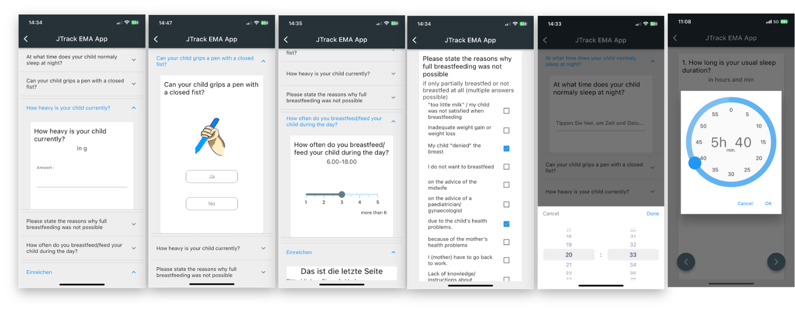

=====================
JTrack EMA+
=====================

JTrack EMA+ is available for **Android** and **iOS**:

- In the `Google Play Store <https://play.google.com/store/apps/details?id=inm7.JTrack.JTrack_EMA_Plus>`__
- In `Apple's App Store <https://apps.apple.com/de/app/jtrack-ema/id1605100657>`__

The enrollment and survey workflow is shared across both platforms. Screenshots in this guide primarily show Android; iOS system dialogs may look different.

What JTrack EMA+ Can Do
+++++++++++++++++++++++

- **Broad question types**: binary, date/time, duration, sliders, single/multiple choice, and more.
- **Platform-independent UX** with paging for long surveys, language support, and :ref:`survey categories <jdash-surveys>` to keep forms organized. It also provides a similar user experience on both Android and iOS devices.
- **Survey updates from the server** so :ref:`questionnaires <jdash-surveys>`
  and media/images can be revised mid-study without reinstalling the app.
  See :ref:`Updating an enrolled survey <ema-survey-updates>` to apply a
  revised questionnaire on an enrolled device.
- **Save & Resume** with answered items highlighted so surveys can be resumed where they were left.
- **Conditional logic** to show/hide questions based on earlier answers, improving relevance and reducing cognitive load.
- **HTML text formatting support** so question text and subtext can include simple inline formatting.
- **Integrated calendar events** for time-sensitive prompts so reminders can be added to the phone calendar.
- :ref:`Administrator settings <ema-admin-settings>` for protected on-device
  management, including downloading revised survey questions.

Prerequisites
+++++++++++++

- Your study coordinator has provided a **QR code** or **Subject ID / username**
  to join the study.
- A stable internet connection for initial setup and survey/media updates.

For reminder and calendar settings that improve response rates, see :ref:`Compliance Optimization for JTrack EMA+ <compliance-ema>`.

.. _ema-install-enroll:

Android - Install & Join the Study
++++++++++++++++++++++++++++++++++

1) Install the App
------------------

1. Open the **Google Play Store** on your Android device.
2. Search for **JTrack EMA+** and install it.

   .. image:: image/EMA/EMA_1.png
      :scale: 40%
      :align: center

2) Join the Study
-----------------

You can enroll by scanning a QR code or by entering your study identifier:

- **Scan a QR code:** tap **Join study**, allow camera access, and scan the
  code supplied by your study team, as illustrated below.
- **Enter a Subject ID / username:** press and hold the enrollment button
  for several seconds to open manual entry. Enter the identifier provided
  by your study team and follow the prompts. No QR-code scan is needed.

**Enrollment by QR code**

1. Open **JTrack EMA+** and tap **Join study**.

   .. image:: image/EMA/EMA_2.png
      :scale: 40%
      :align: center

2. When prompted, allow **Camera** access so the app can scan your study QR code.

   .. image:: image/EMA/EMA_3.png
      :scale: 40%
      :align: center

3. Use your device camera to scan the **QR code** provided by your study team.

.. important::
   For study setup and QR-code generation, see :ref:`Studies in JDash <jdash-studies>`.

3) Complete Required App Settings (only if required)
----------------------------------------------------

After a successful login, the app will prompt you to adjust system settings to ensure reliable background operation.

1. Follow the in-app prompt to open **App settings**.

   .. image:: image/EMA/EMA_4.png
      :scale: 40%
      :align: center

Using JTrack EMA+
+++++++++++++++++

.. _ema-start-survey:

Starting a Survey
-----------------

- :ref:`Surveys <jdash-surveys>` appear according to your study schedule or through prompts configured by the study team.
- If no active questions are shown, pull the screen down to refresh. This
  refreshes the displayed survey view; to retrieve an altered questionnaire,
  use the :ref:`survey-update workflow <ema-survey-updates>`.
- Long surveys can open in a list view, while short surveys may use paging. Progress is saved automatically.

   .. image:: image/EMA/EMA_listview.png
      :scale: 40%
      :align: center

.. _ema-calendar-reminders:

Calendar Reminders
------------------

- Some studies can create calendar events on your phone so you receive calendar notifications when a :ref:`survey is scheduled <jdash-surveys>`.
- When the app shows the **Add Event** dialog, choose your preferred phone calendar from the list and tap **Add Event**.
- If you do not want to add the reminder immediately, tap **Not Now**. If you never want the event added for that prompt, tap **I Don't want**.
- Once the event is added, your phone calendar can notify you at the scheduled survey time.

.. note::

   When a question is set to **daily**, its calendar event is scheduled for
   **07:00**. Follow the **Add Event** prompt to add it to your calendar.
   Researchers configure daily repetition in the
   :ref:`JDash question settings <question-default-settings>`.

For the recommended notification, Focus-mode, and calendar settings, see :ref:`Compliance Optimization for JTrack EMA+ <compliance-ema>`.

   .. image:: image/EMA/EMA_calendar_add_event.png
      :scale: 35%
      :align: center

Save & Resume
-------------

- You can leave the survey at any time. When you return, your saved answers are preserved and answered items remain highlighted for easier navigation.

   .. image:: image/EMA/EMA_resume.png
      :scale: 40%
      :align: center

Leaving a Survey with Unanswered Questions
------------------------------------------

- When you reach the last page and tap **Submit survey**, JTrack EMA+ checks whether any questions are still unanswered.
- If questions are missing, the app shows a confirmation dialog with the number of unanswered items.
- Choose **Return to questionnaire** if you want to go back and answer more questions before submitting.
- Choose **Submit, answer unanswered questions later** if you want to leave the remaining questions for later. In that case, the unanswered questions stay open and can be shown again later.
- Choose **Submit, I have answered all questions** if you want the remaining unanswered questions to be treated as questions you do not want to answer. In that case, those questions are not shown again.
- This gives the user two different ways to leave the survey, depending on whether unanswered questions should remain pending or be treated as intentionally skipped.

   .. image:: image/EMA/EMA_unanswered_questions.png
      :scale: 35%
      :align: center

.. _ema-media-sync:

Media & Image Sync
------------------

If a :ref:`survey references images or media <jdash-surveys>`, the app
retrieves the assets from the server automatically. Keep an internet
connection available while synchronization completes.

If the survey's image references or media were changed, first retrieve the
revised questionnaire using :ref:`Updating an enrolled survey
<ema-survey-updates>`, then check that the referenced assets appear. If they
do not, follow :ref:`EMA troubleshooting <ema-troubleshooting>`.

HTML Formatting in Questions
----------------------------

JTrack EMA+ supports a small set of HTML tags in question text and subtext.
This can be used to format :ref:`questionnaire content <jdash-surveys>` without changing the app itself.
Supported tags are:

.. raw:: html

   <ul>
     <li><code>&lt;b&gt;</code> and <code>&lt;strong&gt;</code> for bold text</li>
     <li><code>&lt;i&gt;</code> and <code>&lt;em&gt;</code> for italic text</li>
     <li><code>&lt;u&gt;</code> for underlined text</li>
     <li><code>&lt;br&gt;</code> for a line break</li>
   </ul>

.. raw:: html

   
Variants such as <code>&lt;br/&gt;</code> and <code>&lt;br /&gt;</code> are also accepted and rendered as line breaks.

Conditional Logic
-----------------

- Some questions appear only if earlier responses meet certain conditions. This keeps surveys shorter and more relevant.

Researchers configure :ref:`surveys <jdash-surveys>`,
:ref:`schedules <question-form>`, media, and
:ref:`conditional logic <survey-conditional-logic>` in :doc:`JDash <JTrack_Dashboard>`. Example response records are shown under :doc:`Data Storage <developers>`.

.. _ema-admin-settings:

Administrator Settings
++++++++++++++++++++++

JTrack EMA+ provides a protected administration menu for study staff. The
administrator access code is provided to study investigators on request from
:ref:`our team <contact-us>`. Open the app's administration menu and enter
the code when prompted; the layout may differ between Android and iOS.

Use **Download questions from server** to retrieve the questionnaire for the
current enrollment. This is useful when the study team has changed questions
or their settings during a running study. Follow the
:ref:`update workflow <ema-survey-updates>` rather than uninstalling the app
or enrolling the participant again.

Other administrator actions depend on the app version and platform. Use them
only for the intended study workflow; the Social app's sensor-debugging
controls are documented separately under
:ref:`Social Administrator Tools <social-admin-tools>`.

.. _ema-survey-updates:

Updating an Enrolled Survey
+++++++++++++++++++++++++++

A running study can use a revised questionnaire without requiring an app
reinstallation. Coordinate the change with the study team and check both
sides of the update:

1. **Prepare the change in JDash.** Edit the questions or settings in the
   :ref:`Survey Editor <survey-edit-view>`. For a questionnaire assigned to a
   study, use **Commit changes to study** to apply that revision to the study.
2. **Download it on the enrolled device.** With an internet connection,
   open :ref:`Administrator Settings <ema-admin-settings>`, enter the code,
   and choose **Download questions from server**.
3. **Verify the result.** Return to the survey and check the changed text,
   answer options, categories, and expected availability. Check any revised
   :ref:`schedules <question-default-settings>`,
   :ref:`conditional rules <survey-conditional-logic>`, and
   :ref:`media <ema-media-sync>` against the intended configuration.

**Which kind of refresh do I need?**

- **Pull down to refresh:** update the displayed survey view, for example
  when checking whether scheduled questions are available.
- **Download questions from server:** explicitly retrieve the revised
  questionnaire for an existing enrollment. Use this when the study team
  needs enrolled participants to receive an altered survey.
- **Automatic media synchronization:** retrieves assets referenced by the
  questionnaire; it is not a substitute for downloading changed questions.
- **App-store update:** installs a new app version. It is separate from a
  questionnaire change made in JDash.

.. note::

   Do not assume that a refreshed screen proves the latest questionnaire has
   been downloaded. Confirm the intended change on the device before
   continuing study procedures. If the result differs, follow
   :ref:`EMA troubleshooting <ema-troubleshooting>` or contact
   :ref:`our team <contact-us>`. See also the
   :ref:`FAQ on running-study updates <faq-running-study-updates>`.

.. _ema-troubleshooting:

Troubleshooting
+++++++++++++++

**I cannot scan the QR code**

Check **Camera** permission, screen brightness on the QR-code source, and
hold the device steady about 15–25 cm from the code. Alternatively, press
and hold the enrollment button to enter the **Subject ID / username**
manually; see :ref:`Enrollment <ema-install-enroll>`.

**The survey still shows old questions**

Ask the study team to confirm that the correct questionnaire is assigned and
its changes were committed to the study. Then follow
:ref:`Updating an enrolled survey <ema-survey-updates>` on the device. Check a
specific changed question to verify the result rather than relying only on
the presence of the survey in the list.

**No survey or active questions appear**

Pull down to refresh and check with the study team whether questions are
expected at the current study day and time. Availability can depend on
:ref:`scheduling <question-default-settings>` and
:ref:`conditional rules <survey-conditional-logic>`. If a revised survey is
expected, use the :ref:`update workflow <ema-survey-updates>`.

**Survey reminders are not arriving**

Check notification permission and whether **Do Not Disturb** or Focus settings
block notifications. On Android, verify **Battery optimization** is
**Unrestricted** and **Remove permission and free up space** is disabled.
For calendar and notification settings, see
:ref:`Calendar Reminders <ema-calendar-reminders>` and
:ref:`EMA compliance settings <compliance-ema>`. Ask the study team to confirm
the expected question schedule if reminders remain absent.

**Images or other media are missing**

Keep the device connected while :ref:`media synchronization <ema-media-sync>`
completes. If references were changed, download the revised questions first.
Ask the study team to check that image filenames match the assets provided
in the :ref:`study's EMA configuration <ema-conf>`.

**A permission was denied by mistake**

On Android, open **System Settings → Apps → JTrack EMA+** and review the
required permissions. On iOS, review JTrack EMA's permissions in **Settings**.
The available entries depend on the platform and features used by the study.

If the issue remains, complete the
:ref:`Before Contacting Us <before-contacting-us>` checklist and send the study
ID, app and OS versions, expected question or reminder, and time of the issue
to :ref:`our team <contact-us>`. Do not uninstall or re-enroll unless the study
team instructs you to do so.
