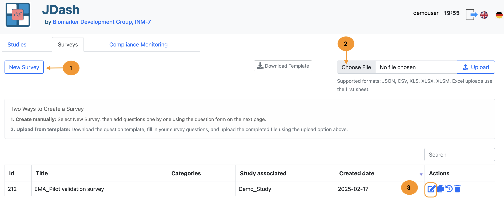
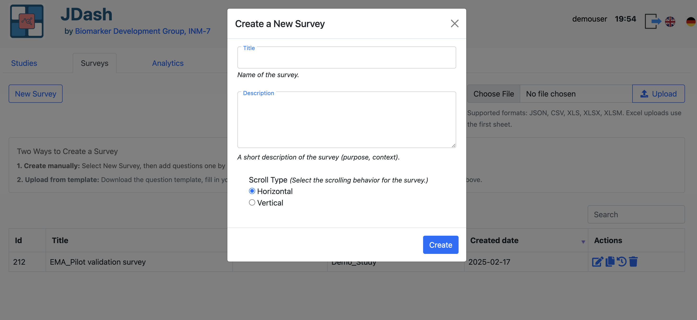
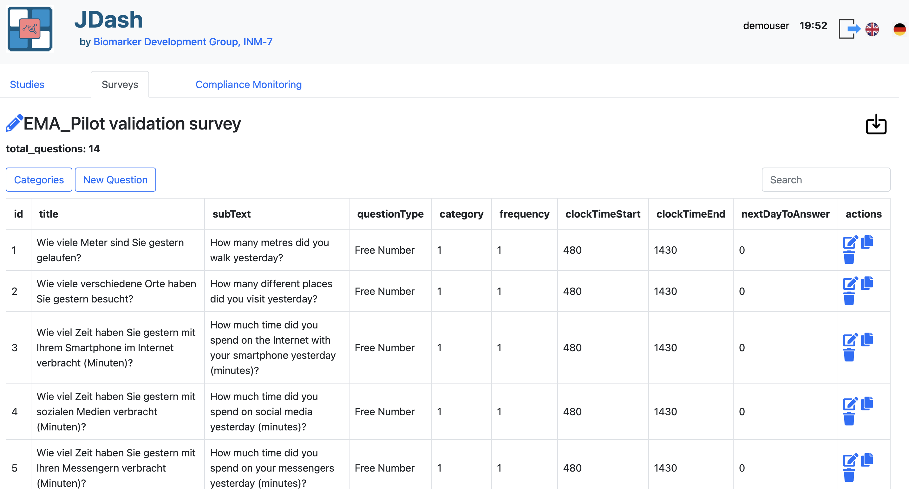
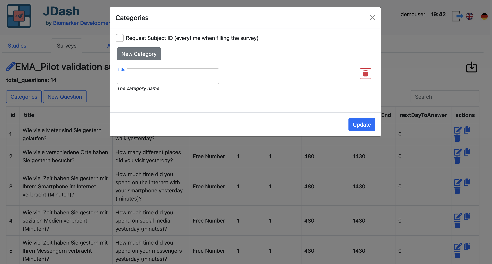
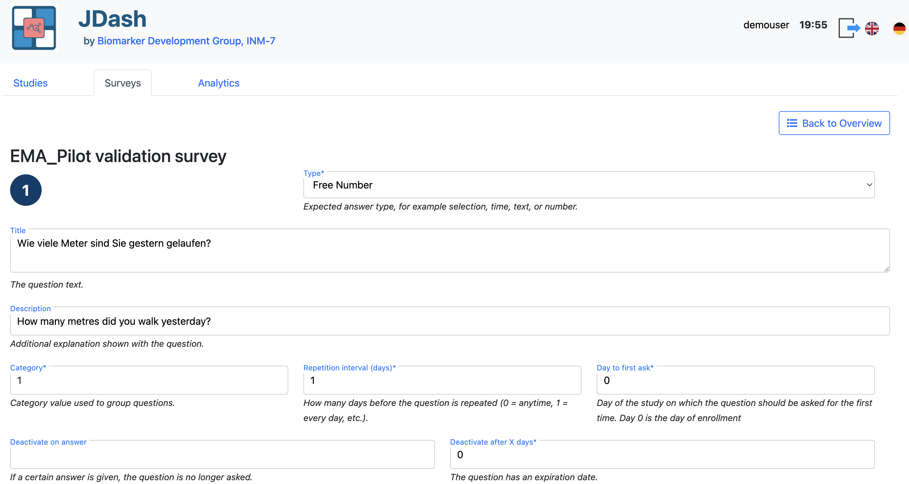
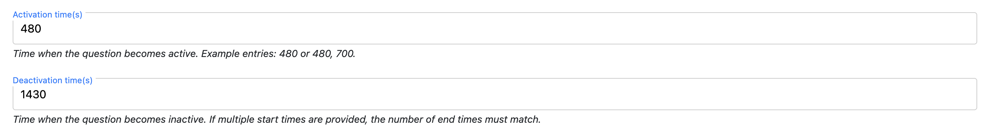
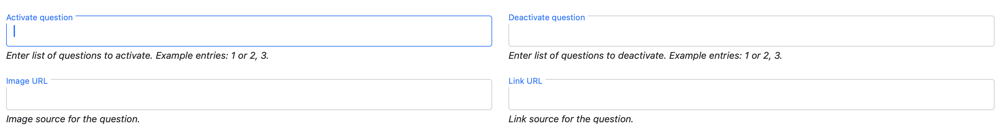
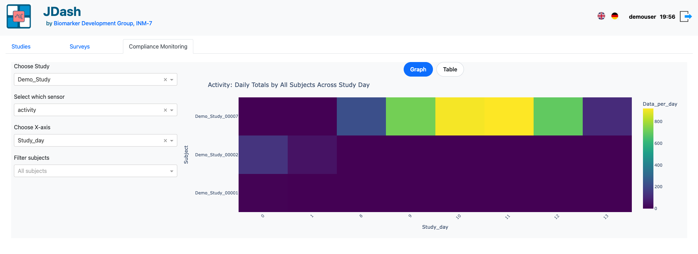

JDash – JTrack Dashboard
========================

JDash helps researchers configure digital health studies, enroll participants,
collect sensor data and EMA responses through :doc:`JTrack Social <Social>`
and :doc:`JTrack EMA+ <EMA>`, and monitor data
quality. It supports studies conducted by clinical institutions and the
`Biomarker Development Group <https://www.fz-juelich.de/inm/inm-7/DE/Forschung/Biomarkerentwicklung/artikel.html?nn=653672>`_.

This guide walks you through using JDash, from creating an account and setting
up a study to managing participants, monitoring data collection, and exporting
results. To use our hosted service, `open JDash <https://jdash.inm7.de/>`_
and follow the login instructions below.

If you are interested in hosting your own installation of JDash on your
preferred infrastructure, see the :ref:`Technical Overview <jdash-technical-overview>`.
Feel free to :ref:`contact us <directcontacts>` for more details.

Login
+++++

Use your registered researcher account to access your studies.

.. image:: image/JDash/JDashLogin.png
    :width: 80%
    :align: center
    :alt: Login page with numbered login, contact, deletion, and language controls

.. container:: quick-box plain

    **Quick access:**

    - :ref:`(1) – Login form <login>`
    - :ref:`(2) – Delete Request <delete>`
    - :ref:`(3) – Mail us <directcontacts>`
    - :ref:`(4) – Language <language>`

.. _login:

Login Form
----------

1. Visit `JDash <https://jdash.inm7.de/>`_.
2. Enter your username and password. If you do not have an account,
   :ref:`register yourself <create-account>` first.
3. Click **Login**.

.. _delete:

Data Deletion Form
------------------

Participants can open **Delete Request** (3) to request removal of their
collected data. Find your **Subject ID** in the JTrack app's menu or info (i)
view, then enter it with your email address and reason and click **Submit**.
Deletion starts when the request is received and may take 1–2 business days
to complete; no manual approval is required.

.. _directcontacts:

Mail Us
-------

For collaboration enquiries and scientific questions, contact Dr. Juergen
Dukart or Dr. Mehran Turna. For technical questions, contact
`Jona M. Fischer <mailto:j.fischer@fz-juelich.de>`_ or
`Mamaka Narava <mailto:m.narava@fz-juelich.de>`_.

.. image:: image/JDash/dash_data_deletion_form.png
    :width: 80%
    :align: center
    :alt: Data deletion request form and information about processing and permanence

.. important::

   Check your **Subject ID** before submitting. Processed deletions cannot be
   undone. As explained on the form, anonymized data already used in scientific
   publications may no longer be withdrawable.

.. _language:

Language Switcher
-----------------

Select the English or German flag (4) to change the website language.

Profiles & Roles
++++++++++++++++

.. _create-account:

Create an Account
------------------

Open the registration form from the `JDash login page <https://jdash.inm7.de/>`_
to create your own account.

1. Enter your name and email address, then choose a username and password.
   Follow the requirements shown beneath the fields and enter the same
   password in **Password confirmation**.
2. Click **Send verification code** and check your email for the code.
3. Follow the verification instructions to complete registration, then return
   to the :ref:`Login form <login>` and sign in with your new credentials.

Creating an account does not automatically give you access to studies or
permission to create them. Ask the study's Principal Investigator to add you
to an existing study, or request Researcher access if you need to create
studies and surveys. See :ref:`Roles & Permissions <jdash-permissions>` for
account types and study roles.

.. image:: image/JDash/JDashRegister.png
    :width: 80%
    :align: center
    :alt: Registration form for a JDash account

Profile
-------

Once logged in click **Profile** in the sidebar to review your account information or to update your password via
**Change password**.

.. image:: image/JDash/JDashProfileInfo.png
    :width: 80%
    :align: center
    :alt: Account profile with a Change password button

.. _jdash-permissions:

Roles & Permissions
-------------------

Account type and study membership control two separate levels of access.
**✓** means permitted; **✗** means not permitted.

**Account-level access**

Account type determines who can create studies and surveys and who can
administer the platform. It does not automatically grant access to existing
studies, except for Administrators.

.. list-table::
    :header-rows: 1
    :widths: 40 20 20 20
    :class: permission-matrix

    * - Permission
      - Registered User
      - Researcher
      - Administrator
    * - Create studies and surveys
      - ✗
      - ✓
      - ✓
    * - Access studies with assigned membership
      - ✓
      - ✓
      - ✓
    * - Access all studies without membership
      - ✗
      - ✗
      - ✓
    * - Manage platform users
      - ✗
      - ✗
      - ✓

A Registered User without study membership can access their profile and request
Researcher access by contacting `Jona M. Fischer <mailto:j.fischer@fz-juelich.de>`_ or
`Mamaka Narava <mailto:m.narava@fz-juelich.de>`_. Administrators have platform-wide access and do not need
individual study memberships.

**Study membership access**

For users with study membership, the assigned role determines what they can
do within that study.

.. list-table::
    :header-rows: 1
    :widths: 40 20 20 20
    :class: permission-matrix

    * - Permission
      - Principal Investigator
      - Investigator
      - Viewer
    * - View study information, analytics, and audit history
      - ✓
      - ✓
      - ✓
    * - Download QR codes
      - ✓
      - ✓
      - ✓
    * - Download study data (sensor and EMA exports)
      - ✓
      - ✓
      - ✗
    * - Edit study configuration and surveys
      - ✓
      - ✓
      - ✗
    * - Update subject status
      - ✓
      - ✓
      - ✗
    * - Send notifications
      - ✓
      - ✓
      - ✗
    * - Remove subjects
      - ✓
      - ✗
      - ✗
    * - Delete subject data
      - ✓
      - ✗
      - ✗
    * - Manage study access
      - ✓
      - ✗
      - ✗

For example, a Researcher assigned as a Viewer can create their own studies
but can only view the study where they hold Viewer membership. An Investigator
can edit an assigned study and update subject status, but cannot remove
subjects or delete their data.

To grant access as a Principal Investigator, select the study (1), search for
an existing username under **Registered user**, choose a **Role**, and click
**Add user** (2). Review the membership table to check the assigned role.

.. image:: image/JDash/JDashProfileAccess.png
    :width: 80%
    :align: center
    :alt: Study access page with study selection, user and role controls, and memberships

Dashboard Tabs
++++++++++++++

Studies
-------

The **Studies** tab shows the studies you can access. Use search, the sensor
filter, and sorting to find a study, or switch between **Grid** and **List**
views. Available actions depend on your study role.

.. image:: image/JDash/JDashStudyGrid.png
    :width: 80%
    :align: center
    :alt: Studies grid with filters and numbered study actions

.. container:: quick-box plain

    **Study actions:**

    - :ref:`(1) – Add Study <create-study>`
    - :ref:`(2) – View <study-details-subjects-view>`
    - :ref:`(3) – Edit <edit-study>`
    - :ref:`(4) – QC <audit-study>`
    - :ref:`(5) – History <history-study>`

.. _create-study:

Create New Study
~~~~~~~~~~~~~~~~

Click **Add Study** to define the study settings and the data participants
will provide. Configure the components required by your protocol.

.. image:: image/JDash/JDashStudyCreate.png
    :width: 80%
    :align: center
    :alt: Study creation form with general settings and optional tracking and EMA sections

.. container:: quick-box plain

    **Study components:**

    - :ref:`General <general>` (the **Test study** toggle is marked 1)
    - :ref:`Passive Tracking (2) <passive-tracking>`
    - :ref:`Active Tracking (3) <active-tracking>`
    - :ref:`Ecological Momentary Assessment (EMA) (4) <ema-conf>`
    - :ref:`Wearable Devices <wearables>`

.. _general:

General
^^^^^^^

Choose a **Study name** without spaces or special characters, such as
``MyStudy_01`` instead of ``My Study 01``. The name identifies the study and
cannot be changed after creation.

Set **Study duration** to the expected number of recording days for each
participant. **Number of subjects** is the recruitment target; to create
additional participant IDs later, use :ref:`participant management <subject-management>`.

Enable **Test study** (1) for a pilot or test study. Use **Study description**
to summarize the research objective, participant group, and protocol for the
study team.

.. _passive-tracking:

Passive Tracking
^^^^^^^^^^^^^^^^

Passive tracking collects data in the background through :doc:`JTrack Social <Social>`.
See :ref:`Permissions by Sensor <social-permissions>` for participant setup
and the :ref:`platform comparison <sensor-comparison>` for sensor availability.

1. Enable **Show passive sensors**.
2. Select the measurements required by your protocol and click **Add**.
3. Review the selected sensors in the table; use × to remove a selection.

.. image:: image/JDash/JDashPassiveSensors.png
    :width: 80%
    :align: center
    :alt: Passive sensor selection and table of sensors added to the study

.. _active-tracking:

Active Tracking
^^^^^^^^^^^^^^^

Active Tracking associates sensor recordings with tasks performed by
participants. In JTrack Social, participants access this feature as
**Active Labeling**.

1. Enable **Show active labels**.
2. Set the **Default Recording Frequency** for continuously recorded sensors.
   Hertz (Hz) means measurements per second: 100 Hz records 100 measurements
   per second.
3. Select the required active sensors and click **Add**. Use × to remove a
   selection from the table.
4. Configure tasks and participant instructions as described below.

.. image:: image/JDash/JDashActiveTracking.png
    :width: 80%
    :align: center
    :alt: Active tracking configuration with default recording frequency and selected sensors

.. note::

   At least one active sensor must be selected to enable Active Labeling.
   Higher recording frequencies increase battery use and storage requirements;
   choose a rate appropriate for your protocol and devices.

**Configure tasks**

Click **Add task** for each activity participants should perform. Use a short,
recognizable name and distinguish instructions for preparing from instructions
for performing the task.

For example, a task named **Sudoku** can give participants **5 seconds** of
preparation time with the instruction “Switch to the Sudoku app,” followed by
**300 seconds** of recording with the task instruction “Play Sudoku for five
minutes.” Preparation and task durations are entered in seconds; preparation
instructions are optional.

.. image:: image/JDash/JDashActiveTasks.png
    :width: 80%
    :align: center
    :alt: Two task forms showing separate preparation times, recording durations, and instructions

Participants access Active Labeling from the main view of JTrack Social on
:ref:`Active Labeling guide <active-labeling-ios>`, which also explains task
instructions and the participant workflow.

.. _ema-conf:

EMA (Ecological Momentary Assessment)
^^^^^^^^^^^^^^^^^^^^^^^^^^^^^^^^^^^^^

Enable **EMA** to assign a questionnaire to the study, then choose one of two
ways to provide it:

- Select an existing questionnaire under **Survey title**. See
  :ref:`Create Survey <create-survey>` to prepare one first.
- Upload a survey JSON file instead. The file must follow the JDash/JTrack
  EMA+ survey schema.

If questions use images, also upload a ZIP archive containing the image files.
Filenames must match the ``Image Url`` values in the survey questions.
Leave EMA disabled if the study does not collect questionnaire responses.
For the participant workflow, see :doc:`JTrack EMA+ <EMA>`; for reminder
settings, see :ref:`EMA calendar reminders <ema-calendar-reminders>`.

.. image:: image/JDash/dash_create_ema.png
    :width: 80%
    :align: center
    :alt: EMA configuration with an existing-survey selector, JSON upload, and image ZIP upload

.. _wearables:

Wearable Devices
^^^^^^^^^^^^^^^^

Configure wearable measurements alongside mobile sensor data and EMA responses:

1. Enable **Show wearables** and click **Add wearable device**.
2. Select the **Device name** for the model participants will use.
3. Select measurements under **Sensors for this device** and click **Add**.
4. Set the sampling interval for each selected sensor. Use × to remove a sensor.

The wearable **Sampling rate** values shown here are time intervals: ``1 min``
means one minute between recordings. Active sensor frequencies in Hz instead
specify measurements per second. The **Unit** column identifies what each
sensor measures.

.. image:: image/JDash/JDashWearables.png
    :width: 80%
    :align: center
    :alt: Wearable device configuration with selected sensors, sampling intervals, and units

.. note::

   Sensor availability depends on the device and integration. Raw PPG and
   other high-frequency signals may require a compatible Garmin model and
   SDK license. Selecting a signal in JDash does not guarantee that every
   watch can provide it. Higher-frequency data also increases storage and
   processing requirements.

See :doc:`Garmin Integration <Garmin_Integration>` for compatible workflows,
processing details, and device limitations.

.. _study-details-subjects-view:

Study Details
~~~~~~~~~~~~~

Click **View** on a study to review its configuration and manage participants.
Check the recording duration, recruitment target, and selected sensors before
preparing participant enrollment.

.. image:: image/JDash/JDashStudyView.png
    :width: 80%
    :align: center
    :alt: Study details with numbered download, QC, EMA, participant actions, and subject table

.. container:: quick-box plain

    **Study details actions:**

    - **Download data (1):** request an export of collected sensor or EMA data;
      download instructions are sent by email. See :ref:`Data Export <data-export>`
      for formats and :ref:`Roles & Permissions <jdash-permissions>` for access.
    - :ref:`QC (2) <audit-study>`: open the study's quality-control checklist.
    - **EMA (3):** inspect the questionnaire assigned to the study.
    - :ref:`Participant actions (4) <subject-management>`: add participants,
      prepare QR codes, send notifications, or change status.
    - :ref:`Subject table (5) <subject-table>`: inspect participant records
      and received data.

.. _subject-management:

**Participant management (4)**

Use **Add subjects** to create additional participant IDs. This is separate
from editing the planned **Number of subjects** in the study configuration.
The generated IDs follow the study naming convention, for example
``Demo_Study_00005``.

Use **Generate QR** for the ID range shown on the button, and the QR download
control to obtain enrollment materials. Check the range before distributing
the codes to participants. Enrollment instructions are available in the
:doc:`JTrack Social <Social>` and :doc:`JTrack EMA+ <EMA>` guides.

**Remove a subject**

Subject removal and subject data deletion require a Principal Investigator
or Administrator. Investigators can update subject status but cannot perform
either removal operation.

Click **Remove Subject** for the participant you want to remove, then choose
how to handle their existing data:

- **Remove and keep existing data:** stops new data from being added while
  retaining existing data as read-only.
- **Remove and delete subject data:** removes the participant's data and file
  references from the active study dataset. Use this option when deletion
  is requested.

.. image:: image/JDash/JDashRemoveSubject.png
    :width: 80%
    :align: center
    :alt: Remove subject dialog offering removal with data retained or removal with data deletion

**Confirm data deletion**

If you choose **Remove and delete subject data**:

1. Review **Subject IDs to delete** and the associated **QR codes and status**.
   Check that the selection contains only the intended participants.
2. Select a **Removal reason**.
3. Read the deletion warning and select the acknowledgement that the active
   application data cannot be restored through JDash.
4. Enter the confirmation text exactly as requested by the dialog.
5. Click **Delete subject data and remove** to complete the operation, or
   **Back** to return without confirming deletion.

.. image:: image/JDash/JDashRemoveSubjectDeleteData.png
    :width: 80%
    :align: center
    :alt: Subject data deletion form with selected IDs, removal reason, QR status, acknowledgement, and typed confirmation

.. important::

   This option permanently deletes the selected participants' active study
   data from this study. After deletion, their QR codes can be reused for a
   new enrollment. Choose the keep-data option if existing recordings must
   remain available.

.. _subject-table:

**Subject table (5)**

Use the filters beneath the column headings to find a participant or restrict
the view by app, sensor information, or status. **App** distinguishes JTrack
Social (``main``) from EMA (``ema``). A participant may have multiple entries,
including records for different apps or repeated enrollments; inspect the
individual entry before acting on it.

Sensor badges use abbreviations such as ``at`` (activity), ``au`` (application
usage), and ``lo`` (location). Expand a row with **+** to inspect registration
and departure dates, received batch counts, and the last-received timestamp
for each sensor. These details help identify which recordings have arrived
and which may need follow-up.

Use the refresh control to update the view or **Export table to CSV** to save
the displayed table separately from the study data export.

.. _notifications:

**Send notification**

Use **Send notification** in the participant actions to send reminders,
instructions, or follow-up messages through the participant app.

1. Enter a **Title** and the message in **Description**.
2. Under **Subjects**, type in **Filter subjects** to find and select recipients.
   Entries include the subject ID and app suffix, such as ``:main`` or
   ``:ema``; check both when choosing the intended app enrollment.
3. Review the selected recipients and message before sending the notification.

.. image:: image/JDash/JDashNotification.png
    :width: 65%
    :align: center
    :alt: Send notification dialog with title, description, and a searchable subject selector showing app-specific recipients

.. note::

   Delivery depends on the participant device's network connection and
   notification settings, so a message may not arrive immediately.

.. _study-closure:

**Conclude study**

When data collection is complete, click **Conclude study** on the Study Details
page. Review the confirmation dialog, then click **Confirm** to conclude the
study or **Cancel** to leave it active.

.. image:: image/JDash/JDashConcludeStudy.png
    :width: 80%
    :align: center
    :alt: Conclude study confirmation explaining study archiving and inactive subjects, with Cancel and Confirm buttons

Concluding a study archives its study folder and marks the study as concluded.
Its participants are no longer active in that study. This action does not
perform the subject data deletion described under
:ref:`participant management <subject-management>`.

.. _edit-study:

Edit Study
~~~~~~~~~~

Click **Edit** on a study to open its existing configuration. The form uses
the same settings described under :ref:`Create New Study <create-study>`.
Review the relevant component and save your changes.

Changing **Number of subjects** updates the recruitment target. To create
additional participant IDs, use :ref:`participant management <subject-management>`.
Saving updates the dashboard configuration; check enrolled apps after they
synchronize to confirm the intended settings are in use.

.. note::

   The study name is the fixed identifier and cannot be changed after creation.

.. _audit-study:

Audit / Quality Control
~~~~~~~~~~~~~~~~~~~~~~~

Open **QC** to check study workflows before recruitment and during data
collection. Use the checklist to record validation results and follow up on
problems.

1. Find a check using **Search** or the **Completion status** filter.
2. Follow its **Steps** and compare the result with **Expected Outcome**.
3. Record completion in the appropriate **Admin** or **Owner** column for
   your role, then click **Update** to save the checklist changes.
4. Use **Comments** to document observations, failures, or follow-up work.
   Comments retain the username and timestamp.

.. image:: image/JDash/JDashQC.png
    :width: 80%
    :align: center
    :alt: Quality-control checklist with Update, search, completion filters, and comments

.. note::

   Checklist results do not change participant data collection. Allow for
   synchronization and processing delays when checking received data; the
   page notes that data becomes available one day after a participant syncs.

.. _history-study:

Study History
~~~~~~~~~~~~~

Open **History** on a study to inspect saved configurations or trace changes.

**JSON versions**

Use **Details** to inspect a saved study configuration or **Download** to save
its JSON file. The **Current** badge identifies the current version. Earlier
versions provide a reference when investigating how settings changed.

.. image:: image/JDash/JDashHistoryJSON.png
    :width: 80%
    :align: center
    :alt: Saved study JSON versions with a Current badge, Details links, and Download buttons

**Audit history**

Switch to **Audit history** to see who changed an object and when. Use search,
**Actor**, and **Action** filters (1) to narrow the records. In the table (2),
**Changes** shows previous values in red and new values in green, allowing you
to trace specific configuration changes.

.. image:: image/JDash/JDashHistory.png
    :width: 80%
    :align: center
    :alt: Audit history with actor and action filters and previous and new field values

Survey
---------------------------
Manages EMA (Ecological Momentary Assessment) questionnaires linked to studies. Displays existing surveys with title, study association, creation date, and actions (edit, copy, delete).
Upload Section: Allows importing survey definitions via JSON files.

   * .. container:: quick-box plain

            **Interface Overview:**
            
            - :ref:`(1) – Create Survey <create-survey>`
            - :ref:`(2) – Upload Survey Json <upload-survey-json>`
            - :ref:`(3) – Edit/View Survey <survey-edit-view>`
            

.. _create-survey:

Create Survey
~~~~~~~~~~~~~~~~~~~~~~~~~~~~~~~~~

The Survey module allows administrators to define and manage EMA (Ecological
Momentary Assessment) questionnaires that will be delivered to study
participants. Each survey contains a title, description, scrolling behaviour,
and associated question items uploaded later as a JSON file.

The *New Survey* dialog provides a guided form for creating a survey entry in
the system.

Form Fields
^^^^^^^^^^^^^^^^^^^^^^^^^^^^^^^^^^^^^^^^^^^^^^^^^^^^^^^^^^^^

**Title**  
   The display name of the survey. This name appears in the survey list and
   throughout the dashboard.

**Description**  
   A short explanation of the survey’s purpose, context, or intended use.
   This helps administrators distinguish between multiple surveys.

**Scroll type**  
   Defines how participants will navigate through the survey items within
   the JTrack EMA+ app. Two options are available:

   - **Horizontal** – Questions scroll left/right.  
     Suitable for one-question-per-screen layouts, swipe-based navigation,
     and compact mobile interfaces.

   - **Vertical** – Questions scroll top/bottom.  
     Suitable for longer pages, forms with multiple inputs, or free-text
     responses requiring more space.

   Select the option that best matches the design of your survey JSON file.

.. _upload-survey-json:

Upload Survey via JSON
~~~~~~~~~~~~~~~~~~~~~~~~~~~~~~~~~

Instead of creating a survey manually through the dialog, you can create a
new survey by **uploading a JSON definition file**. The JSON file must follow
the JDash/JTrack EMA+ survey schema.

The JSON must:

- Be valid UTF-8 encoded JSON.
- Follow the JDash survey schema (field names and structure).
- Define at least the survey metadata and a list of items/questions.

**Sample JSON format**

A sample format file is provided (for example: ``sample_survey.json``).  
Use this as a template when creating new surveys:

.. code-block:: json

   {
     "title": "EMA Pilot validation survey",
     "description": "Short description of the survey purpose and context.",
     "scroll_type": "H",   // or "V"
     "topN": -1
     "questions": [
       {
         "id": "1",
         "active": 1,
         "title": "How are you feeling right now?",
         "subText": "How did you sleep last night?",
         "frequency": 1,
         "clockTime": 0,
         "clockTime_start": "480",
         "clockTime_end": "1430",
         "nextDayToAnswer": 0,
         "category": 1,
         "imageURL": "",
         "url": "",
         "questionType": 3,
         "deactivateOnAnswer": "",
         "deactivateOnDate": 0,
         "activate_question": "",
         "deActivate_question": "",
         "activation_condition": "",
         "deActivation_condition": "",
         "answer": [
                {
                    "id": 1,
                    "text": "",
                    "subText": "",
                    "value": 0.1,
                    "defaultValue": 5.0,
                    "stepSize": 1.0,
                    "minVal": 0.0,
                    "maxVal": 10.0,
                    "minText": "Schlecht | Bad",
                    "maxText": "Gut | Good"
                }
            ]
       }
       // additional items ...
     ]
   }

When preparing a new survey, copy the provided sample JSON file and adapt:

- ``title`` and ``description`` to your study.
- ``scroll_type`` to match the intended navigation style.
- The ``questions`` list to include all questions, response options, and any
  additional fields required by the schema.

.. important::

   Only JSON files following this structure are accepted and rendered correctly by JTrack EMA+.

.. _survey-edit-view:

Survey Details View
~~~~~~~~~~~~~~~~~~~~~~~~~~~~~~~~~

After creating or uploading a survey, selecting it from the Survey list opens
the **Survey Details** page. This page displays all questions defined for the
survey and provides tools for managing categories, adding new questions, and
exporting the survey as JSON.

**Overview of the Question List**

The table shows all survey questions in a structured format. Each row
represents a single question and includes:

- **id** — The internal question identifier (order in the survey).  
- **title** — The primary question text (German example shown).  
- **subText** — The secondary text .  
- **questionType** — Input type (e.g., Free Number, Single Choice, Multiple Choice).  
- **category** — Category assigned to the question (e.g., IHG, GH).  
- **frequency** — How often the question is shown in days.  
- **clockTimeStart / clockTimeEnd** — Valid times to receive reminder notification to answer the question.  
- **nextDayToAnswer** — day when the questions becomes available to answer.

This view allows users to quickly review the full content of the survey and to
edit or organize items as needed.

**Categories Management**

The **Categories** button opens the category management dialog. Categories help group questions into logical sections and are required for
surveys with thematic organization (e.g., "Mobility", "Digital Use").
Investigators can:

- Create new categories  
- Rename existing categories  
- Delete categories

**Adding New Questions**

Click **New Question** to add a new item to the survey.  
This opens the question editor, where you can define all properties of the
question (text, type, category, scheduling rules, etc.).

For a full description of all editable fields, check :ref:`Create /Edit Question <question-form>`

Once the question is saved:

- It appears immediately in the question list
- It can be edited, duplicated, or deleted through the action buttons on the right

This workflow ensures that new survey items follow the same structure and
validation rules as existing ones.

**Downloading the survey JSON**

The download icon (⬇) in the top-right corner of the page exports the entire
survey definition as a JSON file. This JSON can be used for:

- Backups  
- Versioning  
- Editing offline  
- Sharing surveys between studies

**Row Actions (per item)**

Each question row includes three action buttons:

**✏️ Edit**  
   Opens the question editing dialog.  
   Allows modification of text, category, type, time window, and all properties.

**📄 Copy / Duplicate**  
   Creates a new question using the selected item as a template.  
   Useful when building surveys with repeated or similar formats.

**🗑️ Delete**  
   Removes the question from the survey.  
   A confirmation prompt prevents accidental deletion.

.. _question-form:

Create / Edit Question
~~~~~~~~~~~~~~~~~~~~~~~~~~~~~~~~~

The Question Editor allows investigators to define or modify a single survey
question within the EMA survey. Each field controls a specific aspect of how
the question behaves, how it appears to the user, and when it is shown.

**Form Fields**

Below are the descriptions of all fields available in the Create/Edit Question
form.

**Sequence Id**

The position of the question in the survey.  
Questions are displayed in ascending order based on this value.

**Type**

Specifies the question type (e.g., Free Number, Single Choice, Multiple Choice,
Free Text, Slider).  
The selected type determines how the question is rendered in the participant
application.

**Title**

The main question text shown to participants (e.g., in German or the primary
study language).

**Description**

Additional descriptive text, explanation, or translation shown below the main
question.  
Useful for bilingual surveys or questions needing clarification.

**Use default values toggle**

When disabled, all values must be filled manually. If enabled, system-defined default values are used for:

- Frequency  
- NextDayToAnswer  
- ClockTimeStart  
- ClockTimeEnd  
- DeactivateOnDate  

**Category**

A numeric category label used to group questions into thematic clusters.  

.. admonition:: Example:

   - 1 - Mobility  
   - 2 - Digital Activity  
   - 3 - Sleep  
   - 4 - Mood

**Frequency**

Defines how often the question is shown.

.. admonition:: Values:

   - **0** — Ask at any time the user opens the survey  
   - **1** — Ask every day  
   - **n** — Ask every *n* days (e.g., 2 = every second day)

**NextDayToAnswer**

Controls on which study day this question first becomes available.

.. admonition:: Examples:

   - **0** — Starts on day 0  
   - **1** — Starts on day 1  
   - **5** — Question begins appearing on day 5  

**DeactivateOnAnswer**

If set, the question will be skipped or hidden in future survey sessions after
a specific answer value is selected.  
Commonly used to disable follow-up items after a “No” response.

**DeactivateOnDate**

Defines a study day after which the question should no longer be shown.

.. admonition:: Example:

   - **0** — No deactivation by date  
   - **10** — Question disappears after day 10 of the study

**Activation time(s)**

The time (in minutes from midnight) when the question becomes active.

.. admonition:: Examples:

   - **480** = 08:00  
   - **900** = 15:00

If multiple times are provided (comma-separated), the user will receive
multiple activations.

These times determine when notifications are sent and when the question
appears in the JTrack app.

**Deactivation time(s)**

The time (in minutes since midnight) when the question becomes inactive.

Must match the number of entries in ClockTime Start if multiple values are
used.

.. admonition:: Example:

   - **1430** = 23:50  
   - ``480,900`` must have a matching ``600,1000`` (start/end pairs)

This ensures each activation window has a corresponding end time.

.. note::

   Activation and deactivation times together define the valid response window
   for each question. Ensure that end times are logically after start times to
   avoid invalid configurations.

.. _survey-conditional-logic:

Conditional Logic
^^^^^^^^^^^^^^^^^

You can define **conditional logic** for a question to dynamically activate or
deactivate other questions based on a participant's response.

**Overview**

Each question provides the following fields:

- **Activate Question** – Sequence IDs of questions to activate.
- **Deactivate Question** – Sequence IDs of questions to deactivate.
- **Activation Condition** – Displayed when **Activate Question** is configured.
- **Deactivation Condition** – Displayed when **Deactivate Question** is configured.

These fields allow you to control which questions appear next, enabling
branching logic within a survey.

.. note::
   Please not the conditional logic follows the on paper survey model, so the question are always visible to user
   and only if a condition met the questions will de activated. therefore, please don't use activation condition solely. 

.. image:: image/JDash/jdash_activate_question2.png
   :width: 90%
   :align: center

A comma-separated list of question **Sequence IDs** that should be activated
when the specified condition is met.

.. admonition:: Example

   - ``1``
   - ``2,3``

This is typically used to display follow-up questions that are only relevant
for certain answers.

**Deactivate Question**

A comma-separated list of question **Sequence IDs** that should be deactivated
when the specified condition is met.

This is useful for skipping irrelevant or mutually exclusive questions.

**Conditions**

The **Activation Condition** and **Deactivation Condition** fields determine
when the corresponding branching rules are applied.

- **Activation Condition** controls when questions listed in
  **Activate Question** become visible.
- **Deactivation Condition** controls when questions listed in
  **Deactivate Question** are hidden or skipped.
- These fields become available automatically after entering values in the
  corresponding **Activate Question** or **Deactivate Question** fields.
- Conditions must match one or more answer choices defined for the current
  question.

.. note::

   Conditions are evaluated against the participant's response to the current
   question. The selected condition value must correspond to one of the
   configured answer options.

.. important::

   For **Single Choice** and **Multiple Choice** questions, activation and
   deactivation conditions can be selected directly from the available answer
   choices.

   For all other question types, condition values must be entered manually.
   These values are compared against the participant's response to determine
   whether the corresponding activation or deactivation rule is applied.

**Combined Logic**

.. image:: image/JDash/jdash_activate_question3.png
   :width: 90%
   :align: center

Both activation and deactivation rules can be configured for the same question.

In the example above:

- Question ``13`` is activated when the participant selects ``Ja``.
- Question ``14`` is deactivated when the participant selects ``Nein``.

This allows complex survey flows to be created without requiring separate
question groups.

.. admonition:: Example scenario

   Consider the question:

   *"Do you currently drive to work?"*

   Available answers:

   - ``Ja``
   - ``Nein``

   Configuration:

   - **Activate Question:** ``13``
   - **Activation Condition:** ``Ja``

   - **Deactivate Question:** ``14``
   - **Deactivation Condition:** ``Nein``

   Result:

   - Selecting ``Ja`` activates question ``13``.
   - Selecting ``Nein`` deactivates question ``14``.

.. tip::

   Use activation and deactivation logic to build conditional survey paths,
   reduce unnecessary questions, and improve the participant experience.

**Image URL**

An optional image filename associated with the question (e.g., ``image1.png``).
This image must exist in the app’s configured image directory.

**URL**

An optional external link related to the question (e.g., informational page,
instructions, consent wording).  
The link appears below the question text in the app.

.. _answer-form:

Create / Edit Answer
~~~~~~~~~~~~~~~~~~~~~~~~~~~~~~~~~~

For question types that require predefined answer options (such as
**Single Choice**, **Multiple Choice**), the Question
Editor displays an **Answer Form** section. This section allows the
investigators to define the selectable choices shown to participants.

.. image:: image/JDash/survey_edit_answer.png
    :width: 600px
    :align: center

**Slider Settings**  

For slider-type questions, the answer form allows you to define the minimum and maximum values, step size, and optional labels for the slider endpoints.
and default value, show the slider value in the app, the slider will be pre-filled with that value when the question is displayed and if user does not change it, 
it will considered as not answered and the default value will be ignored. so please set the default value to a value that is **not in the range** of the slider, for example, if the slider range is 0-10, set the default value to -1 or 11.

Click **Add Choice** to insert a new answer option row.  
Each row contains two fields:

**Sequence Id**  
   The display order of the option. Choices appear in ascending order based on
   this value.

**Choice**  
   The text label shown to the participant (e.g., *Yes*, *No*, *Often*, *Rarely*, etc.).

.. admonition:: Example:
 
   - ``1 → Less than 10 minutes``  
   - ``2 → 10–30 minutes``  
   - ``3 → More than 30 minutes``  

**Deleting a choice**

To remove an answer option, click the **trash icon** (🗑️) on the right side of
the row.  
The option is removed immediately from the form.

.. _jdash-compliance-monitoring:

Compliance Monitoring
------------------------------

The **Compliance Monitoring** tab provides interactive visualizations for
monitoring sensor data collection throughout a study. It helps researchers
identify missing recordings, inactive participants, irregular sensor activity,
and overall data completeness.

The dashboard focuses on subject-level monitoring and allows users to explore
recording patterns across study days using an interactive heatmap.

The dashboard shows whether data arrived; participant-facing settings that help prevent gaps are described in :doc:`Compliance Optimization <Compliance_Optimization>`.

Selection Panel
~~~~~~~~~~~~~~~~~~~

The left-side control panel allows users to configure the displayed
visualization.

**Choose Study**

Select the study for which compliance information should be displayed.

**Select Sensor**

Choose the sensor type to visualize (e.g., activity, location,
accelerometer, application usage).

**Choose X-axis**

Select how data should be displayed along the horizontal axis.
Available options may include:

- Study day
- Calendar date

**Filter Subjects**

Optionally restrict the visualization to specific participants instead of
displaying the entire study cohort.

Visualization Panel
~~~~~~~~~~~~~~~~~~~

The main panel displays a heatmap representing sensor activity across
participants and study days.

Subject QC Timeline
^^^^^^^^^^^^^^^^^^^^^^^^^^^^^^^^^^

The **Subject QC Timeline** heatmap provides an overview of sensor recordings
for each participant throughout the study.

- **Y-axis** — Subject IDs
- **X-axis** — Study day or selected time axis
- **Color intensity** — amount of recorded sensor data for the selected sensor

Higher color intensity indicates greater recording activity, while lighter
regions may indicate reduced or missing data.

The visualization can help identify:

- Missing recordings
- Participants with limited sensor activity
- Periods of device inactivity
- Sensor interruptions
- Longitudinal recording patterns

.. note::

   Depending on synchronization schedules and backend processing, uploaded
   data may appear in the dashboard with a delay after the participant syncs
   the device.

Notification Scheduler
++++++++++++++++++++++++

JDash includes a background notification scheduler that automatically sends EMA
reminders to participants based on the survey configuration.

The scheduler runs periodically as a cron job and processes a generated JSON
schedule containing:

- Study days on which notifications should be sent
- Activation times configured for survey questions
- Study-specific notification schedules

Workflow
---------

1. Survey activation times are configured in the EMA survey definition.
2. The notification schedule is generated and stored as a JSON structure.
3. The scheduler runs at regular intervals via cron.
4. For each participant, the scheduler calculates the current study day based
   on the enrollment date.
5. The scheduler checks whether the current study day exists in the generated
   notification schedule.
6. If a configured activation time falls within the current processing window,
   a push notification is sent to the participant's device.
7. Notifications are delivered through Firebase Cloud Messaging (FCM).

Generated Schedule
---------------------------------

The scheduler uses a generated JSON file that maps study days to activation
times.

Example:

.. code-block:: json

   {
      "Study_A": {
         "days": {
            "0": [480, 720],
            "1": [480, 720],
            "2": [480]
         }
      }
   }

In this example:

- Day 0: notifications at 08:00 and 12:00
- Day 1: notifications at 08:00 and 12:00
- Day 2: notification at 08:00

This ensures that participants receive reminders relative to their individual
enrollment date.

Notification Delivery
---------------------

Notifications are delivered to enrolled participants through the mobile
application and are used to inform users that new EMA questions are available.

.. note::

   Notification schedules are derived directly from the EMA survey
   configuration. Any changes to survey activation times are automatically
   reflected in future notification schedules after the schedule is
   regenerated.

.. _jdash-technical-overview:

Technical Overview
++++++++++++++++++

JDash follows a modular Django-based architecture with a Bootstrap-powered
frontend and embedded Plotly-Dash dashboards for visualizing participant
compliance, sensor activity, and study progress.

Core Components
---------------------------
* Backend: Django-based application handling authentication, routing,
  form processing, database operations, and server-side rendering.

* Frontend: HTML templates styled with Bootstrap, using BootstrapTables
  and AJAX for interactive tables, filtering, file uploads, and dynamic UI
  updates.

* Database: MariaDB stores studies, subjects, sensor settings, EMA surveys,
  tasks, audit checks, notifications, and user-related configuration.

* Visualization Components: Interactive compliance visualizations are implemented 
  using Dash and Plotly components integrated within Django views and templates.

* Deployment: Supports local development with Django ``runserver`` and
  production deployment using Apache with ``mod_wsgi``.

Deployment Instructions
-----------------------

JDash can be deployed locally for development or on a production web server
using Apache and ``mod_wsgi``. The latest deployment steps, environment setup, database configuration, and
server configuration details are maintained in the official GitHub repository.

`JTrack Dashboard repository <https://github.com/Biomarker-Development-at-INM7/JTrack-dashboard>`_
