JDash – JTrack Dashboard
========================

JDash helps researchers configure digital health studies, enroll participants,
collect sensor data and EMA responses through :doc:`JTrack Social <Social>`
and :doc:`JTrack EMA+ <EMA>`, and monitor data
quality. It supports studies conducted by clinical institutions and the
`Biomarker Development Group <https://www.fz-juelich.de/inm/inm-7/DE/Forschung/Biomarkerentwicklung/artikel.html?nn=653672>`_.

This guide walks you through using JDash, from creating an account and setting
up a study to managing participants, monitoring data collection, and exporting
results. To use our hosted service, `open JDash <https://jdash.inm7.de/>`_
and follow the login instructions below.

If you are interested in hosting your own installation of JDash on your
preferred infrastructure, see the :ref:`Technical Overview <jdash-technical-overview>`.
Feel free to :ref:`contact us <directcontacts>` for more details.

Login
+++++

Use your registered researcher account to access your studies.

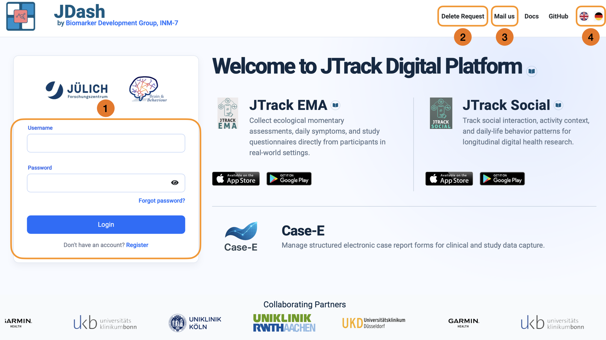

.. container:: quick-box plain

    **Quick access:**

    - :ref:`(1) – Login form <login>`
    - :ref:`(2) – Delete Request <delete>`
    - :ref:`(3) – Mail us <directcontacts>`
    - :ref:`(4) – Language <language>`

.. _login:

Login Form
----------

1. Visit `JDash <https://jdash.inm7.de/>`_.
2. Enter your username and password. If you do not have an account,
   :ref:`register yourself <create-account>` first.
3. Click **Login**.

.. _delete:

Data Deletion Form
------------------

Participants can open **Delete Request** (3) to request removal of their
collected data. Find your **Subject ID** in the JTrack app's menu or info (i)
view, then enter it with your email address and reason and click **Submit**.
Deletion starts when the request is received and may take 1–2 business days
to complete; no manual approval is required.

.. _directcontacts:

Mail Us
-------

For collaboration enquiries and scientific questions, contact Dr. Juergen
Dukart or Dr. Mehran Turna. For technical questions, contact
`Jona M. Fischer <mailto:j.fischer@fz-juelich.de>`_ or
`Mamaka Narava <mailto:m.narava@fz-juelich.de>`_.

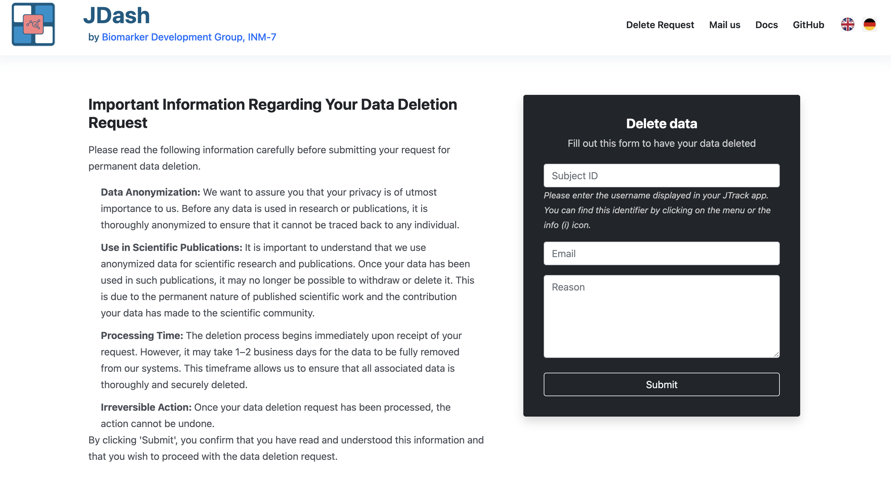

.. important::

   Check your **Subject ID** before submitting. Processed deletions cannot be
   undone. As explained on the form, anonymized data already used in scientific
   publications may no longer be withdrawable.

.. _language:

Language Switcher
-----------------

Select the English or German flag (4) to change the website language.

Profiles & Roles
++++++++++++++++

.. _create-account:

Create an Account
------------------

Open the registration form from the `JDash login page <https://jdash.inm7.de/>`_
to create your own account.

1. Enter your name and email address, then choose a username and password.
   Follow the requirements shown beneath the fields and enter the same
   password in **Password confirmation**.
2. Click **Send verification code** and check your email for the code.
3. Follow the verification instructions to complete registration, then return
   to the :ref:`Login form <login>` and sign in with your new credentials.

Creating an account does not automatically give you access to studies or
permission to create them. Ask the study's Principal Investigator to add you
to an existing study, or request Researcher access if you need to create
studies and surveys. See :ref:`Roles & Permissions <jdash-permissions>` for
account types and study roles.

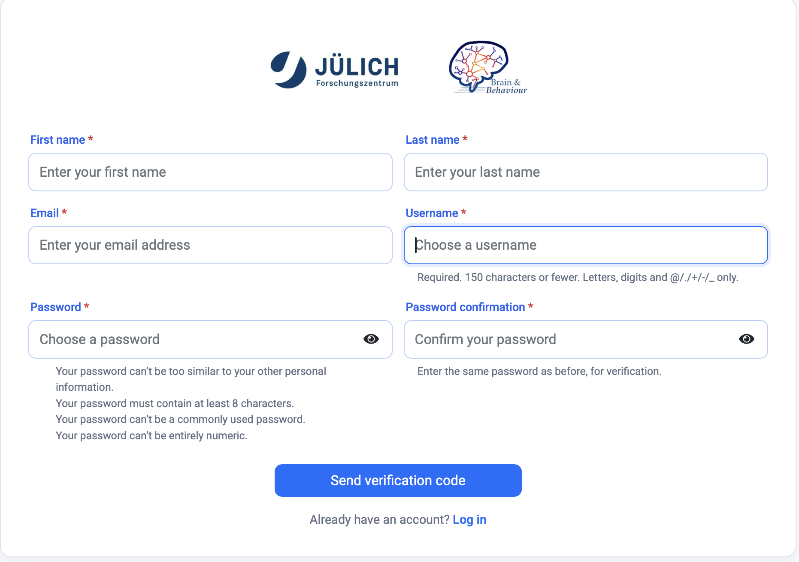

Profile
-------

Once logged in click **Profile** in the sidebar to review your account information or to update your password via
**Change password**.

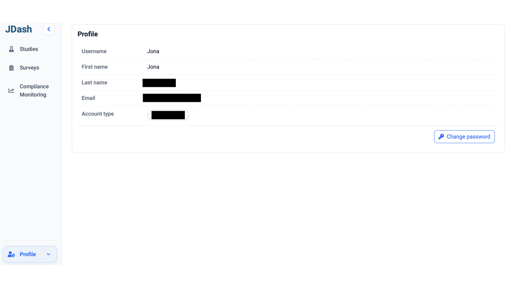

.. _jdash-permissions:

Roles & Permissions
-------------------

Account type and study membership control two separate levels of access.
**✓** means permitted; **✗** means not permitted.

**Account-level access**

Account type determines who can create studies and surveys and who can
administer the platform. It does not automatically grant access to existing
studies, except for Administrators.

.. list-table::
    :header-rows: 1
    :widths: 40 20 20 20
    :class: permission-matrix

    * - Permission
      - Registered User
      - Researcher
      - Administrator
    * - Create studies and surveys
      - ✗
      - ✓
      - ✓
    * - Access studies with assigned membership
      - ✓
      - ✓
      - ✓
    * - Access all studies without membership
      - ✗
      - ✗
      - ✓
    * - Manage platform users
      - ✗
      - ✗
      - ✓

A Registered User without study membership can access their profile and request
Researcher access by contacting `Jona M. Fischer <mailto:j.fischer@fz-juelich.de>`_ or
`Mamaka Narava <mailto:m.narava@fz-juelich.de>`_. Administrators have platform-wide access and do not need
individual study memberships.

**Study membership access**

For users with study membership, the assigned role determines what they can
do within that study.

.. list-table::
    :header-rows: 1
    :widths: 40 20 20 20
    :class: permission-matrix

    * - Permission
      - Principal Investigator
      - Investigator
      - Viewer
    * - View study information, analytics, and audit history
      - ✓
      - ✓
      - ✓
    * - Download QR codes
      - ✓
      - ✓
      - ✓
    * - Download study data (sensor and EMA exports)
      - ✓
      - ✓
      - ✗
    * - Edit study configuration and surveys
      - ✓
      - ✓
      - ✗
    * - Update subject status
      - ✓
      - ✓
      - ✗
    * - Send notifications
      - ✓
      - ✓
      - ✗
    * - Remove subjects
      - ✓
      - ✗
      - ✗
    * - Delete subject data
      - ✓
      - ✗
      - ✗
    * - Manage study access
      - ✓
      - ✗
      - ✗

For example, a Researcher assigned as a Viewer can create their own studies
but can only view the study where they hold Viewer membership. An Investigator
can edit an assigned study and update subject status, but cannot remove
subjects or delete their data.

To grant access as a Principal Investigator, select the study (1), search for
an existing username under **Registered user**, choose a **Role**, and click
**Add user** (2). Review the membership table to check the assigned role.

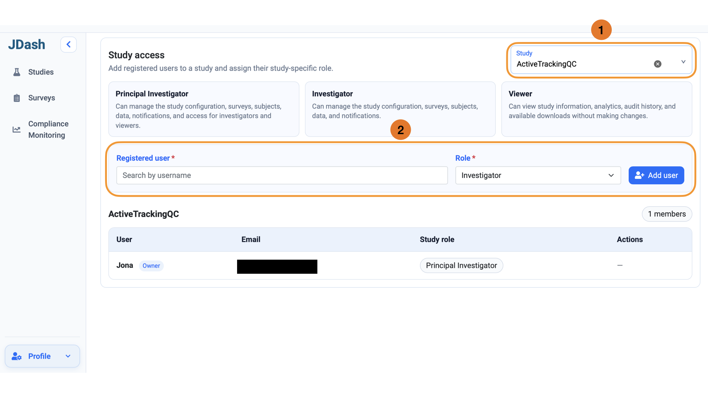

.. _jdash-studies:

Studies
++++++++++++++

The **Studies** tab shows the studies you can access. Use search, the sensor
filter, and sorting to find a study, or switch between **Grid** and **List**
views. Available actions depend on your study role.

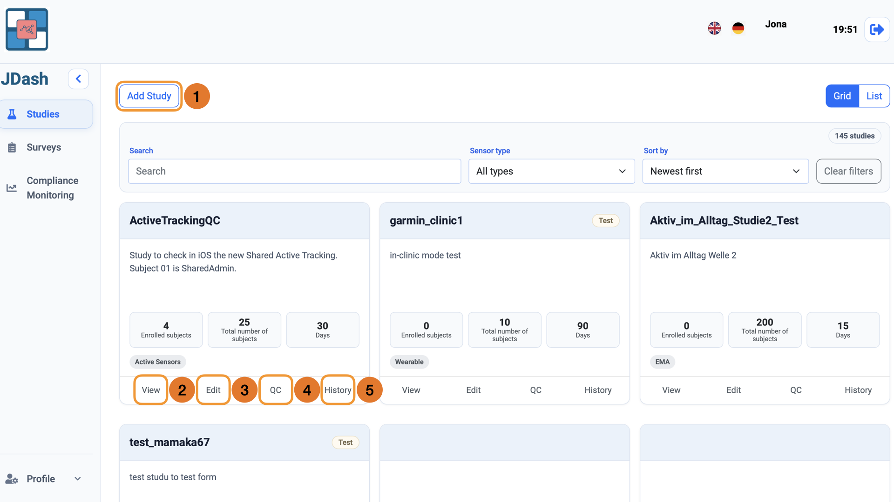

.. container:: quick-box plain

    **Study actions:**

    - :ref:`(1) – Add Study <create-study>`
    - :ref:`(2) – View <study-details-subjects-view>`
    - :ref:`(3) – Edit <edit-study>`
    - :ref:`(4) – QC <audit-study>`
    - :ref:`(5) – History <history-study>`

.. _create-study:

Create New Study
-----------------------

Click **Add Study** to define the study settings and the data participants
will provide. Configure the components required by your protocol.

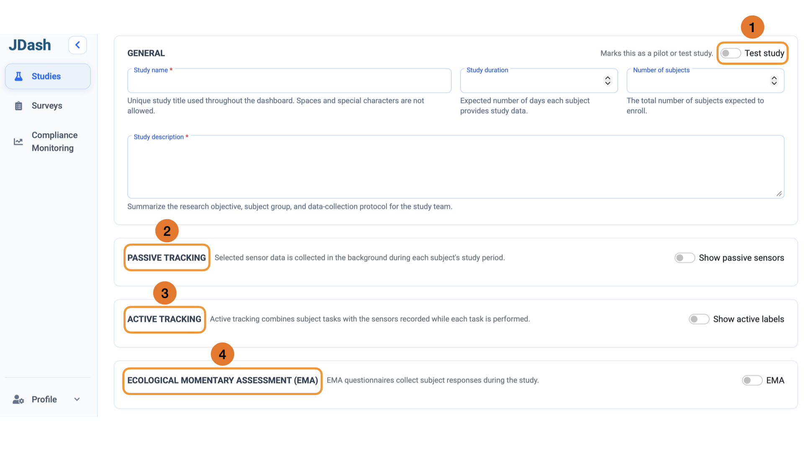

.. container:: quick-box plain

    **Study components:**

    - :ref:`General <general>` (the **Test study** toggle is marked 1)
    - :ref:`Passive Tracking (2) <passive-tracking>`
    - :ref:`Active Tracking (3) <active-tracking>`
    - :ref:`Ecological Momentary Assessment (EMA) (4) <ema-conf>`
    - :ref:`Wearable Devices <wearables>`

.. _general:

General
~~~~~~~~

Choose a **Study name** without spaces or special characters, such as
``MyStudy_01`` instead of ``My Study 01``. The name identifies the study and
cannot be changed after creation.

Set **Study duration** to the expected number of recording days for each
participant. **Number of subjects** is the recruitment target; to create
additional participant IDs later, use :ref:`participant management <subject-management>`.

Enable **Test study** (1) for a pilot or test study. Use **Study description**
to summarize the research objective, participant group, and protocol for the
study team.

.. _passive-tracking:

Passive Tracking
~~~~~~~~~~~~~~~~~

Passive tracking collects data in the background through :doc:`JTrack Social <Social>`.
See :ref:`Permissions by Sensor <social-permissions>` for participant setup
and the :ref:`platform comparison <sensor-comparison>` for sensor availability.

1. Enable **Show passive sensors**.
2. Select the measurements required by your protocol and click **Add**.
3. Review the selected sensors in the table; use × to remove a selection.

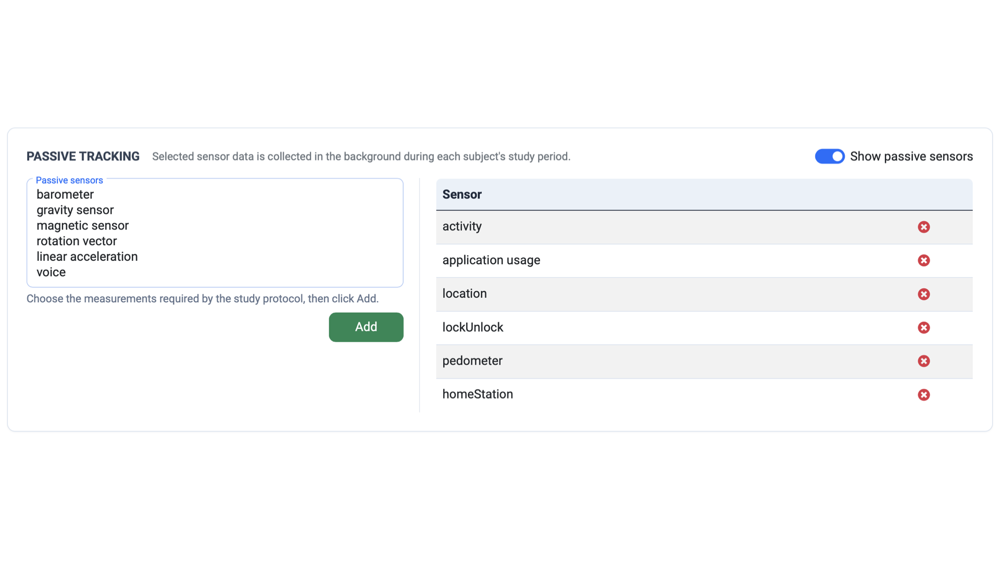

.. _active-tracking:

Active Tracking
~~~~~~~~~~~~~~~~

Active Tracking associates sensor recordings with tasks performed by
participants. In JTrack Social, participants access this feature as
**Active Labeling**.

1. Enable **Show active labels**.
2. Set the **Default Recording Frequency** for continuously recorded sensors.
   Hertz (Hz) means measurements per second: 100 Hz records 100 measurements
   per second.
3. Select the required active sensors and click **Add**. Use × to remove a
   selection from the table.
4. Configure tasks and participant instructions as described below.

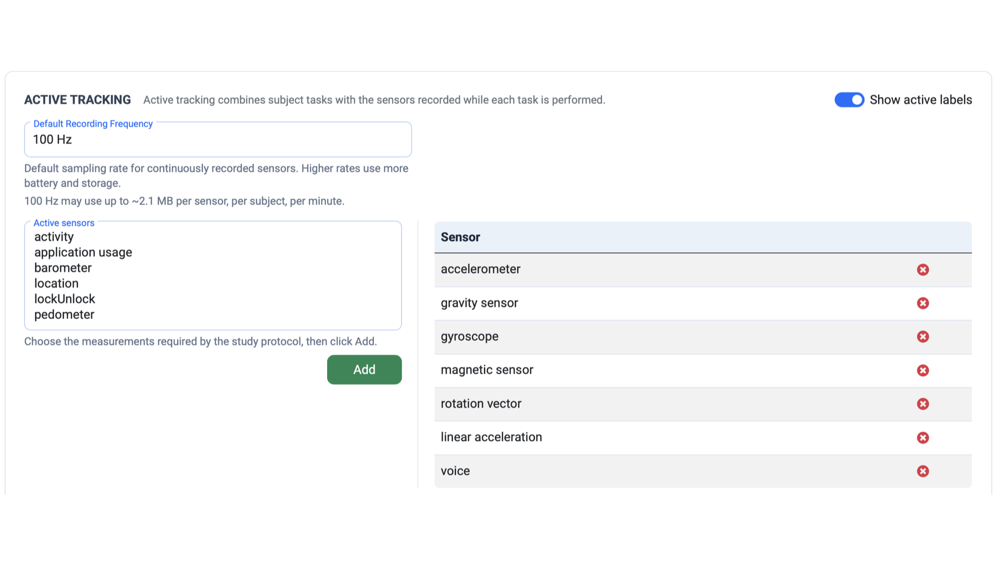

.. note::

   At least one active sensor must be selected to enable Active Labeling.
   Higher recording frequencies increase battery use and storage requirements;
   choose a rate appropriate for your protocol and devices.

**Configure tasks**

Click **Add task** for each activity participants should perform. Use a short,
recognizable name and distinguish instructions for preparing from instructions
for performing the task.

For example, a task named **Sudoku** can give participants **5 seconds** of
preparation time with the instruction “Switch to the Sudoku app,” followed by
**300 seconds** of recording with the task instruction “Play Sudoku for five
minutes.” Preparation and task durations are entered in seconds; preparation
instructions are optional.

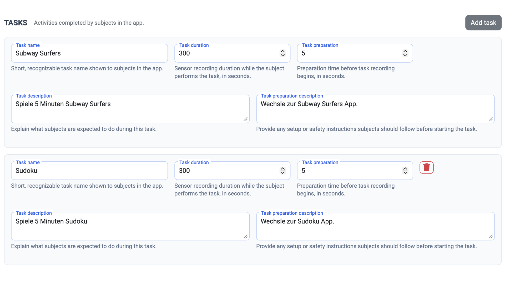

Participants access Active Labeling from the main view of JTrack Social on
:ref:`Active Labeling guide <active-labeling-ios>`, which also explains task
instructions and the participant workflow.

.. _ema-conf:

EMA (Ecological Momentary Assessment)
~~~~~~~~~~~~~~~~~~~~~~~~~~~~~~~~~~~~~~~

Enable **EMA** to assign a questionnaire to the study, then choose one of two
ways to provide it:

- Select an existing questionnaire under **Survey title**. See
  :ref:`Create Survey <create-survey>` to prepare one first.
- Upload a survey JSON file instead. The file must follow the JDash/JTrack
  EMA+ survey schema.

If questions use images, also upload a ZIP archive containing the image files.
Filenames must match the ``Image Url`` values in the survey questions.
Leave EMA disabled if the study does not collect questionnaire responses.
For the participant workflow, see :doc:`JTrack EMA+ <EMA>`; for reminder
settings, see :ref:`EMA calendar reminders <ema-calendar-reminders>`.

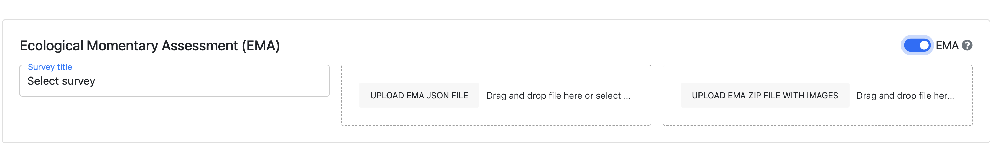

.. _wearables:

Wearable Devices
~~~~~~~~~~~~~~~~~

Configure wearable measurements alongside mobile sensor data and EMA responses:

1. Enable **Show wearables** and click **Add wearable device**.
2. Select the **Device name** for the model participants will use.
3. Select measurements under **Sensors for this device** and click **Add**.
4. Set the sampling interval for each selected sensor. Use × to remove a sensor.

The wearable **Sampling rate** values shown here are time intervals: ``1 min``
means one minute between recordings. Active sensor frequencies in Hz instead
specify measurements per second. The **Unit** column identifies what each
sensor measures.

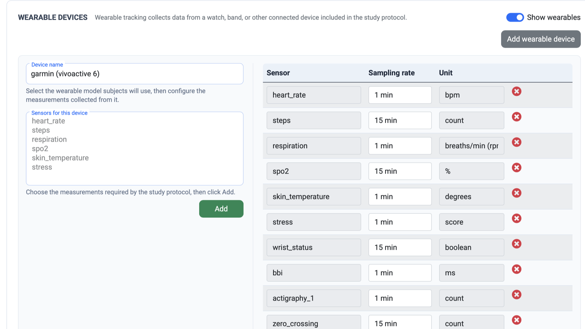

.. note::

   Sensor availability depends on the device and integration. Raw PPG and
   other high-frequency signals may require a compatible Garmin model and
   SDK license. Selecting a signal in JDash does not guarantee that every
   watch can provide it. Higher-frequency data also increases storage and
   processing requirements.

See :doc:`Garmin Integration <Garmin_Integration>` for compatible workflows,
processing details, and device limitations.

.. _study-details-subjects-view:

Study Details
-----------------------

Click **View** on a study to review its configuration and manage participants.
Check the recording duration, recruitment target, and selected sensors before
preparing participant enrollment.

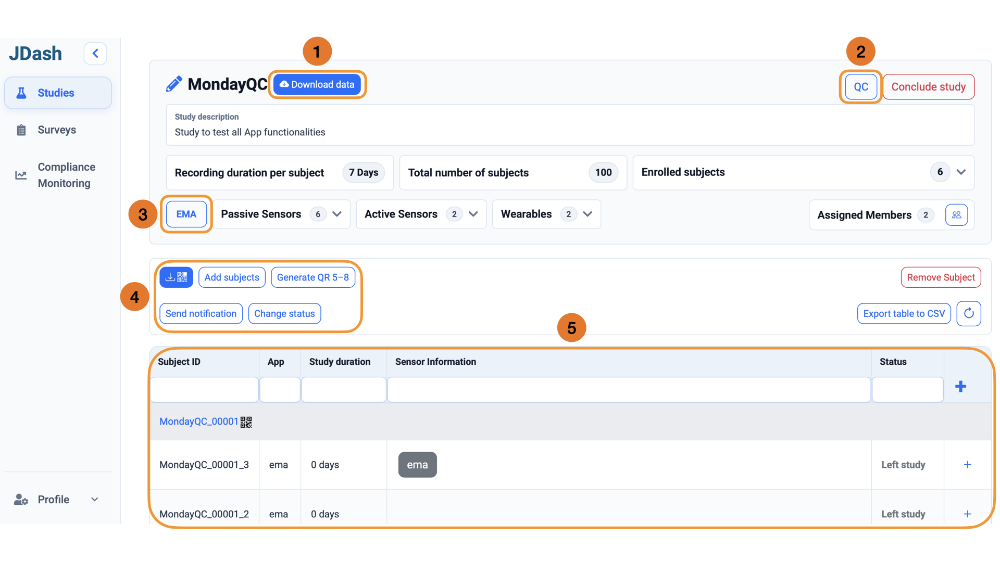

.. container:: quick-box plain

    **Study details actions:**

    - **Download data (1):** request an export of collected sensor or EMA data;
      download instructions are sent by email. See :ref:`Data Export <data-export>`
      for formats and :ref:`Roles & Permissions <jdash-permissions>` for access.
    - :ref:`QC (2) <audit-study>`: open the study's quality-control checklist.
    - **EMA (3):** inspect the questionnaire assigned to the study.
    - :ref:`Participant actions (4) <subject-management>`: add participants,
      prepare QR codes, send notifications, or change status.
    - :ref:`Subject table (5) <subject-table>`: inspect participant records
      and received data.

.. _subject-management:

**Participant management (4)**

Use **Add subjects** to create additional participant IDs. This is separate
from editing the planned **Number of subjects** in the study configuration.
The generated IDs follow the study naming convention, for example
``Demo_Study_00005``.

Use **Generate QR** for the ID range shown on the button, and the QR download
control to obtain enrollment materials. Check the range before distributing
the codes to participants. Enrollment instructions are available in the
:doc:`JTrack Social <Social>` and :doc:`JTrack EMA+ <EMA>` guides.

**Remove a subject**

Subject removal and subject data deletion require a Principal Investigator
or Administrator. Investigators can update subject status but cannot perform
either removal operation.

Click **Remove Subject** for the participant you want to remove, then choose
how to handle their existing data:

- **Remove and keep existing data:** stops new data from being added while
  retaining existing data as read-only.
- **Remove and delete subject data:** removes the participant's data and file
  references from the active study dataset. Use this option when deletion
  is requested.

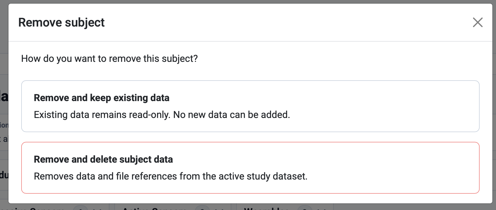

**Confirm data deletion**

If you choose **Remove and delete subject data**:

1. Review **Subject IDs to delete** and the associated **QR codes and status**.
   Check that the selection contains only the intended participants.
2. Select a **Removal reason**.
3. Read the deletion warning and select the acknowledgement that the active
   application data cannot be restored through JDash.
4. Enter the confirmation text exactly as requested by the dialog.
5. Click **Delete subject data and remove** to complete the operation, or
   **Back** to return without confirming deletion.

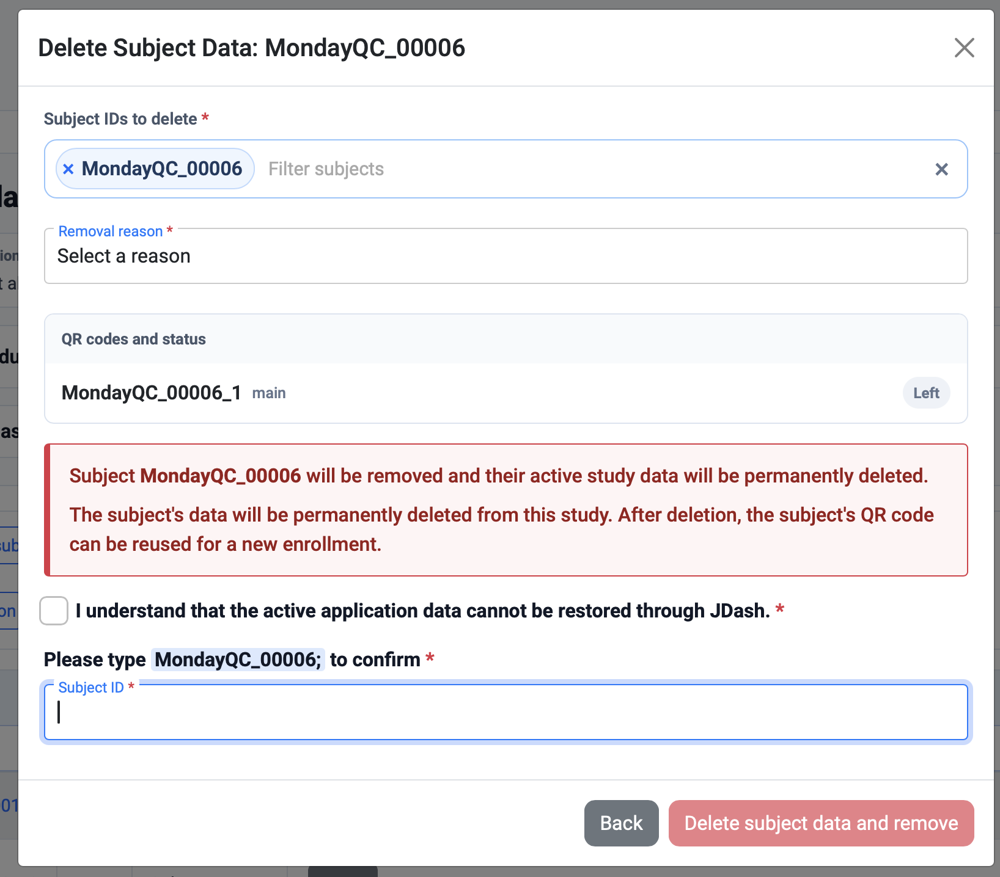

.. important::

   This option permanently deletes the selected participants' active study
   data from this study. After deletion, their QR codes can be reused for a
   new enrollment. Choose the keep-data option if existing recordings must
   remain available.

.. _subject-table:

**Subject table (5)**

Use the filters beneath the column headings to find a participant or restrict
the view by app, sensor information, or status. **App** distinguishes JTrack
Social (``main``) from EMA (``ema``). A participant may have multiple entries,
including records for different apps or repeated enrollments; inspect the
individual entry before acting on it.

Sensor badges use abbreviations such as ``at`` (activity), ``au`` (application
usage), and ``lo`` (location). Expand a row with **+** to inspect registration
and departure dates, received batch counts, and the last-received timestamp
for each sensor. These details help identify which recordings have arrived
and which may need follow-up.

Use the refresh control to update the view or **Export table to CSV** to save
the displayed table separately from the study data export.

.. _notifications:

**Send notification**

Use **Send notification** in the participant actions to send reminders,
instructions, or follow-up messages through the participant app.

1. Enter a **Title** and the message in **Description**.
2. Under **Subjects**, type in **Filter subjects** to find and select recipients.
   Entries include the subject ID and app suffix, such as ``:main`` or
   ``:ema``; check both when choosing the intended app enrollment.
3. Review the selected recipients and message before sending the notification.

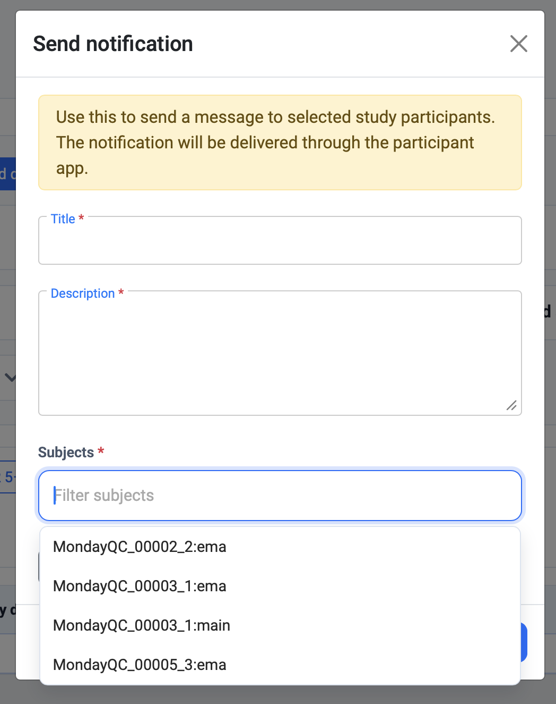

.. note::

   Delivery depends on the participant device's network connection and
   notification settings, so a message may not arrive immediately.

.. _study-closure:

**Conclude study**

When data collection is complete, click **Conclude study** on the Study Details
page. Review the confirmation dialog, then click **Confirm** to conclude the
study or **Cancel** to leave it active.

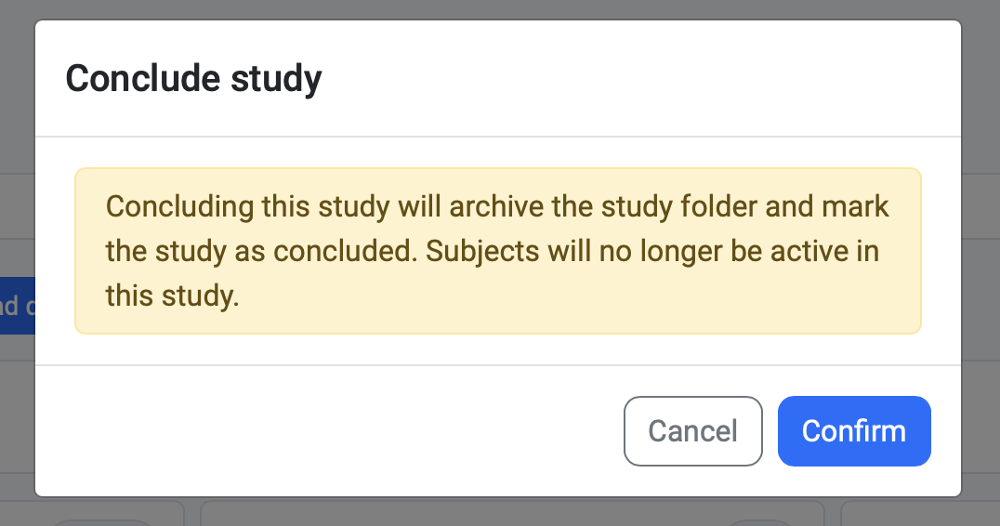

Concluding a study archives its study folder and marks the study as concluded.
Its participants are no longer active in that study. This action does not
perform the subject data deletion described under
:ref:`participant management <subject-management>`.

.. _edit-study:

Edit Study
-----------------------

Click **Edit** on a study to open its existing configuration. The form uses
the same settings described under :ref:`Create New Study <create-study>`.
Review the relevant component and save your changes.

Changing **Number of subjects** updates the recruitment target. To create
additional participant IDs, use :ref:`participant management <subject-management>`.
Saving updates the dashboard configuration; check enrolled apps after they
synchronize to confirm the intended settings are in use.

.. note::

   The study name is the fixed identifier and cannot be changed after creation.

.. _audit-study:

Audit / Quality Control
-------------------------

Open **QC** to check study workflows before recruitment and during data
collection. Use the checklist to record validation results and follow up on
problems.

1. Find a check using **Search** or the **Completion status** filter.
2. Follow its **Steps** and compare the result with **Expected Outcome**.
3. Record completion in the appropriate **Admin** or **Owner** column for
   your role, then click **Update** to save the checklist changes.
4. Use **Comments** to document observations, failures, or follow-up work.
   Comments retain the username and timestamp.

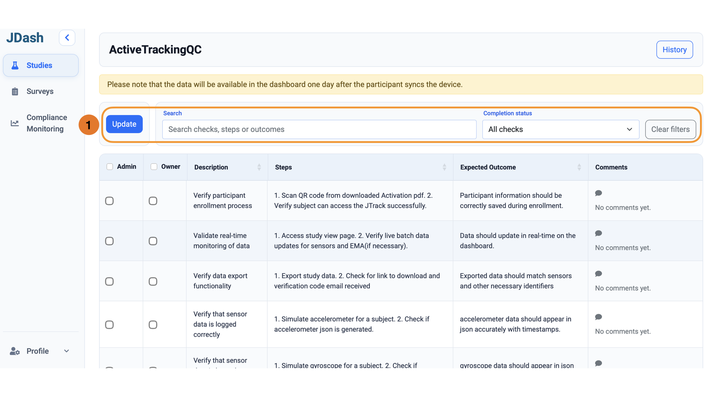

.. note::

   Checklist results do not change participant data collection. Allow for
   synchronization and processing delays when checking received data; the
   page notes that data becomes available one day after a participant syncs.

.. _history-study:

Study History
-----------------------

Open **History** on a study to inspect saved configurations or trace changes.

**JSON versions**

Use **Details** to inspect a saved study configuration or **Download** to save
its JSON file. The **Current** badge identifies the current version. Earlier
versions provide a reference when investigating how settings changed.

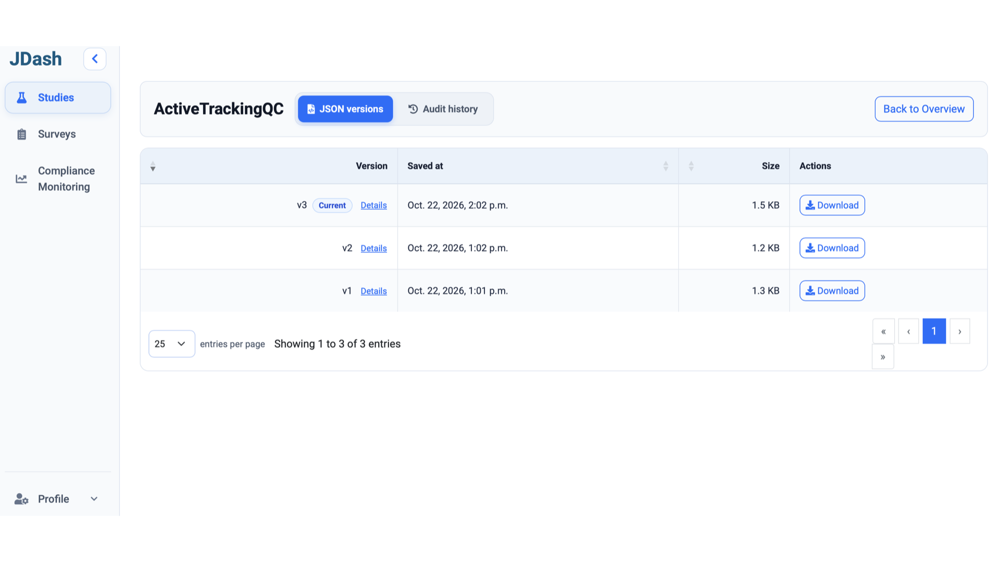

**Audit history**

Switch to **Audit history** to see who changed an object and when. Use search,
**Actor**, and **Action** filters (1) to narrow the records. In the table (2),
**Changes** shows previous values in red and new values in green, allowing you
to trace specific configuration changes.

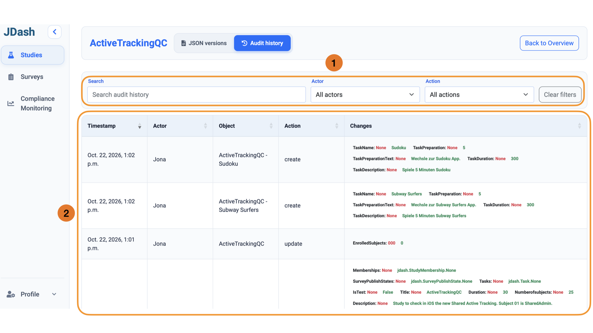

.. _jdash-surveys:

Surveys
++++++++++++++

The **Surveys** tab manages questionnaires for :doc:`JTrack EMA+ <EMA>`.
Find an existing survey with the search, category, and associated-study
filters, or choose one of three starting points below.

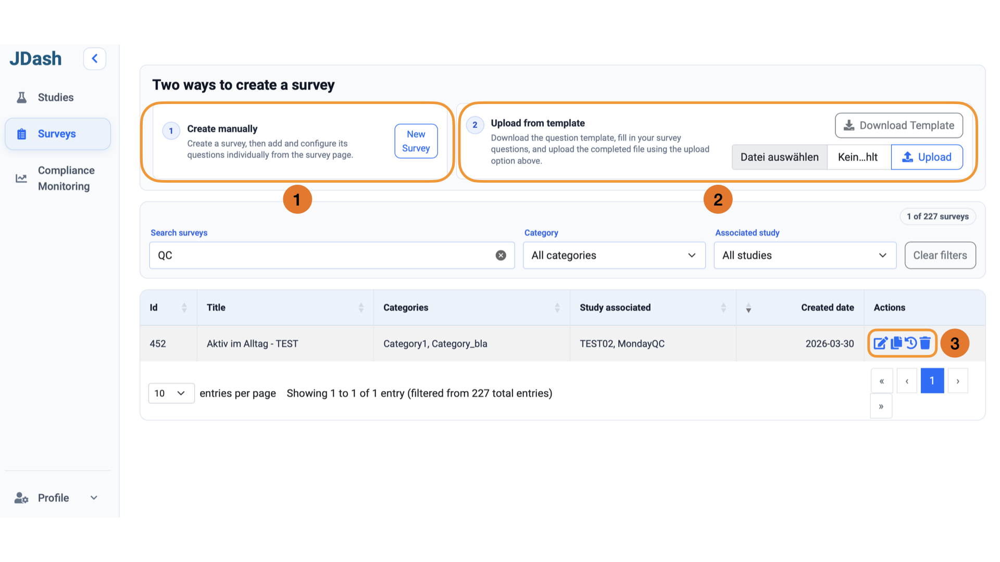

.. container:: quick-box plain

    **Survey starting points:**

    - :ref:`Start from scratch (1) <create-survey>` using **New Survey**.
    - :ref:`Start from a template (2) <upload-survey-json>` using
      **Download Template** and **Upload**.
    - :ref:`Duplicate an existing survey (3) <duplicate-survey>` using the
      copy action in its row.

The other row actions (3) open the :ref:`Survey Editor <survey-edit-view>`,
show its history, or delete
it. Use the editor to review questions before assigning the questionnaire in
:ref:`study EMA settings <ema-conf>`.

.. _create-survey:

Start from Scratch
---------------------

Click **New Survey** (1) to create an empty questionnaire. Enter a recognizable
**Title** and a **Description** of its purpose. Choose **Horizontal** for
side-to-side navigation or **Vertical** for a scrolling layout, then click
**Create**.

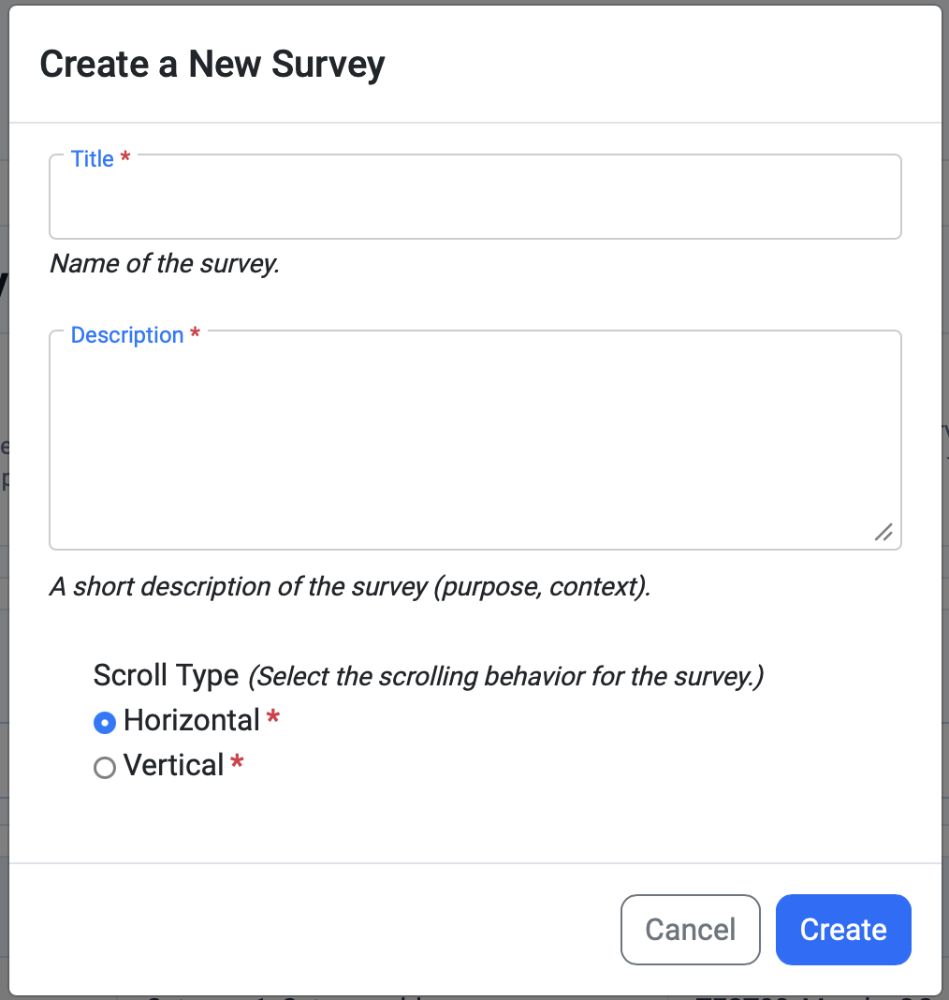

Next, define :ref:`categories <survey-categories>` and
:ref:`add questions <question-form>` in the
:ref:`Survey Editor <survey-edit-view>`.

.. _upload-survey-json:
.. _survey-template:

Start from a Template
-----------------------

Use **Download Template** (2) to prepare several questions outside the
question editor, then choose the completed file and click **Upload**.
The question template is a tab-separated text file, rather than a survey JSON
file. A copy is available here:
:download:`survey question template <_static/survey_question_template.txt>`.
Use the dashboard's download for the latest version.

1. Open the template in an editor that preserves tab-separated columns and
   its UTF-16 text encoding. Keep the header row and column order intact.
2. Adapt the example question rows. Give each question a distinct ``id`` and
   enter its ``title``, optional ``subText``, ``category``, and ``questionType``.
   The template uses numeric question-type codes; retain the format shown in
   the examples rather than substituting the display names from the editor.
3. Set the scheduling fields, such as ``frequency``, ``nextDayToAnswer``, and
   ``clockTime_start`` / ``clockTime_end``, to match your protocol. The repeated
   answer-column groups hold response choices or type-specific answer settings.
4. Save in the original tab-separated format and upload the file through the
   Surveys page. Review the imported questions, categories, answer choices,
   and timing in the :ref:`Survey Editor <survey-edit-view>` before using
   the survey in a study.

.. note::

   Example values are starting points, not recommended study settings. In
   particular, review repetition intervals and expiry days rather than
   retaining them simply because they appear in the template.

.. _duplicate-survey:

Duplicate an Existing Survey
------------------------------------------

Find the questionnaire you want to reuse and select its copy action (3).
Open the resulting copy in the :ref:`Survey Editor <survey-edit-view>`
and adapt its title, description, categories, and
questions for the new study. Review inherited schedules, answer choices, and
conditional rules as carefully as the question text.

When ready, select the new questionnaire in the
:ref:`study EMA configuration <ema-conf>`.

.. _survey-edit-view:

Survey Editor
------------------------------------------

Open a survey with the edit action on the Surveys page. The numbered areas
in the editor support three tasks:

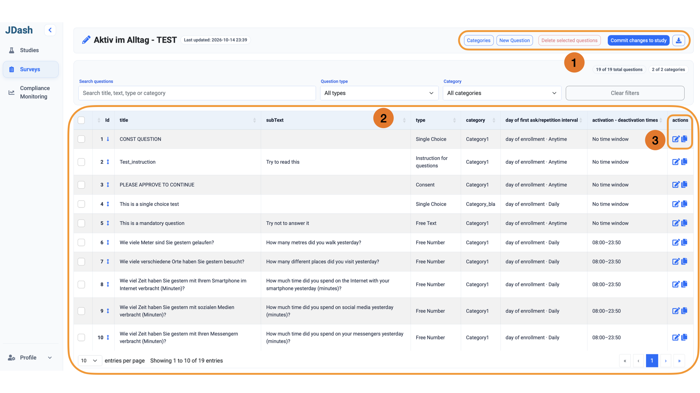

- **Toolbar (1):** manage **Categories**, add a **New Question**, delete
  checked questions with **Delete selected questions**, use **Commit changes
  to study**, or download the survey definition with the download icon.
  After editing a survey used by a study, use **Commit changes to study** to
  apply the revised questionnaire to that study.
- **Question table (2):** review question order, text, type, category, first
  study day, repetition interval, and activation windows. Search and filters
  help find questions that share a type or category. Use the row checkboxes
  to choose questions for bulk deletion.
- **Row actions (3):** edit a question or duplicate it as a starting point
  for another question. Review copied settings before saving.

The survey-definition download is separate from
:ref:`exports of participant responses <data-export>`.

.. _survey-categories:

Manage Categories
~~~~~~~~~~~~~~~~~~~~~~~~~~

Use **Categories** in the toolbar (1) to organize questions into meaningful
groups, such as Mobility, Sleep, or Mood. Click **New Category** to add a
name, edit an existing name, or use its trash icon to remove it. Click
**Update** to save the category changes.

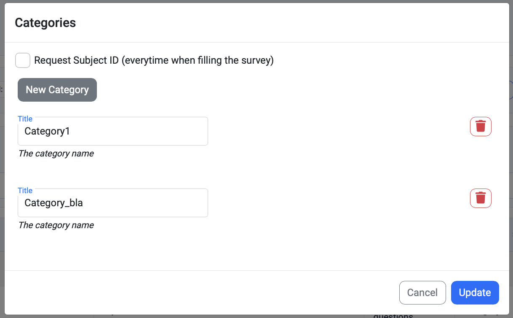

Enable **Request Subject ID** only if your workflow requires participants to
enter a subject ID each time they fill in the survey. Assign each question
using the editor's **Category** field, as described below.

.. _question-form:

Create / Edit Question
-----------------------

Click **New Question** in the survey toolbar, or the edit action on an existing
question. Configure the question through five aspects:

.. container:: quick-box plain

    - :ref:`1. Default settings <question-default-settings>`: text,
      required responses, and scheduling.
    - :ref:`2. Question types <question-types>`: choose the response format
      within the default settings.
    - :ref:`3. Category assignment <question-category>`: group the question
      within the default settings.
    - :ref:`4. Advanced settings <question-advanced-settings>`: cross-question
      rules and supporting media or links.
    - :ref:`5. Conditional logic <survey-conditional-logic>`: combine default
      and advanced settings to control what is asked.

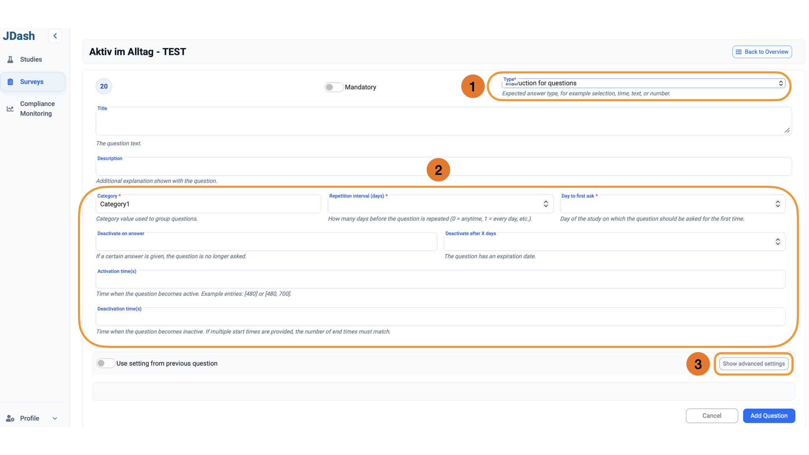

.. _question-default-settings:

1. Default Settings
~~~~~~~~~~~~~~~~~~~~~~

The standard form contains the settings needed for a question without opening
**Show advanced settings**. Enter the participant-facing **Title**, use
**Description** for an explanation or translation, and enable **Mandatory**
when an answer is required.

Choose the response **Type (1)** and assign a **Category** in the default
settings area **(2)**. The remaining fields in area (2) control when the
question is available:

.. list-table:: Default scheduling and stopping rules
    :header-rows: 1
    :widths: 32 68

    * - Setting
      - What to configure
    * - Repetition interval (days)
      - ``0`` means anytime, ``1`` every day, and ``n`` every n days.
    * - Day to first ask
      - First study day on which to ask the question; ``0`` is enrollment day.
    * - Deactivate on answer
      - An answer value that stops this question from being asked again.
        This affects the current question, not another question.
    * - Deactivate after X days
      - The question's expiry day in the study; ``0`` means no expiry by day.
    * - Activation time(s) / Deactivation time(s)
      - Matching start and end times for the response windows, in minutes
        after midnight.

For example, ``480`` is 08:00 and ``1430`` is 23:50. For two windows, enter
matching lists such as ``[480, 900]`` and ``[600, 1000]`` for 08:00–10:00 and
15:00–16:40. Keep the number of start and end times equal, with each end after
its corresponding start. These windows also inform the reminder schedule;
see :ref:`EMA calendar reminders <ema-calendar-reminders>` for the participant
reminder workflow.

Use **Use setting from previous question** when the preceding question is a
suitable starting point, then review the resulting values. Reusing settings
does not replace checking them against the protocol. Click **Add Question**
to save a new question, or save the edited question with the editor's action.

.. _question-types:

2. Question Types
~~~~~~~~~~~~~~~~~~~~~~

Select **Type (1)** in the default form before configuring the response.
Choose the type that matches the information you need, rather than asking
participants to encode it in free text.

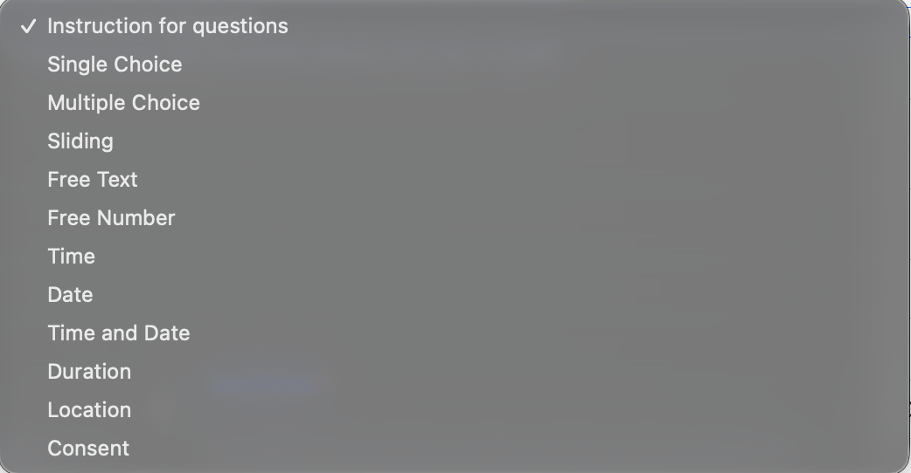

.. list-table:: Choosing a response format
    :header-rows: 1
    :widths: 35 65

    * - Type
      - Use for
    * - Instruction for questions
      - Participant instructions or explanatory content.
    * - Single Choice / Multiple Choice
      - One answer or several answers from a defined list.
    * - Sliding
      - A rating on a configured numeric scale.
    * - Free Text / Free Number
      - A written response or a numeric value.
    * - Time / Date / Time and Date / Duration
      - Structured temporal responses.
    * - Location
      - A location response.
    * - Consent
      - A participant consent response.

For choice and sliding questions, also configure the
:ref:`answer settings <answer-form>` before saving.

.. _question-category:

3. Category Assignment
~~~~~~~~~~~~~~~~~~~~~~~

Choose the question's **Category** in the default settings area (2). Create
or rename groups through :ref:`Categories <survey-categories>` in the survey
toolbar first. Group related questions under a consistent category so the
survey remains easy to navigate and filter. After importing or duplicating
questions, review their inherited category assignments.

.. _question-advanced-settings:

4. Advanced Settings
~~~~~~~~~~~~~~~~~~~~~~

Click **Show advanced settings (3)** to reveal additional controls:

- **Activate question** and **Deactivate question** target other questions
  by their sequence IDs. Enter a list such as ``[13]`` or ``[13, 14]``.
  The associated condition fields appear when targets are entered; see
  :ref:`Conditional Logic <survey-conditional-logic>`.
- **Image URL** references an image used by the question. For study image
  uploads, match the filename to the archive provided under
  :ref:`EMA configuration <ema-conf>`.
- **Link URL** provides a supporting external resource, such as instructions
  or information for participants.

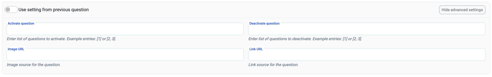

Use **Hide advanced settings** to return to the compact form.

.. _survey-conditional-logic:

5. Conditional Logic
~~~~~~~~~~~~~~~~~~~~~~

Conditional behavior can use both parts of the question editor:

- In **default settings**, **Deactivate on answer** stops the current
  question after a specified response. First-day, repetition, expiry, and
  response-window settings also determine whether that question is available.
- In **advanced settings**, **Activate question** and **Deactivate question**
  change other questions when the current answer meets the corresponding
  **Activation condition** or **Deactivation condition**.

To configure a rule, identify the target questions in the survey table,
enter their IDs in the appropriate advanced field, then set the answer
condition. For **Single Choice** and **Multiple Choice**, select conditions
from the configured answer options. For other types, enter the condition
value manually in the form.

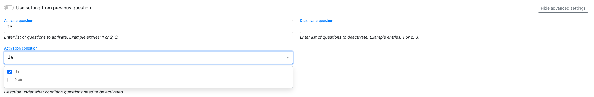

For example, a question asking whether a participant drives can activate
question ``13`` after **Ja** and deactivate question ``14`` after **Nein**.
Both rules can be configured on the same source question:

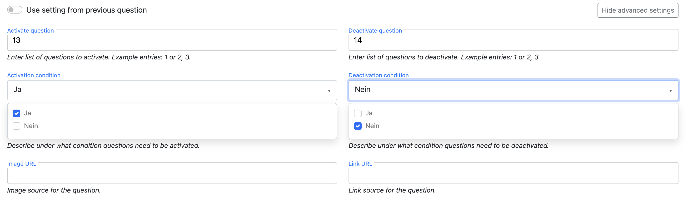

.. important::

   Questions follow a paper-survey model: an activation rule alone does not
   make a target question initially hidden. Plan the corresponding
   deactivation behavior and test both matching and non-matching answers.
   Also check the target's default schedule, since branching and timing must
   work together.

Review target IDs after reordering or duplicating questions. Test the complete
participant flow in :doc:`JTrack EMA+ <EMA>` before committing the survey
changes to a study.

.. _answer-form:

Create / Edit Answer
---------------------

For **Single Choice** and **Multiple Choice**, click **Add Choice** to create
response options. Enter clear labels, use the drag handles to arrange the
options, and use the trash icon to remove an option.

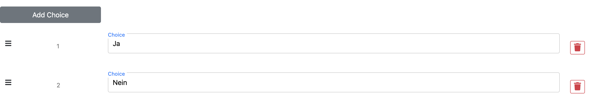

For **Sliding**, configure minimum and maximum values, the step size, endpoint
labels, and the default value.

.. important::

   **Use a default value outside the slider's valid range**, for example
   ``-1`` for a scale from ``0`` to ``10``. An unchanged default is treated
   as unanswered, so leaving the slider untouched does not count as a response.
   This helps distinguish an intentional answer from a question the participant
   leaves unanswered or explicitly skips. See the
   :doc:`JTrack EMA+ guide <EMA>` for the unanswered-question workflow.

After changing response options, review any
:ref:`conditional rules <survey-conditional-logic>` that depend on them.

.. _jdash-compliance-monitoring:

Compliance Monitoring
++++++++++++++++++++++++++++

Use **Compliance Monitoring** to check whether study data is arriving and
identify participants who may need follow-up. Start with total compliance
across the study, then inspect an individual sensor or the EMA questionnaire
to understand a gap in more detail.

Choose the study under **Choose Study**. To investigate one participant, use
**Choose subject for single-subject view**. **Filter Subjects** limits the
cohort using **Include** or **Exclude**. Switch between **overview** and the
available sensor tabs, such as **ema** in this example.

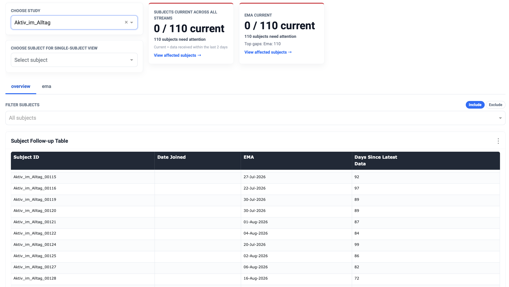

Total Compliance
---------------------

The **Subjects current across all streams** card summarizes how many
participants are up to date across the study's data streams. Individual
stream cards, such as **EMA current**, help narrow down which data is missing.
In the example, **current** means data received within the last two days.
This is a recency check, rather than a percentage of all expected recordings
or questionnaire answers completed.

Use **View affected subjects** to investigate participants who need attention.
The **Subject Follow-up Table** lists participants alongside their latest
stream dates and **Days Since Latest Data**, helping you prioritize follow-up.

**Activity over the study period**

The **Subject Activity by Study Day** heatmap shows the recording pattern for
the selected cohort:

- Each row represents a participant.
- The horizontal axis shows study days in this example. Use **X axis** to
  change the available time-axis view.
- The **Data received** color scale shows the amount of received data per
  cell. Darker cells indicate more data; use the legend to read the values.
- Hover over a participant's status marker to inspect the current study day,
  status, days since last data, and last data day and date.

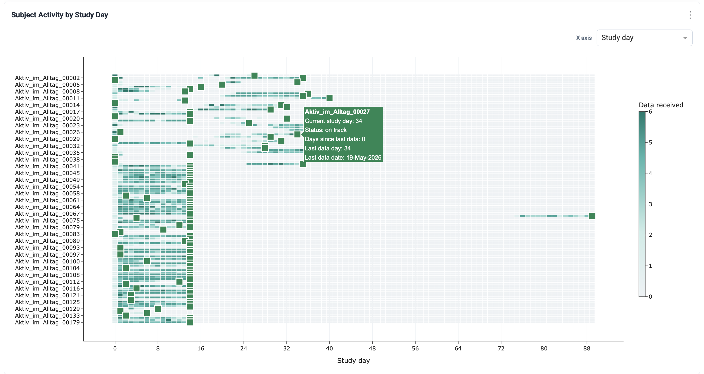

Read the timeline together with the recency cards: a participant may have
recordings earlier in the study but no recent uploads. Gaps identify periods
to investigate; they do not by themselves establish why data is absent.

Compliance by Sensor: EMA Example
------------------------------------------

Select a sensor tab to inspect that stream separately. For **ema**, the
**EMA Completion Matrix** shows the percentage of expected questions answered
for each participant and scheduled EMA frequency window.

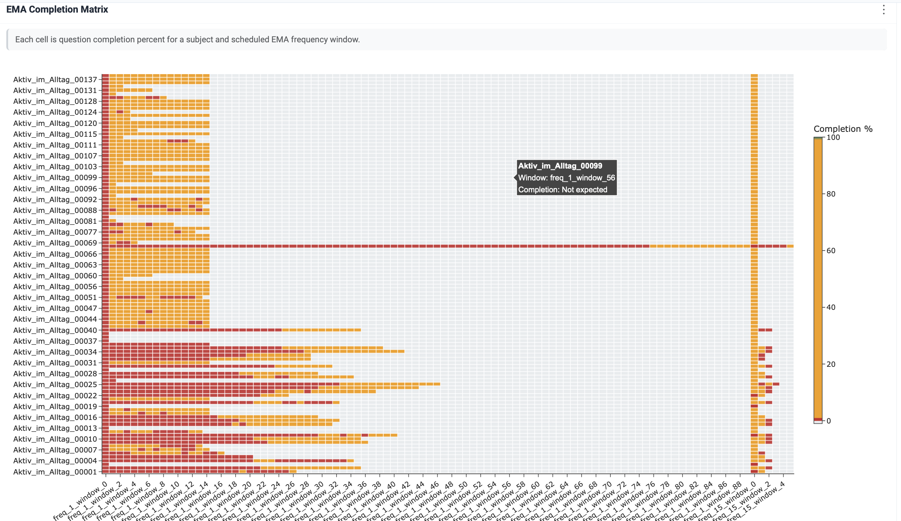

Read this matrix differently from the total-activity heatmap:

- **Orange** indicates full completion; **red** indicates zero completion
  where responses were expected. Read intermediate values against the
  **Completion %** legend.
- **Grey** can mean **Not expected**, as shown in the tooltip. It should not
  automatically be counted as a missed questionnaire.
- Window labels include the repetition frequency, such as
  ``freq_1_window_14``. Windows are grouped by frequency, so adjacent columns
  from different frequency groups are not necessarily consecutive study days.
  Hover over a cell to inspect its window and completion status.

**Questionnaire update at day 14**

In this example, the questionnaire's last-day setting was updated. The change
is visible around **study day 14**, where many daily-question rows transition
from completed windows to windows with no expected responses. Interpret that
boundary in the context of the questionnaire update rather than treating it
as a simultaneous loss of compliance across participants.

When investigating such a pattern, compare the matrix with the question's
:ref:`default scheduling settings <question-default-settings>` and the
:ref:`Survey Editor <survey-edit-view>`. Check repetition intervals, expiry
days, and which questions were expected during each window. Different sensor
tabs may use different measurements; use the displayed legend and tooltips
rather than applying EMA completion percentages to every stream.

.. note::

   Uploaded data can appear with a delay after synchronization and processing.
   Before contacting a participant about a gap, check the expected schedule
   and latest received-data details in the
   :ref:`subject table <subject-table>`. Participant settings that help prevent
   gaps are described in :doc:`Compliance Optimization <Compliance_Optimization>`.

Notification Scheduler
++++++++++++++++++++++++

JDash includes a background notification scheduler that automatically sends EMA
reminders to participants based on the survey configuration.

The scheduler runs periodically as a cron job and processes a generated JSON
schedule containing:

- Study days on which notifications should be sent
- Activation times configured for survey questions
- Study-specific notification schedules

Workflow
---------

1. Survey activation times are configured in the EMA survey definition.
2. The notification schedule is generated and stored as a JSON structure.
3. The scheduler runs at regular intervals via cron.
4. For each participant, the scheduler calculates the current study day based
   on the enrollment date.
5. The scheduler checks whether the current study day exists in the generated
   notification schedule.
6. If a configured activation time falls within the current processing window,
   a push notification is sent to the participant's device.
7. Notifications are delivered through Firebase Cloud Messaging (FCM).

Generated Schedule
---------------------------------

The scheduler uses a generated JSON file that maps study days to activation
times.

Example:

.. code-block:: json

   {
      "Study_A": {
         "days": {
            "0": [480, 720],
            "1": [480, 720],
            "2": [480]
         }
      }
   }

In this example:

- Day 0: notifications at 08:00 and 12:00
- Day 1: notifications at 08:00 and 12:00
- Day 2: notification at 08:00

This ensures that participants receive reminders relative to their individual
enrollment date.

Notification Delivery
---------------------

Notifications are delivered to enrolled participants through the mobile
application and are used to inform users that new EMA questions are available.

.. note::

   Notification schedules are derived directly from the EMA survey
   configuration. Any changes to survey activation times are automatically
   reflected in future notification schedules after the schedule is
   regenerated.

.. _jdash-technical-overview:

Technical Overview
++++++++++++++++++

JDash follows a modular Django-based architecture with a Bootstrap-powered
frontend and embedded Plotly-Dash dashboards for visualizing participant
compliance, sensor activity, and study progress.

Core Components
---------------------------
* Backend: Django-based application handling authentication, routing,
  form processing, database operations, and server-side rendering.

* Frontend: HTML templates styled with Bootstrap, using BootstrapTables
  and AJAX for interactive tables, filtering, file uploads, and dynamic UI
  updates.

* Database: MariaDB stores studies, subjects, sensor settings, EMA surveys,
  tasks, audit checks, notifications, and user-related configuration.

* Visualization Components: Interactive compliance visualizations are implemented 
  using Dash and Plotly components integrated within Django views and templates.

* Deployment: Supports local development with Django ``runserver`` and
  production deployment using Apache with ``mod_wsgi``.

Deployment Instructions
-----------------------

JDash can be deployed locally for development or on a production web server
using Apache and ``mod_wsgi``. The latest deployment steps, environment setup, database configuration, and
server configuration details are maintained in the official GitHub repository.

`JTrack Dashboard repository <https://github.com/Biomarker-Development-at-INM7/JTrack-dashboard>`_
