=====================
JTrack Social
=====================

JTrack Social is available for **Android** and **iOS**:

- In the `Google Play Store <https://play.google.com/store/apps/details?id=inm7.JTrack.JTrack_Social>`__
- In `Apple's App Store <https://apps.apple.com/de/app/jtrack-social/id1645319896>`__

Prerequisites
+++++++++++++

.. list-table:: Minimum operating-system requirements
   :header-rows: 1
   :widths: 50 50

   * - Android
     - iOS
   * - Android 14 or later
     - iOS 16 or later

.. note::

   JTrack Social 2.47 was the last version supporting iOS 15. For a new
   installation, use a phone meeting the current minimum requirements above.

- Your study coordinator has provided you with a **QR code** to join the study.
- A stable internet connection is required during the initial setup.

For settings that improve background collection and participant compliance,
see :ref:`Compliance Optimization for JTrack Social <compliance-social>`.

.. container:: quick-box plain

   **Set up your phone:**

   - :ref:`Android installation and setup <jtrack-social-android>`
   - :ref:`iOS installation and setup <jtrack-social-ios>`

.. _social-sensors:

What JTrack Social records
++++++++++++++++++++++++++

The exact data collected depends on the :ref:`study configuration <jdash-studies>`.
Records use pseudonymous study identifiers. Sensor availability differs between
platforms; see the :ref:`Android and iOS comparison <sensor-comparison>`.
Common JTrack Social modules record the following types of information:

.. note::
   Not every study enables every module. JTrack Social only records the sensors and permissions :ref:`configured <create-study>` for that study.

Location
--------

- Relative location coordinates and timestamps. When configured, location
  coordinates are transformed on the device before storage; these remain
  study records associated with pseudonymous identifiers.
- These data can be used to estimate mobility patterns such as time spent at places, distance covered, and changes in daily routines.

Application Usage
-----------------

- The app name or app category, together with timestamps and foreground usage duration.
- This is used to measure general usage patterns, not the content inside apps.

Activity Recognition
--------------------

- Motion-state labels reported by the phone, such as walking, running, still, cycling, or being in a vehicle, depending on device support.
- The app records the recognized state and when it changed.

Accelerometer
-------------

- Raw movement values on the x, y, and z axes.
- On iOS and Android, raw accelerometer recording is restricted to configured **Active Labeling** tasks; passive accelerometer monitoring is not supported.
- The apps use the most suitable platform background API available so a running task can continue when the participant briefly opens another app.

Gyroscope
---------

- Raw rotation-rate values on the x, y, and z axes.
- Raw gyroscope recording is restricted to configured **Active Labeling** tasks and is not used for passive monitoring.

Pedometer
---------

- Step counts over time.
- This can be used to summarize walking activity or daily movement volume.

Lock and Unlock Events
----------------------

- Screen lock and unlock events, and on some devices the time spent in each state.
- These events help describe phone availability and interaction patterns.

Audio
-----

- If the study enables audio capture, the app can record microphone input during defined periods or active-labeling tasks.
- Audio collection is study-specific and should always be described in the study consent materials.

.. _social-permissions:

Sensor Permissions
------------------

Permissions depend on the configured sensors and the phone platform.
Follow the :ref:`Android permission instructions <social-permissions-android>`
or :ref:`iOS permission instructions <social-permissions-ios>`. The shared
:ref:`Application Permissions <application-permissions>` reference explains
what each permission is used for.

.. _social-active-labeling:

Active Labeling
---------------

Active Labeling records sensor data while participants perform a named task,
such as walking or brushing teeth. The recording includes the task name,
time, duration, and the sensors enabled for that task. Audio is included only
when configured in the study. Data is stored on the phone until it can be
uploaded to the study server.

Follow the :ref:`Android task instructions <active-labeling-android>` or
:ref:`iOS task instructions <active-labeling-ios>`. Researchers configure tasks
and preparation instructions in :ref:`JDash Active Tracking <active-tracking>`.
Use clear task names and follow the study team's duration and preparation
instructions consistently.

.. _jtrack-social-android:

Android
+++++++

Install & Join the Study
------------------------

1. Install the App
~~~~~~~~~~~~~~~~~~

1. Open `JTrack Social on Google Play <https://play.google.com/store/apps/details?id=inm7.JTrack.JTrack_Social>`__.
2. Install **JTrack Social** from its store page.

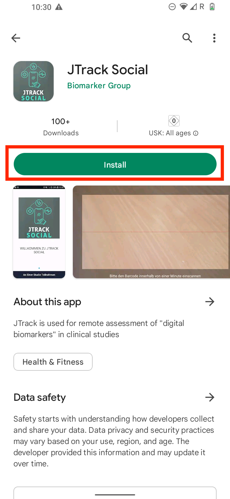

2. Join the Study
~~~~~~~~~~~~~~~~~

1. Open **JTrack Social** and tap **Join study**.

   .. image:: image/Social/social_2.png
      :width: 300px
      :align: center
      :alt: Android welcome screen with the Join study control highlighted

2. When prompted, allow **Camera** access so the app can scan your study QR code.

   .. image:: image/Social/social_3.png
      :width: 100%
      :align: center
      :alt: Android camera permission prompt used during QR-code enrollment

3. Use your device camera to scan the **QR code** provided by your study team.

.. tip::

   **Enroll without scanning a QR code:** press and hold the enrollment
   button (**Join study** / **Enroll to study**) for several seconds to open
   manual entry. Enter the **Subject ID / username** provided by your study
   team and follow the prompts to complete enrollment.

.. important::
   For study setup and QR-code generation, see :ref:`Studies in JDash <jdash-studies>`.

Check Enrollment
~~~~~~~~~~~~~~~~

After enrolling by QR code or manual entry, check that the app opens its main screen
and lets you continue through the requested settings rather than returning
to the welcome/enrollment screen. The screenshot under **Background Settings** shows the main app
behind the battery-settings prompt. Complete the permissions below
and confirm that battery use is **Unrestricted**.

If you remain on the welcome screen or setup cannot be completed, follow the
:ref:`Android troubleshooting steps <social-troubleshooting-android>`. The
study team can verify that data is arriving in
:ref:`JDash Compliance Monitoring <jdash-compliance-monitoring>`.

.. _social-permissions-android:

Permissions
-----------

Only sensors enabled in the :ref:`study configuration <jdash-studies>`
request access. The following screenshots and settings apply to Android.
For the shared permission reference, see
:ref:`Application Permissions <application-permissions>`.

Background Settings
~~~~~~~~~~~~~~~~~~~

After enrollment, the app may prompt you to adjust Android system settings so background data collection can run reliably.

1. Tap the in-app button to open the **App settings** screen.

   .. image:: image/Social/social_4.png
      :width: 300px
      :align: center
      :alt: Android main app behind a prompt to open battery settings

2. **Disable** **Remove permission and free up space**.

   .. image:: image/Social/social_6.png
      :width: 300px
      :align: center
      :alt: Android app settings showing Remove permission and free up space

3. Open **Battery optimization** and set JTrack Social to **Unrestricted**.

   .. image:: image/Social/social_5.png
      :width: 300px
      :align: center
      :alt: Android battery optimization settings for JTrack Social

4. Confirm **Unrestricted** is selected so Android does not limit the app.

   .. image:: image/Social/social_7.png
      :width: 300px
      :align: center
      :alt: Android battery setting with Unrestricted selected

.. tip::
   These settings help prevent Android from stopping the app in the background, which can interrupt data collection.

Audio Sensor
~~~~~~~~~~~~

- Allows the app to record microphone input when audio collection is enabled in the study.
- On some devices, the app may also request storage or media access so recordings can be saved locally before upload.

1. Allow **Microphone** access.

   .. image:: image/Social/social_8.png
      :width: 300px
      :align: center
      :alt: Android microphone permission prompt

2. If requested, allow **File/Storage** access so recordings can be saved.

   .. image:: image/Social/social_9.png
      :width: 300px
      :align: center
      :alt: Android file and storage permission prompt

Location Sensor
~~~~~~~~~~~~~~~

- Enables location capture based on the :ref:`study configuration <jdash-studies>`.
- For how location is represented in study records, see
  :ref:`What JTrack Social records <social-sensors>`.

Allow the location permission when prompted.

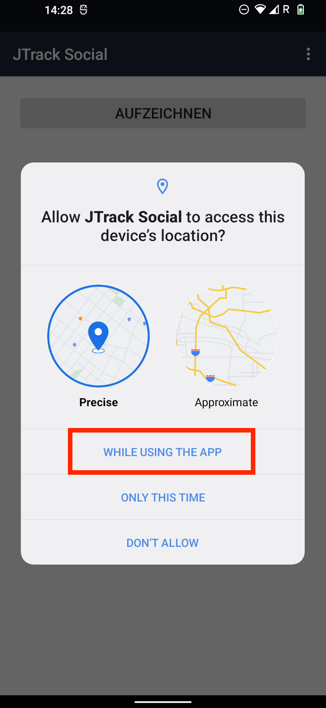

Application Usage Sensor
~~~~~~~~~~~~~~~~~~~~~~~~

- Collects app usage statistics, such as which apps are used and for how long.
- On Android, this usually requires enabling **Usage access** manually.

To enable it on Android:

1. Open **Usage access** settings.
2. Select **JTrack Social**.
3. Enable the permission.

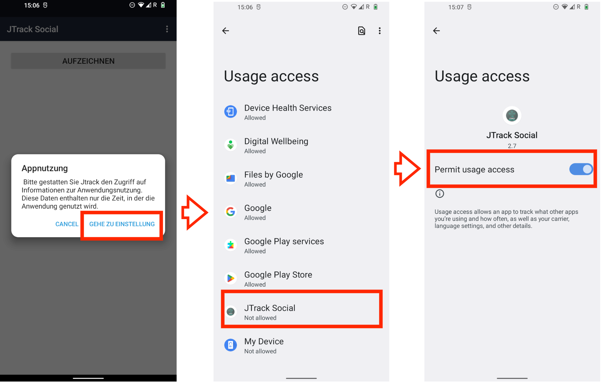

.. note::
   This module does **not** collect message contents, typed text, or other in-app content. It records general usage patterns only.

Activity Recognition Sensor
~~~~~~~~~~~~~~~~~~~~~~~~~~~

- Detects basic physical activity states such as walking, running, or stillness.
- Depending on the phone, the permission may appear as **Activity recognition** or another motion-related system prompt.

Allow **Activity recognition** when prompted.

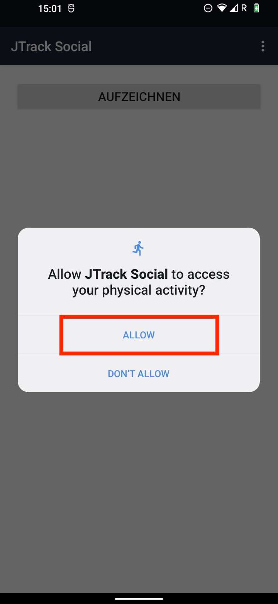

.. _active-labeling-android:

Active Labeling
---------------

The screenshots below show the Android task interface. For the shared
recording model and upload behavior, see
:ref:`Active Labeling overview <social-active-labeling>`.

Use *Active Labeling* to mark what you are doing in real time. This helps the study link sensor data with the correct activity.

Overview
~~~~~~~~

- The home screen shows **Recently completed activities** and the large **Play/Stop** control.
- Use **+** to pick or create an activity, or **>** to load the next scheduled one.
- Some tasks display a short instruction and a preparation countdown before starting.

Step-by-Step
~~~~~~~~~~~~

1) Open the Activity Screen
^^^^^^^^^^^^^^^^^^^^^^^^^^^

You will see your recent tasks and the main control.

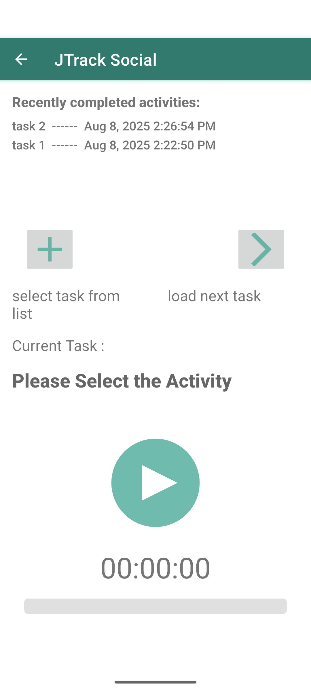

2) Add or Select an Activity
^^^^^^^^^^^^^^^^^^^^^^^^^^^^

Tap the **+** button to add or select a task. In the **New Activity** dialog:

- **Enter activity**: type the activity name, for example *task 1*
- **Duration in seconds (optional)**: set a fixed length if your study requires it, otherwise leave it empty
- **Record Audio**: enable this only if your study instructs you to capture audio

Tap **Add**.

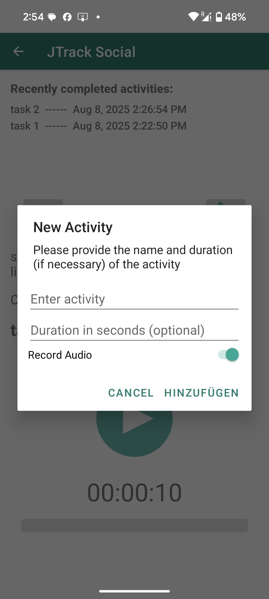

As you type, suggestions may appear. Tap one to select it.

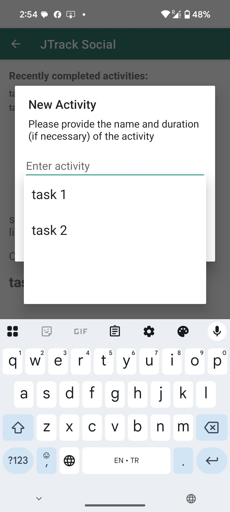

3) Read the Task Instruction
^^^^^^^^^^^^^^^^^^^^^^^^^^^^

Some studies display a brief instruction popup for the selected task. Tap **OK** to continue.

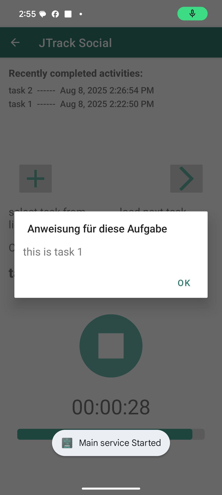

4) Wait for the Preparation Countdown
^^^^^^^^^^^^^^^^^^^^^^^^^^^^^^^^^^^^^

If your :ref:`study uses a preparation phase <jdash-studies>`, you will see a countdown. The task starts automatically when the countdown, and any beeps, finish.

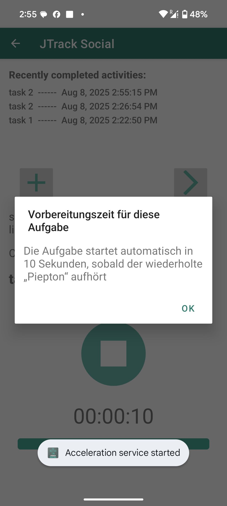

5) Start and Stop the Task
^^^^^^^^^^^^^^^^^^^^^^^^^^

- Press the **Play** button to start. The timer and progress bar will run.
- Press the **Stop** button to end the task.
- When finished, the task appears under **Recently completed activities** with a timestamp.

Notes and Tips
~~~~~~~~~~~~~~

- Notifications such as **Main service started** or **Acceleration service started** confirm that background sensors are running.
- If you enabled **Record Audio**, Android may show a temporary green microphone indicator while recording.
- If you entered a fixed duration, the task ends automatically when the timer completes.
- To repeat a task, either use **>** to load the next task or tap **+** to choose the activity again.

UI Troubleshooting
~~~~~~~~~~~~~~~~~~

- **Cannot find the + button**: Scroll slightly if the Play button covers screen elements on small displays.
- **No suggestions appear**: Type the full name or create the activity once so future entries can suggest it.
- **Audio toggle missing**: Your study may not require audio. Follow only the options shown in your app.

.. _social-troubleshooting-android:

Troubleshooting
---------------

If enrollment or collection is incomplete:

- Check internet connectivity and camera permission, and ask the study team
  to verify the QR code if scanning does not complete enrollment.
- Review the :ref:`Android permissions <social-permissions-android>` and
  background settings if expected sensor data is missing.
- If tasks do not start, ask the study team to check that Active Labeling is
  enabled and the task list has downloaded. Check the requested activity and
  microphone permissions on the phone.
- Follow :doc:`Troubleshooting <Troubleshooting>` before sending a support
  request. Do not uninstall unless the study team asks you to do so.

.. _jtrack-social-ios:

iOS
+++

Install & Join the Study
------------------------

1. Open `JTrack Social in the App Store <https://apps.apple.com/de/app/jtrack-social/id1645319896>`__.
2. Install **JTrack Social** on your iPhone.

   .. image:: _static/Social_iOS_AppStore.png
      :width: 300px
      :align: center
      :alt: JTrack Social listing in the iOS App Store

3. Open **JTrack Social** and tap **Join study**.

   .. image:: _static/Social_iOS_Notify.png
      :width: 300px
      :align: center
      :alt: iOS JTrack Social enrollment screen and notification prompt

4. Allow **Camera** access when prompted so the app can scan your study QR code.

   .. image:: _static/Social_iOS_Camera.png
      :width: 300px
      :align: center
      :alt: iOS camera permission prompt for study QR-code scanning

5. Scan the **QR code** provided by your study team.

   .. image:: _static/Social_iOS_Enrolled.png
      :width: 300px
      :align: center
      :alt: iOS Enrollment successful confirmation with the Okay button

6. Complete the :ref:`iOS permissions <social-permissions-ios>` requested
   for your study, then check the enrollment result below.

.. tip::

   **Enroll without scanning a QR code:** press and hold the enrollment
   button (**Join study** / **Enroll to study**) for several seconds to open
   manual entry. Enter the **Subject ID / username** provided by your study
   team and follow the prompts to complete enrollment.

Check Enrollment
~~~~~~~~~~~~~~~~

After successful enrollment by QR code or manual entry, the app displays
**Enrollment successful**. Tap **Okay** and complete any remaining study permission prompts.
If this message does not appear, check your internet connection and camera
permission, and ask the study team to verify the QR code.

Enrollment and data transfer are separate checks. Follow
:ref:`background collection guidance <compliance-social>` and ask the study
team to check received data in :ref:`JDash Compliance Monitoring
<jdash-compliance-monitoring>` if collection appears incomplete.

.. _social-permissions-ios:

Permissions
-----------

Allow the permissions requested for the sensors enabled in your
:ref:`study configuration <jdash-studies>`. Follow only the prompts relevant
to your study. The :ref:`Application Permissions <application-permissions>`
reference explains each permission's purpose.

Activity and Bluetooth
~~~~~~~~~~~~~~~~~~~~~~

Allow the requested motion/activity access for activity measurements. If your
study uses a wearable, allow Bluetooth access so the phone can communicate
with it.

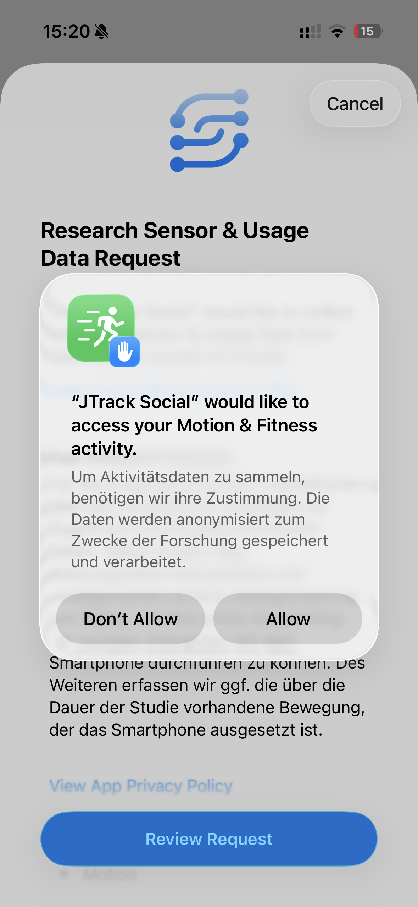

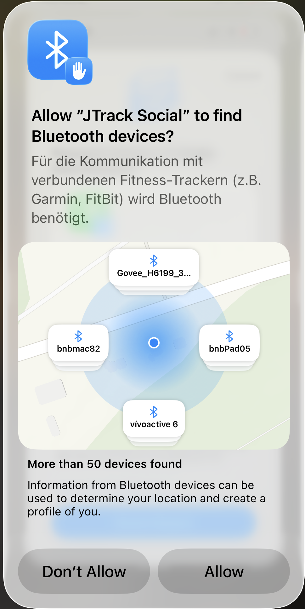

SensorKit Authorization
~~~~~~~~~~~~~~~~~~~~~~~

If the study requests SensorKit access, complete the research-data request:

1. Read **Research Sensor & Usage Data Request**, including the research
   purpose, and tap **Review Request**.

   .. image:: _static/Social_iOS_Sensorkit1.png
      :width: 300px
      :align: center
      :alt: Research Sensor and Usage Data Request with the Review Request button

2. Review the requested data category and its explanation. The example shows
   **Motion**. Tap **Allow Collection & Sharing** to authorize it for the study.

   .. image:: _static/Social_iOS_Sensorkit2.png
      :width: 300px
      :align: center
      :alt: Motion research-data explanation with Allow Collection and Sharing

3. On **Authorisation Review**, confirm that the requested category appears
   in the access list, then tap **Done**. The example lists **Motion** under
   the access granted to JTrack Social.

   .. image:: _static/Social_iOS_Sensorkit3.png
      :width: 300px
      :align: center
      :alt: Authorisation Review showing Motion access granted and the Done button

.. note::

   The requested categories and wording depend on the study and iOS version.
   Follow the prompts on your device. If you cancel or deny a permission,
   tell the study team so they can help check the required setup. Android's
   Usage access and battery-optimization settings do not apply to iOS.

.. _active-labeling-ios:

Active Labeling
---------------

On iOS, Active Labeling is available from the main view when enabled in the
:ref:`study configuration <active-tracking>`. The shared
:ref:`Active Labeling overview <social-active-labeling>` describes the recorded
data and upload behavior.

Participant Flow
~~~~~~~~~~~~~~~~

Participants can:

1. Select a predefined task using autocomplete or enter one manually.
2. Review the task instructions.
3. Adjust the duration if needed.
4. Start the task.
5. Wait through the short countdown before data recording begins.
6. Perform the task while the selected sensors run in the background.
7. Let the task stop automatically or stop it manually.

The app logs:

- Task name
- Timestamp
- Duration
- Sensor data during the session

Troubleshooting
---------------

If enrollment or collection is incomplete:

- Check the QR code, internet connection, and camera permission if enrollment
  does not complete.
- Review the :ref:`iOS permissions <social-permissions-ios>` if a requested
  sensor is unavailable or SensorKit authorization was not completed.
- If a task does not start, ask the study team to check that Active Labeling
  is enabled in the :ref:`study configuration <active-tracking>` and the task
  list has downloaded. Check required motion and microphone permissions.
- Follow :ref:`background collection guidance <compliance-social>` and
  :doc:`Troubleshooting <Troubleshooting>` before reporting an issue.

.. _social-admin-tools:

Administrator Tools
-------------------

Use these protected iOS tools to verify a participant device without changing
the study protocol.

The iOS administration area currently includes:

* **Sensor debugging:** select a sensor independently of its enabled state and inspect live hardware values or historical data from the last 72 hours.
* **Plotting:** display incoming or stored values in an on-device graph and report explicitly when a sensor is unavailable or no historical data exists.
* **Active Labeling preview:** inspect task selection, instructions, preparation countdown, timer, audio option, and start/stop behavior without requiring the normal study schedule.
* **Sensor-state reporting:** send the effective local enabled/disabled flags to the server. This normally requires Wi-Fi; an administrator can approve a one-time cellular exception.
* **Wearable diagnostics:** when Garmin or Fitbit is enabled, inspect pairing, synchronization, local data, upload state, and diagnostic logs through the corresponding dashboard.

.. warning::
   Administration and debugging controls are intended for trained study staff. Running tests or changing device configuration can temporarily affect normal participant workflows.

Technical Notes
+++++++++++++++

Platform Implementation
-----------------------

The Android and iOS apps use the same study enrollment, sensor configuration, active-labeling, local-storage, and server-upload concepts. Platform APIs differ, but the participant workflow and resulting JTrack data model are kept as comparable as possible.

On iOS, JTrack Social currently:

* records only the phone sensors enabled by the downloaded :ref:`study configuration <jdash-studies>`;
* uses Core Motion for activity, pedometer, and active-labeling motion data;
* uses SensorKit for supported historical data such as app usage and lock/unlock information;
* supports location, Apple Health, audio during configured active-labeling tasks, and Garmin/Fitbit wearables when enabled;
* stores data locally until it can be uploaded securely; and
* stops new recording when the configured :ref:`study duration <jdash-studies>` ends, while allowing delayed SensorKit batches to be retrieved for up to 48 hours.

As on Android, not every module is available or enabled in every study. iOS permissions and background scheduling are controlled by the operating system and may therefore differ slightly from Android.

Active Labeling Records
-----------------------

Each Active Labeling session results in:

- A ``labeling event`` with ``taskname``, ``startTimestamp``, ``endTimestamp``, and ``duration``
- Sensor data, such as accelerometer and gyroscope samples, tagged with the task name
- An optional audio file that can be zipped and uploaded
- A corresponding database entry such as ``ActiveLabelingSensor``, ``ActiveLabelingSession``, or ``ActiveLabelingTasks``

.. important::
   The task name is included as a label in every recorded sensor sample. This supports supervised learning and later analysis.

Upload Conditions
-----------------

After the task finishes:

- Sensor data is saved locally.
- If the device is online and the server is reachable, the data is uploaded to the study backend.
- If audio recording is enabled, the audio file is zipped and transmitted as part of the upload.
- After successful upload, local files are deleted to save space.

.. note::
   Data is only uploaded if ``JTrack_serverOnline`` and ``JTrack_connected`` are both ``true``.

.. _sensor-comparison:

Sensor Data in Comparison between Android & iOS
+++++++++++++++++++++++++++++++++++++++++++++++

The overview above explains the sensor modules in plain language. The comparison below is intended for more technical readers who need platform-specific units, resolutions, and implementation details.

Example server records and export concepts are documented under :doc:`Data Storage <developers>`.

.. list-table:: Platform comparison
   :header-rows: 1
   :widths: 14 17 17 18 18 28

   * - Sensor
     - Unit (iOS)
     - Unit (Android)
     - Resolution (iOS)
     - Resolution (Android)
     - Notes
   * - Accelerometer
     - ``x, y, z`` in m/s²
     - ``x, y, z`` in m/s²
     - Up to 100 Hz
     - Up to 100 Hz
     - Active Labeling only; high sampling rates increase battery use and data volume.
   * - Gyroscope
     - ``x, y, z`` rotation rate
     - ``x, y, z`` rotation rate
     - Up to 100 Hz
     - Up to 100 Hz
     - Active Labeling only; records rotation and orientation changes.
   * - Activity recognition
     - Numeric activity code
     - Numeric activity code
     - On state changes, with iOS-side filtering
     - On state changes, as provided by Android
     - Platform support for individual activity states differs.
   * - Application usage
     - Foreground duration in seconds
     - Foreground duration in milliseconds
     - SensorKit intervals, typically 15 minutes
     - Dynamic intervals beginning at midnight
     - iOS may provide categories for third-party apps; Android provides app names and categories.
   * - Lock/unlock
     - Counts and time in each state
     - Individual lock or unlock events
     - SensorKit intervals, typically 15 minutes
     - Live events
     - The resulting records differ because the operating systems expose different APIs.
   * - Pedometer
     - Steps per interval
     - Steps per interval
     - Dynamic
     - Dynamic
     - Historical availability depends on the operating system and permission state.

Garmin Pairing & Sync
+++++++++++++++++++++

If your :ref:`study uses a Garmin wearable <jdash-studies>`, pairing and syncing are handled directly inside **JTrack Social**.
For participants, the main steps are:

1. Charge the Garmin device and turn it on.
2. Enable **Bluetooth** on your phone.
3. Open the Garmin pairing flow inside **JTrack Social** and follow the on-screen prompts.
4. Wait for the first sync to finish before starting normal study participation.
5. Keep the watch worn, charged, and within Bluetooth range of the phone.

.. tip::
   If syncing seems delayed, first check that Bluetooth is enabled, the watch battery is not low, and JTrack Social is allowed to run in the background on the phone.

Detailed Garmin Guide
---------------------

For full Garmin setup, pairing, dashboard configuration, syncing, and troubleshooting steps, see :doc:`Garmin Integration <Garmin_Integration>`.

