=====================
JTrack Social
=====================

JTrack Social is available for **Android** and **iOS**:

- In the `Google Play Store <https://play.google.com/store/apps/details?id=inm7.JTrack.JTrack_Social>`__
- In `Apple's App Store <https://apps.apple.com/de/app/jtrack-social/id1645319896>`__

Prerequisites
+++++++++++++

.. list-table:: Minimum operating-system requirements
   :header-rows: 1
   :widths: 50 50

   * - Android
     - iOS
   * - Android 14 or later
     - iOS 16 or later

.. note::

   JTrack Social 2.47 was the last version supporting iOS 15. For a new
   installation, use a phone meeting the current minimum requirements above.

- Your study coordinator has provided you with a **QR code** to join the study.
- A stable internet connection is required during the initial setup.

For settings that improve background collection and participant compliance,
see :ref:`Compliance Optimization for JTrack Social <compliance-social>`.

.. container:: quick-box plain

   **Set up your phone:**

   - :ref:`Android installation and setup <jtrack-social-android>`
   - :ref:`iOS installation and setup <jtrack-social-ios>`

.. _social-sensors:

What JTrack Social records
++++++++++++++++++++++++++

The exact data collected depends on the :ref:`study configuration <jdash-studies>`.
Records use pseudonymous study identifiers. Sensor availability differs between
platforms; see the :ref:`Android and iOS comparison <sensor-comparison>`.
Common JTrack Social modules record the following types of information:

.. note::
   Not every study enables every module. JTrack Social only records the sensors and permissions :ref:`configured <create-study>` for that study.

Location
--------

- Relative location coordinates and timestamps. When configured, location
  coordinates are transformed on the device before storage; these remain
  study records associated with pseudonymous identifiers.
- These data can be used to estimate mobility patterns such as time spent at places, distance covered, and changes in daily routines.

Application Usage
-----------------

- The app name or app category, together with timestamps and foreground usage duration.
- This is used to measure general usage patterns, not the content inside apps.

Activity Recognition
--------------------

- Motion-state labels reported by the phone, such as walking, running, still, cycling, or being in a vehicle, depending on device support.
- The app records the recognized state and when it changed.

Accelerometer
-------------

- Raw movement values on the x, y, and z axes.
- On iOS and Android, raw accelerometer recording is restricted to configured **Active Labeling** tasks; passive accelerometer monitoring is not supported.
- The apps use the most suitable platform background API available so a running task can continue when the participant briefly opens another app.

Gyroscope
---------

- Raw rotation-rate values on the x, y, and z axes.
- Raw gyroscope recording is restricted to configured **Active Labeling** tasks and is not used for passive monitoring.

Pedometer
---------

- Step counts over time.
- This can be used to summarize walking activity or daily movement volume.

Lock and Unlock Events
----------------------

- Screen lock and unlock events, and on some devices the time spent in each state.
- These events help describe phone availability and interaction patterns.

Audio
-----

- If the study enables audio capture, the app can record microphone input during defined periods or active-labeling tasks.
- Audio collection is study-specific and should always be described in the study consent materials.

.. _social-permissions:

Sensor Permissions
------------------

Permissions depend on the configured sensors and the phone platform.
Follow the :ref:`Android permission instructions <social-permissions-android>`
or :ref:`iOS permission instructions <social-permissions-ios>`. The shared
:ref:`Application Permissions <application-permissions>` reference explains
what each permission is used for.

.. _social-active-labeling:

Active Labeling
---------------

Active Labeling records sensor data while participants perform a named task,
such as walking or brushing teeth. The recording includes the task name,
time, duration, and the sensors enabled for that task. Audio is included only
when configured in the study. Data is stored on the phone until it can be
uploaded to the study server.

Follow the :ref:`Android task instructions <active-labeling-android>` or
:ref:`iOS task instructions <active-labeling-ios>`. Researchers configure tasks
and preparation instructions in :ref:`JDash Active Tracking <active-tracking>`.
Use clear task names and follow the study team's duration and preparation
instructions consistently.

.. _jtrack-social-android:

Android
+++++++

Install & Join the Study
------------------------

1. Install the App
~~~~~~~~~~~~~~~~~~

1. Open `JTrack Social on Google Play <https://play.google.com/store/apps/details?id=inm7.JTrack.JTrack_Social>`__.
2. Install **JTrack Social** from its store page.

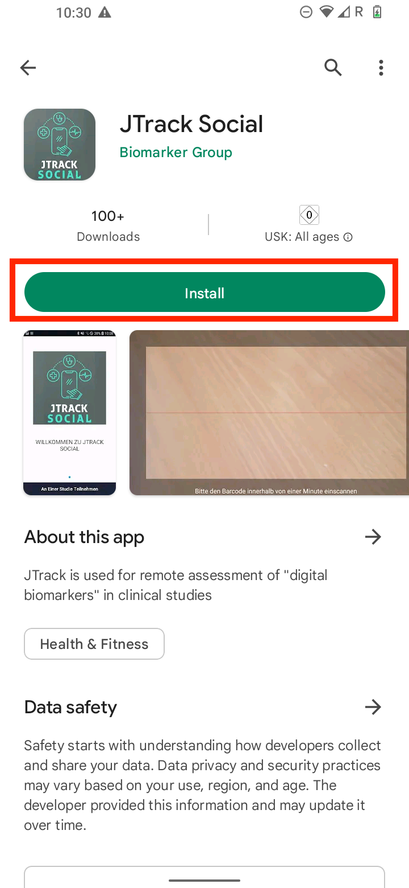

2. Join the Study
~~~~~~~~~~~~~~~~~

1. Open **JTrack Social** and tap **Join study**.

   .. image:: image/Social/social_2.png
      :width: 300px
      :align: center
      :alt: Android welcome screen with the Join study control highlighted

2. When prompted, allow **Camera** access so the app can scan your study QR code.

   .. image:: image/Social/social_3.png
      :width: 100%
      :align: center
      :alt: Android camera permission prompt used during QR-code enrollment

3. Use your device camera to scan the **QR code** provided by your study team.

.. tip::

   **Enroll without scanning a QR code:** press and hold the enrollment
   button (**Join study** / **Enroll to study**) for several seconds to open
   manual entry. Enter the **Subject ID / username** provided by your study
   team and follow the prompts to complete enrollment.

.. important::
   For study setup and QR-code generation, see :ref:`Studies in JDash <jdash-studies>`.

Check Enrollment
~~~~~~~~~~~~~~~~

After enrolling by QR code or manual entry, check that the app opens its main screen
and lets you continue through the requested settings rather than returning
to the welcome/enrollment screen. The screenshot under **Background Settings** shows the main app
behind the battery-settings prompt. Complete the permissions below
and confirm that battery use is **Unrestricted**.

If you remain on the welcome screen or setup cannot be completed, follow the
:ref:`Android troubleshooting steps <social-troubleshooting-android>`. The
study team can verify that data is arriving in
:ref:`JDash Compliance Monitoring <jdash-compliance-monitoring>`.

.. _social-permissions-android:

Permissions
-----------

Only sensors enabled in the :ref:`study configuration <jdash-studies>`
request access. The following screenshots and settings apply to Android.
For the shared permission reference, see
:ref:`Application Permissions <application-permissions>`.

Background Settings
~~~~~~~~~~~~~~~~~~~

After enrollment, the app may prompt you to adjust Android system settings so background data collection can run reliably.

1. Tap the in-app button to open the **App settings** screen.

   .. image:: image/Social/social_4.png
      :width: 300px
      :align: center
      :alt: Android main app behind a prompt to open battery settings

2. **Disable** **Remove permission and free up space**.

   .. image:: image/Social/social_6.png
      :width: 300px
      :align: center
      :alt: Android app settings showing Remove permission and free up space

3. Open **Battery optimization** and set JTrack Social to **Unrestricted**.

   .. image:: image/Social/social_5.png
      :width: 300px
      :align: center
      :alt: Android battery optimization settings for JTrack Social

4. Confirm **Unrestricted** is selected so Android does not limit the app.

   .. image:: image/Social/social_7.png
      :width: 300px
      :align: center
      :alt: Android battery setting with Unrestricted selected

.. tip::
   These settings help prevent Android from stopping the app in the background, which can interrupt data collection.

Audio Sensor
~~~~~~~~~~~~

- Allows the app to record microphone input when audio collection is enabled in the study.
- On some devices, the app may also request storage or media access so recordings can be saved locally before upload.

1. Allow **Microphone** access.

   .. image:: image/Social/social_8.png
      :width: 300px
      :align: center
      :alt: Android microphone permission prompt

2. If requested, allow **File/Storage** access so recordings can be saved.

   .. image:: image/Social/social_9.png
      :width: 300px
      :align: center
      :alt: Android file and storage permission prompt

Location Sensor
~~~~~~~~~~~~~~~

- Enables location capture based on the :ref:`study configuration <jdash-studies>`.
- For how location is represented in study records, see
  :ref:`What JTrack Social records <social-sensors>`.

Allow the location permission when prompted.

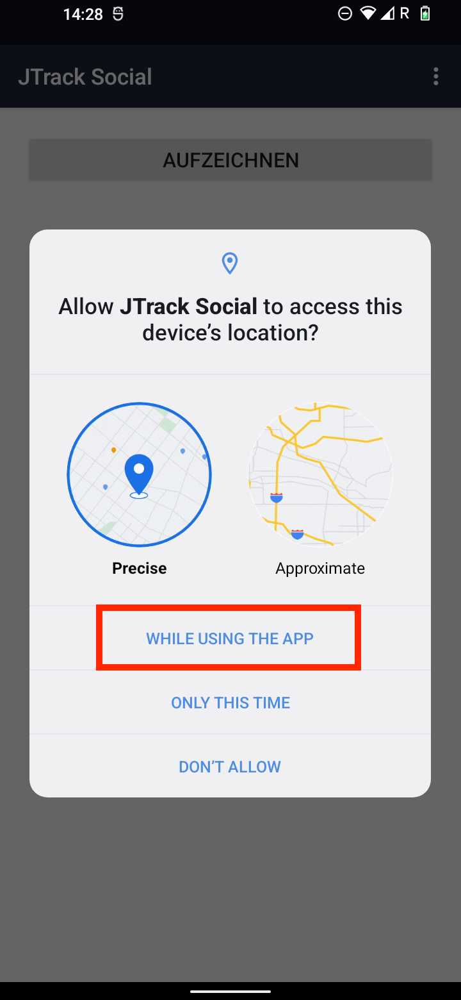

Application Usage Sensor
~~~~~~~~~~~~~~~~~~~~~~~~

- Collects app usage statistics, such as which apps are used and for how long.
- On Android, this usually requires enabling **Usage access** manually.

To enable it on Android:

1. Open **Usage access** settings.
2. Select **JTrack Social**.
3. Enable the permission.

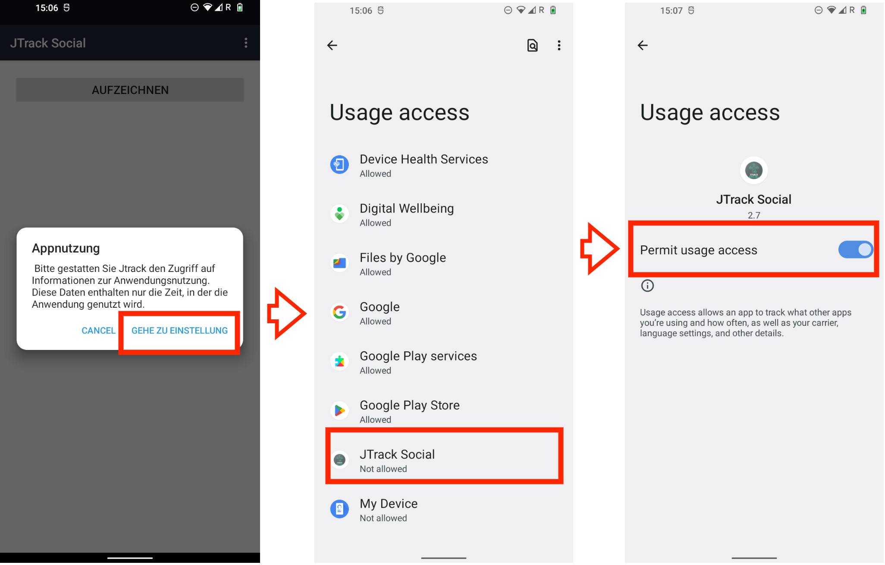

.. note::
   This module does **not** collect message contents, typed text, or other in-app content. It records general usage patterns only.

Activity Recognition Sensor
~~~~~~~~~~~~~~~~~~~~~~~~~~~

- Detects basic physical activity states such as walking, running, or stillness.
- Depending on the phone, the permission may appear as **Activity recognition** or another motion-related system prompt.

Allow **Activity recognition** when prompted.

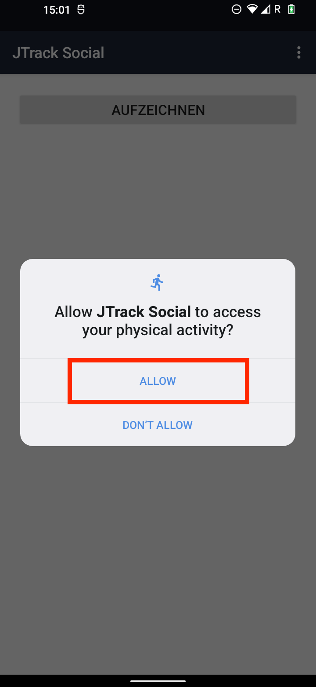

.. _active-labeling-android:

Active Labeling
---------------

The screenshots below show the Android task interface. For the shared
recording model and upload behavior, see
:ref:`Active Labeling overview <social-active-labeling>`.

Use *Active Labeling* to mark what you are doing in real time. This helps the study link sensor data with the correct activity.

Overview
~~~~~~~~

- The home screen shows **Recently completed activities** and the large **Play/Stop** control.
- Use **+** to pick or create an activity, or **>** to load the next scheduled one.
- Some tasks display a short instruction and a preparation countdown before starting.

Step-by-Step
~~~~~~~~~~~~

1) Open the Activity Screen
^^^^^^^^^^^^^^^^^^^^^^^^^^^

You will see your recent tasks and the main control.

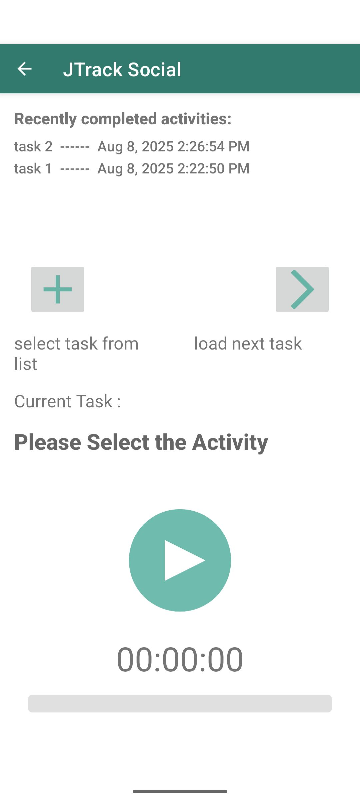

2) Add or Select an Activity
^^^^^^^^^^^^^^^^^^^^^^^^^^^^

Tap the **+** button to add or select a task. In the **New Activity** dialog:

- **Enter activity**: type the activity name, for example *task 1*
- **Duration in seconds (optional)**: set a fixed length if your study requires it, otherwise leave it empty
- **Record Audio**: enable this only if your study instructs you to capture audio

Tap **Add**.

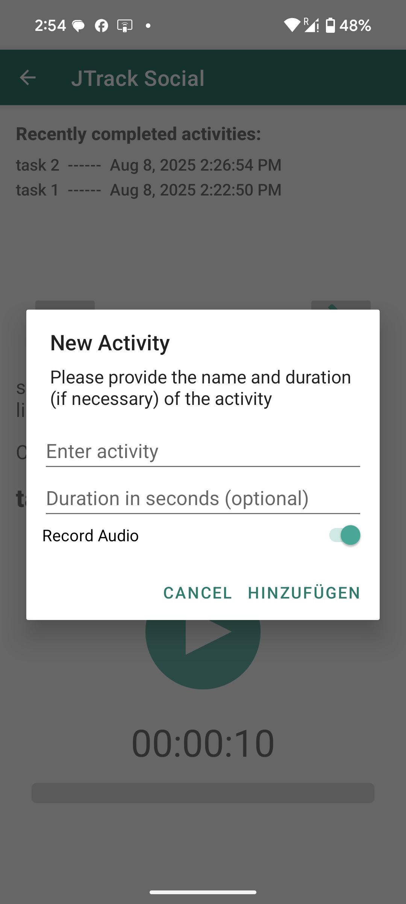

As you type, suggestions may appear. Tap one to select it.

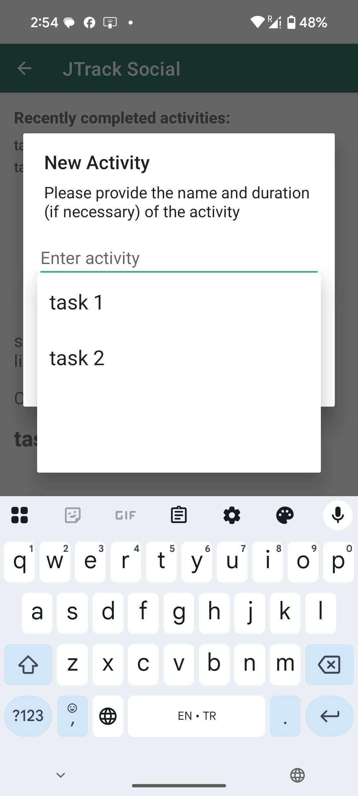

3) Read the Task Instruction
^^^^^^^^^^^^^^^^^^^^^^^^^^^^

Some studies display a brief instruction popup for the selected task. Tap **OK** to continue.

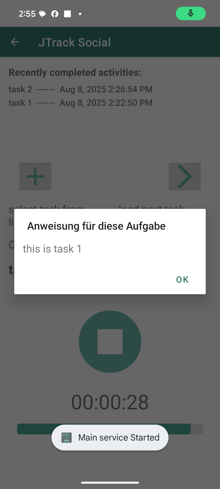

4) Wait for the Preparation Countdown
^^^^^^^^^^^^^^^^^^^^^^^^^^^^^^^^^^^^^

If your :ref:`study uses a preparation phase <jdash-studies>`, you will see a countdown. The task starts automatically when the countdown, and any beeps, finish.

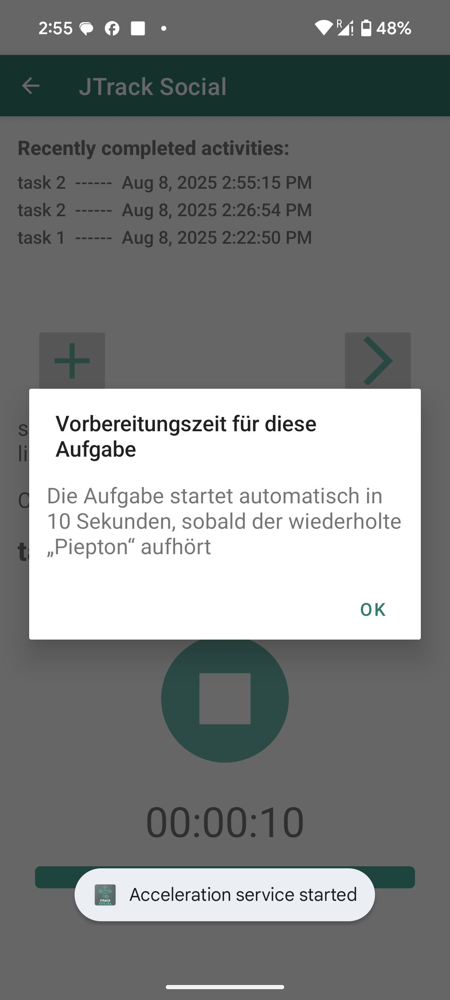

5) Start and Stop the Task
^^^^^^^^^^^^^^^^^^^^^^^^^^

- Press the **Play** button to start. The timer and progress bar will run.
- Press the **Stop** button to end the task.
- When finished, the task appears under **Recently completed activities** with a timestamp.

Notes and Tips
~~~~~~~~~~~~~~

- Notifications such as **Main service started** or **Acceleration service started** confirm that background sensors are running.
- If you enabled **Record Audio**, Android may show a temporary green microphone indicator while recording.
- If you entered a fixed duration, the task ends automatically when the timer completes.
- To repeat a task, either use **>** to load the next task or tap **+** to choose the activity again.

UI Troubleshooting
~~~~~~~~~~~~~~~~~~

- **Cannot find the + button**: Scroll slightly if the Play button covers screen elements on small displays.
- **No suggestions appear**: Type the full name or create the activity once so future entries can suggest it.
- **Audio toggle missing**: Your study may not require audio. Follow only the options shown in your app.

.. _social-troubleshooting-android:

Troubleshooting
---------------

If enrollment or collection is incomplete:

- Check internet connectivity and camera permission, and ask the study team
  to verify the QR code if scanning does not complete enrollment.
- Review the :ref:`Android permissions <social-permissions-android>` and
  background settings if expected sensor data is missing.
- If tasks do not start, ask the study team to check that Active Labeling is
  enabled and the task list has downloaded. Check the requested activity and
  microphone permissions on the phone.
- Follow :doc:`Troubleshooting <Troubleshooting>` before sending a support
  request. Do not uninstall unless the study team asks you to do so.

.. _jtrack-social-ios:

iOS
+++

Install & Join the Study
------------------------

1. Open `JTrack Social in the App Store <https://apps.apple.com/de/app/jtrack-social/id1645319896>`__.
2. Install **JTrack Social** on your iPhone.

   .. image:: _static/Social_iOS_AppStore.png
      :width: 300px
      :align: center
      :alt: JTrack Social listing in the iOS App Store

3. Open **JTrack Social** and tap **Join study**.

   .. image:: _static/Social_iOS_Notify.png
      :width: 300px
      :align: center
      :alt: iOS JTrack Social enrollment screen and notification prompt

4. Allow **Camera** access when prompted so the app can scan your study QR code.

   .. image:: _static/Social_iOS_Camera.png
      :width: 300px
      :align: center
      :alt: iOS camera permission prompt for study QR-code scanning

5. Scan the **QR code** provided by your study team.

   .. image:: _static/Social_iOS_Enrolled.png
      :width: 300px
      :align: center
      :alt: iOS Enrollment successful confirmation with the Okay button

6. Complete the :ref:`iOS permissions <social-permissions-ios>` requested
   for your study, then check the enrollment result below.

.. tip::

   **Enroll without scanning a QR code:** press and hold the enrollment
   button (**Join study** / **Enroll to study**) for several seconds to open
   manual entry. Enter the **Subject ID / username** provided by your study
   team and follow the prompts to complete enrollment.

Check Enrollment
~~~~~~~~~~~~~~~~

After successful enrollment by QR code or manual entry, the app displays
**Enrollment successful**. Tap **Okay** and complete any remaining study permission prompts.
If this message does not appear, check your internet connection and camera
permission, and ask the study team to verify the QR code.

Enrollment and data transfer are separate checks. Follow
:ref:`background collection guidance <compliance-social>` and ask the study
team to check received data in :ref:`JDash Compliance Monitoring
<jdash-compliance-monitoring>` if collection appears incomplete.

.. _social-permissions-ios:

Permissions
-----------

Allow the permissions requested for the sensors enabled in your
:ref:`study configuration <jdash-studies>`. Follow only the prompts relevant
to your study. The :ref:`Application Permissions <application-permissions>`
reference explains each permission's purpose.

.. _social-permission-check-ios:

Permission Check
~~~~~~~~~~~~~~~~

Open the main menu and choose **Check Permissions** to review the permissions
expected for your study. If a required permission is missing, follow the app's
instructions to open iOS Settings and grant it, then return and check again.
This checks authorization; use the :ref:`debugger <social-debugging-ios>` to
check whether sensor data is actually available.

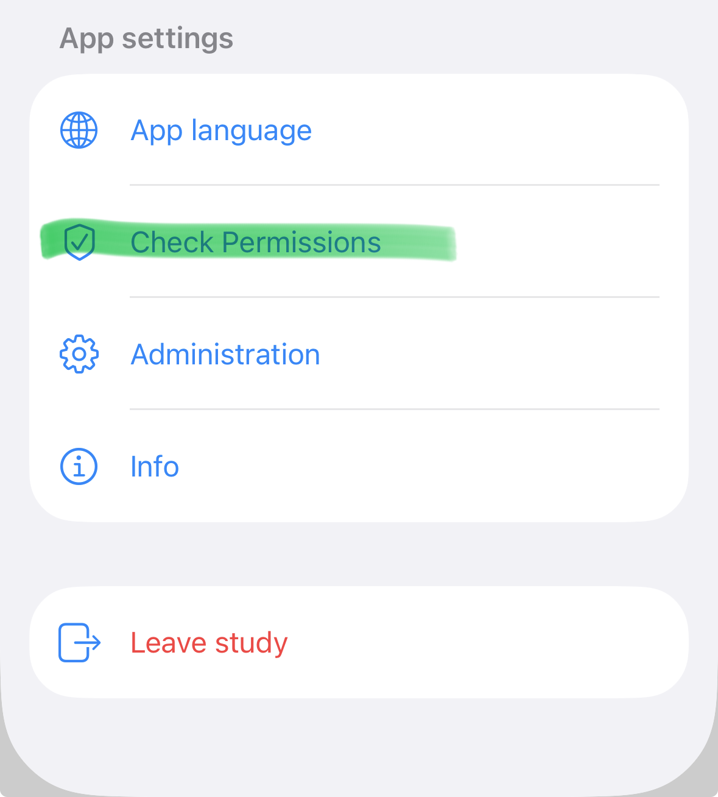

The result distinguishes granted permissions from those **not yet requested**.
For example, **All permissions granted** can appear alongside **Not yet
requested: Microphone**. This does not mean microphone access was denied or
that every possible sensor has been authorized; interpret it against the
study's requested sensors.

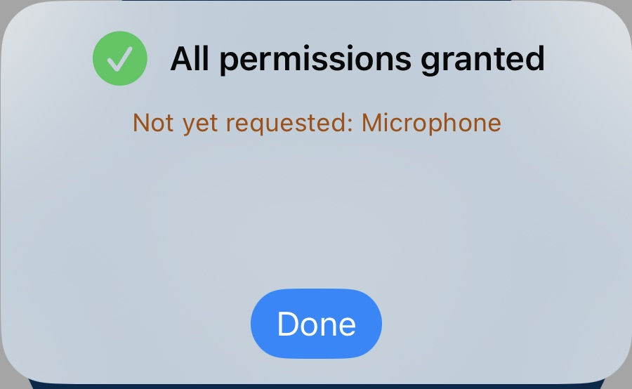

Activity and Bluetooth
~~~~~~~~~~~~~~~~~~~~~~~

Allow the requested motion/activity access for activity measurements. If your
study uses a wearable, allow Bluetooth access so the phone can communicate
with it.

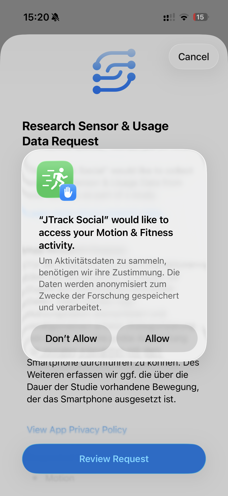

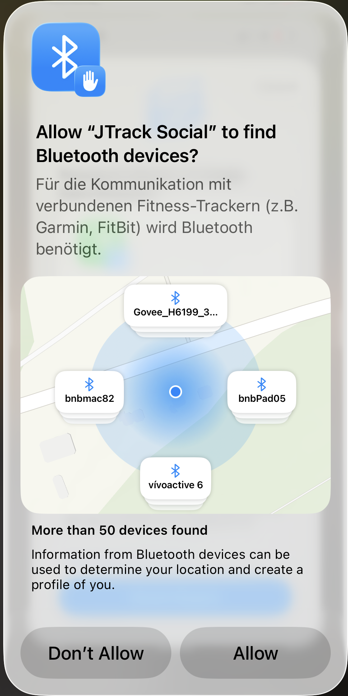

SensorKit Authorization
~~~~~~~~~~~~~~~~~~~~~~~~

If the study requests SensorKit access, complete the research-data request:

1. Read **Research Sensor & Usage Data Request**, including the research
   purpose, and tap **Review Request**.

   .. image:: _static/Social_iOS_Sensorkit1.png
      :width: 300px
      :align: center
      :alt: Research Sensor and Usage Data Request with the Review Request button

2. Review the requested data category and its explanation. The example shows
   **Motion**. Tap **Allow Collection & Sharing** to authorize it for the study.

   .. image:: _static/Social_iOS_Sensorkit2.png
      :width: 300px
      :align: center
      :alt: Motion research-data explanation with Allow Collection and Sharing

3. On **Authorisation Review**, confirm that the requested category appears
   in the access list, then tap **Done**. The example lists **Motion** under
   the access granted to JTrack Social.

   .. image:: _static/Social_iOS_Sensorkit3.png
      :width: 300px
      :align: center
      :alt: Authorisation Review showing Motion access granted and the Done button

.. note::

   The requested categories and wording depend on the study and iOS version.
   Follow the prompts on your device. If you cancel or deny a permission,
   tell the study team so they can help check the required setup. Android's
   Usage access and battery-optimization settings do not apply to iOS.

.. _social-status-mobile-data:

Status Reports via Mobile Data
~~~~~~~~~~~~~~~~~~~~~~~~~~~~~~

JTrack Social sends :ref:`weekly technical status reports
<social-weekly-status-report>` to help the study team check enabled sensors,
permissions, and pending data. If the phone rarely connects to Wi-Fi, you can
choose **Enable** in the mobile-data prompt so these reports can still be sent.
Choose **Cancel** to leave reports waiting for Wi-Fi.

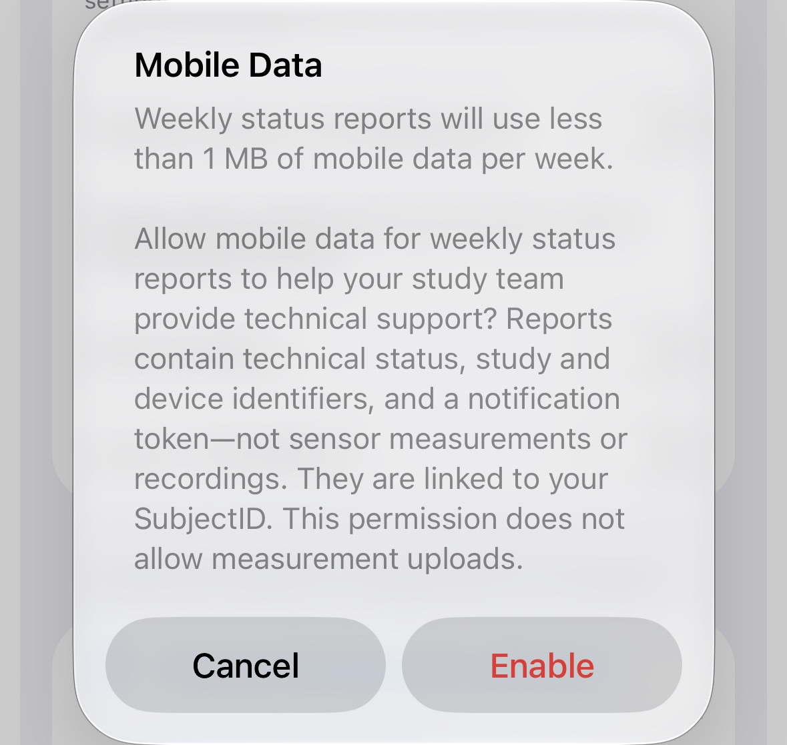

The prompt estimates **less than 1 MB per week** for status reports. These
reports are linked to the Subject ID and include technical status, study and
device identifiers, and a notification token when available. They contain no
sensor measurements or recordings. This choice does **not** authorize
measurement uploads over mobile data. You can review the choice under
**Administration → General → Weekly status via mobile data**.

For the report contents and sending schedule, see
:ref:`Weekly technical status report <social-weekly-status-report>`.

.. _active-labeling-ios:

Active Labeling
---------------

On iOS, Active Labeling is available from the main view when enabled in the
:ref:`study configuration <active-tracking>`. The shared
:ref:`Active Labeling overview <social-active-labeling>` describes the recorded
data and upload behavior.

Participant Flow
~~~~~~~~~~~~~~~~

Participants can:

1. Select a predefined task using autocomplete or enter one manually.
2. Review the task instructions.
3. Adjust the duration if needed.
4. Start the task.
5. Wait through the short countdown before data recording begins.
6. Perform the task while the selected sensors run in the background.
7. Let the task stop automatically or stop it manually.

The app logs:

- Task name
- Timestamp
- Duration
- Sensor data during the session

.. _social-data-collection-ios:

Data collection and transfer on iOS
------------------------------------

JTrack Social distinguishes between collecting measurements, storing them on
the phone, and sending them to the study server. Data can therefore be present
on the phone even when no recent upload is visible on the server. Collection
depends on the study configuration, the required permissions, the availability
of the data source, and the execution time provided by iOS.

Passive collection and automatic uploads
~~~~~~~~~~~~~~~~~~~~~~~~~~~~~~~~~~~~~~~~~

Passive sensors collect or retrieve data without starting an active-labeling
session. Only sensors enabled for the study are used. Depending on the sensor,
data arrive through callbacks or are fetched during foreground or background
execution. Wearable synchronization is a separate step: retrieving data from
a Garmin device onto the phone does not itself upload those data to the server.

The upload policy distinguishes between high-frequency measurements and other
passive data:

* High-frequency streams configured in Hz use batches of up to **2,500 data
  points**. A final batch can contain fewer points when pending data are drained,
  for example during an explicit upload.
* Other passive streams become eligible for automatic upload when **1,000 data
  points** are pending, or when no successful upload for that stream has occurred
  on the current local calendar day, whichever condition is met first.
  Upload requests contain up to **1,000 data points**, with a smaller final batch
  if necessary.
* A stream with no previous successful upload can send a smaller initial batch.
  Empty streams do not generate measurement uploads.

The daily check is an upload-scheduling rule, not a requirement that each file
contains exactly one day's measurements. A backlog may span several measurement
days and require multiple requests. Eligibility is evaluated separately for
the relevant sensor or wearable stream; a low-volume stream should not have to
wait for another stream to accumulate enough measurements.

.. important::

   Automatic uploads are attempted when the app has an execution opportunity
   and an allowed network connection. iOS controls background execution, so
   JTrack cannot guarantee an upload every day or at a fixed time. An unavailable
   network, an unreachable server, or insufficient background execution time
   can postpone sending. Pending data remain available for a later attempt.

Manual synchronization can send pending data without waiting for the normal
automatic-upload threshold. Upload batch sizes describe the number of stored
records, not the sampling frequency, file size, or duration of the recording.
Audio recordings are handled as recording files rather than batches of numeric
sensor points.

Active labeling and delayed SensorKit data
~~~~~~~~~~~~~~~~~~~~~~~~~~~~~~~~~~~~~~~~~~~

Active labeling associates measurements with a defined task, time interval,
study, and subject. Only the active sensors configured for that study are used.
Direct recordings can already be stored locally before supplementary SensorKit
data become available.

For enabled accelerometer and gyroscope streams, SensorKit can supplement the
direct recordings. The Active Sensor Data view provides the session-specific
fetch workflow, normally **48 to 167 hours after the task ends**. This is the
app's fetch window, not a guarantee that SensorKit has recorded or will return
data for every session. Fetching SensorKit data and sending data to the study
server are separate operations.

The session controls have distinct purposes:

* **Load SensorKit data** retrieves available supplementary data for the session.
  Repeated fetches merge new samples without intentionally duplicating samples
  already retained or acknowledged as sent. A cooldown can temporarily disable
  another fetch.
* **Send and delete** uploads the session's pending data and removes the
  successfully transferred local measurement data. A loading indicator remains
  visible while this operation is running. A failed operation must not be
  interpreted as a completed transfer.
* **Wrap data collection** moves the session to the finished section. It does
  not itself send or delete measurements. Reopening is time-limited; in Shared
  Phone Mode it also requires that the subject has not left.

In ordinary single-subject operation, enabled upload paths can transfer pending
recordings automatically. Shared Phone Mode deliberately differs: active
recordings are retained for local review and are not automatically uploaded.
The conductor explicitly sends an individual session or uses the Shared Phone
Dashboard to send all pending data. Measurements are separated by subject and
sensor when preparing uploads, even when several subjects use the same phone.

In Shared Phone Mode, local quality-control plots can display direct and
SensorKit measurements together. These plots support review but do not certify
complete data coverage. Participant-facing operation does not expose these
quality-control plots as behavioral feedback.

Network access and local retention
~~~~~~~~~~~~~~~~~~~~~~~~~~~~~~~~~~~

Measurement uploads normally require **Wi-Fi**. Administrators can separately
allow mobile data for regular data sending and for leaving a study with its
final upload. Permission to send weekly status reports over mobile data does
**not** authorize measurement uploads over mobile data.

Records are removed from the pending upload queue only after a successful
server response. If sending fails, unacknowledged data remain pending. A lost
server response can still cause a retry of a request already received by the
server; this is not an exactly-once delivery guarantee.

Some data have additional local-history requirements. Garmin sleep and
homeBeacon history are retained locally for administrative review, with sent
state used to exclude acknowledged records from subsequent pending uploads.
Shared active-session records and their subject attribution support delayed
SensorKit retrieval across subject switches. Local retention and cleanup
therefore depend on the data type and workflow, rather than every successful
upload deleting every local record.

.. _social-weekly-status-report:

Weekly technical status report
~~~~~~~~~~~~~~~~~~~~~~~~~~~~~~~

In addition to measurements, the app sends a technical status report using the
``update_user`` endpoint. A report becomes due when no successful report has
been sent yet or when seven days have elapsed since the previous successful
report. A changed push-notification token or an explicit status update can
trigger an earlier report. A failed report does not advance its successful-send
timestamp.

The report includes:

* ``sensorStates``: the effective sensor configuration reported by the app.
* ``pendingData``: pending-data counts for the relevant enabled sensors and
  wearable streams. These describe unsent data, not all historical data retained
  on the phone. An unavailable count must not be interpreted as zero.
* ``permissionStates``: ``permissionGranted``, ``permissionUnknown``, and
  ``permissionsCheckedAt`` (Unix milliseconds). These are read-only permission
  checks; creating a report does not request new system permissions.
* ``connectedWifi``: whether the phone was using Wi-Fi when the report was
  created. This is not a server-reachability test or a network-usage history.
* Study, subject and device identifiers, app version, device model, shared-admin
  status, and the notification token when available.

.. note::

   The report contains no sensor measurements or audio recordings. However,
   it contains identifiers and is linked to study participation: it is **not
   anonymous**. It is intended to support study operation and technical support.

An enabled sensor is not necessarily authorized or delivering data. Likewise,
absence from ``permissionGranted`` does not by itself establish that a person
explicitly denied permission. Some permissions may not have been requested;
others cannot be determined through a read-only iOS API. In particular,
HealthKit does not expose the user's read-authorization decisions.

The mobile-data question for weekly reports is presented only after enrollment
and after the app's sensor-permission sequence has finished. Already-enrolled
users who have not made this choice can receive it during a later foreground
visit. Without this consent, status reports wait for Wi-Fi. Granting it permits
only the technical report to use mobile data; it does not enable sensor uploads.

The normal weekly status payload is small, typically **less than 1 MB per week**.
This is an estimate for status reporting, not a limit on measurement uploads or
a hard cap on all application network traffic.

Shared Phone Mode sends status reports separately for enrolled profiles,
including the shared administrator. Configuration and pending-data counts are
associated with the respective subject; system permissions describe the shared
phone. Each profile has its own report receipt. If background execution ends
before every due profile has been processed, remaining reports stay due for a
later opportunity.

.. _social-admin-tools:

Administrator Tools
-------------------

Open **Administration** from the iOS app menu to access the protected tools
used by study staff. Use them to check device settings, investigate missing
recordings, and report the phone's sensor state to the server.

.. note::

   The administrator access code is provided to study investigators on request.
   Contact :ref:`our team <contact-us>` to request it.

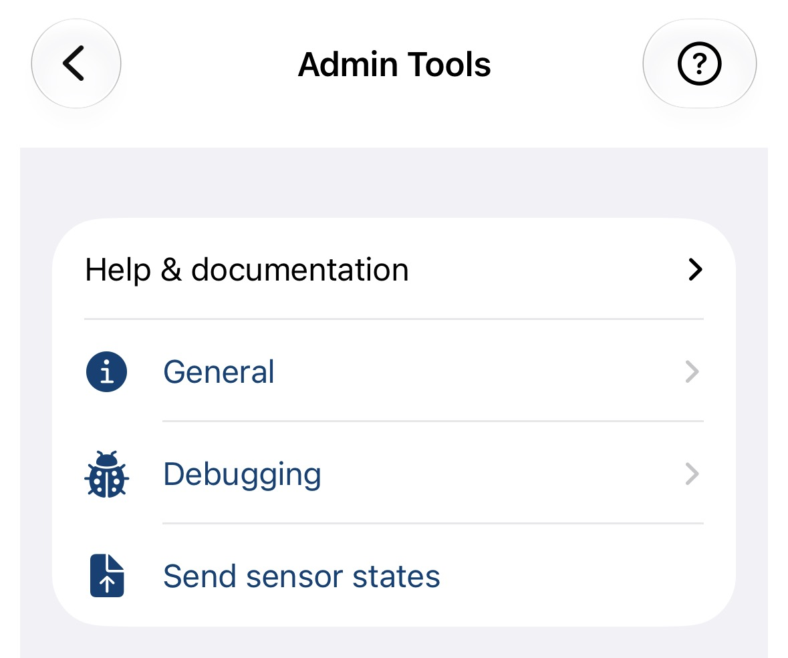

- **Help & documentation:** open the documentation from the Admin Tools menu.
- **General:** inspect the enrolled user and device, recording frequency,
  upload settings, and enabled sensor services.
- **Debugging:** inspect live hardware readings or available historical sensor
  data and plots. Historical checks can cover the last 72 hours; the app
  reports when a sensor or its data is unavailable.
- **Send sensor states:** report the effective local sensor enabled/disabled
  flags to the server. This normally uses Wi-Fi; an administrator can approve
  a one-time cellular exception.
- **Garmin (optional):** when Garmin is configured for the study, use its
  dashboard for pairing, synchronization, local data, upload status, and
  diagnostic logs. See :doc:`Garmin Integration <Garmin_Integration>`.

.. note::

   Garmin is not shown in these screenshots because the example study does
   not configure Garmin sensors. Its absence here does not mean that Garmin
   administration tools are unavailable in studies that use them.

.. _social-general-settings-ios:

General Settings
~~~~~~~~~~~~~~~~

Use **UserID** and **DeviceID** to check which enrollment and phone you are
investigating. Compare the **Recording frequency** with the
:ref:`study's Active Tracking configuration <active-tracking>`; the displayed
50 Hz is an example, not a recommended rate for every study.

**Advanced Notifications** helps you observe when the app saves and sends
data. See the :ref:`on-device troubleshooting phases <social-troubleshooting-ios>`
for how to use it during an investigation.

Under **Mobile Data**, the controls have separate purposes:

- **Weekly status via mobile data:** permits only
  :ref:`technical status reports <social-weekly-status-report>` to use cellular
  data. It does not enable measurement uploads.
- **Data sending:** permits routine measurement uploads over cellular data.
- **Leave + final Send:** permits cellular use when leaving the study,
  including final uploads.

These permissions are off by default until enabled; firmware downloads remain
Wi-Fi-only. The screenshot illustrates weekly status reporting enabled while
the two measurement-upload permissions remain off.

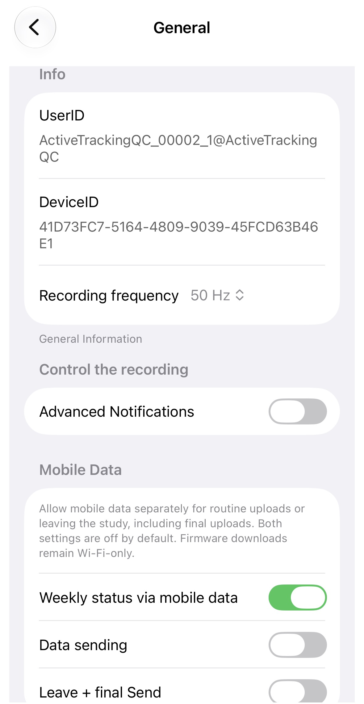

**Available services** shows the local sensor toggles, while **Active Labeling**
groups sensors used during timed tasks. In this example, accelerometer and
gyroscope are enabled. These settings should be checked against the intended
:ref:`study configuration <jdash-studies>`; enabling a service does not replace
the required :ref:`iOS permissions <social-permissions-ios>`.

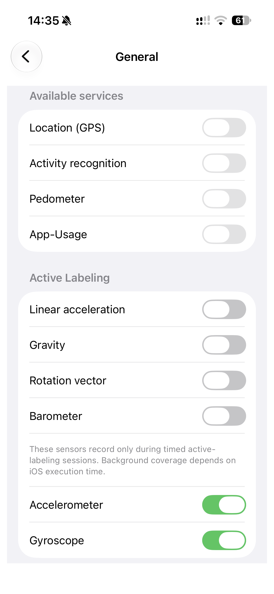

.. _social-debugging-ios:

Debugging
~~~~~~~~~

Open **Administration → Debugging** and select a sensor to inspect its current
readings and available historical data from the past **72 hours**. Use the
plots to distinguish a sensor that is collecting now from one that recorded
earlier but has since stopped. The debugger reports unavailable sensors or
missing historical data. Compare the result with the expected
:ref:`study configuration <jdash-studies>` and
:ref:`permissions <social-permission-check-ios>`.

.. _social-forensic-logging-ios:

Forensic Logging
~~~~~~~~~~~~~~~~

Under **Administration → General → Advanced**, enable **Forensic logging**
and relaunch the app to capture a complete startup. In the same **Advanced**
section, **Prepare complete log export** prepares the recorded diagnostics
for export. **Copy forensic log** is also available
for copying log text. Follow the
:ref:`troubleshooting workflow <social-troubleshooting-ios>` below when
collecting a day of diagnostics for the team.

Logs remain local and are not uploaded automatically. Disabling logging stops
new entries but retains existing logs. Developer Mode is not required.

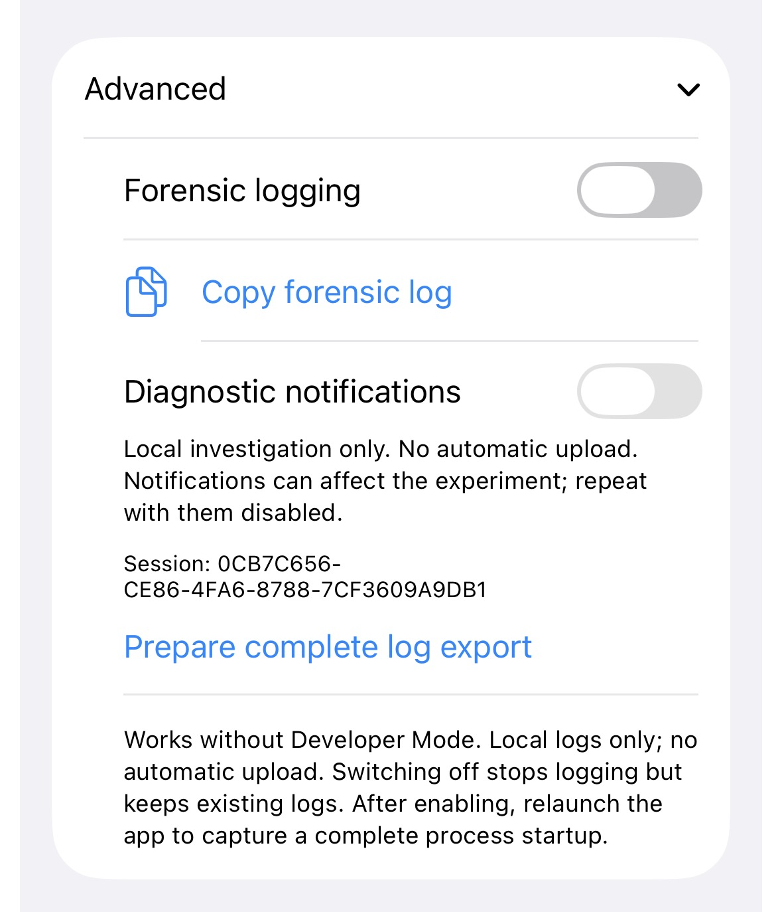

.. warning::

   Administration and debugging controls are intended for trained study staff.
   Changing sensor or recording settings can affect participant data collection;
   keep them consistent with the study protocol.

.. _social-shared-mode:

Shared Phone Mode
~~~~~~~~~~~~~~~~~

For active-labeling-only workflows where several participants use one iPhone,
enable **Shared Phone Mode** under **General**. Synchronize before enabling or
disabling this mode. Unsent recordings retain their original subject when
switching, and the original subject remains the administration profile.

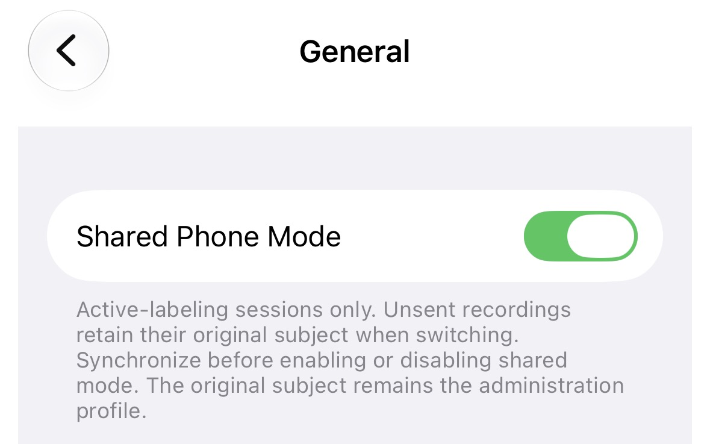

**Check and switch the active participant**

Check **Logged in as** on the main screen before recording a task. This
identifies the participant currently selected on the shared phone.

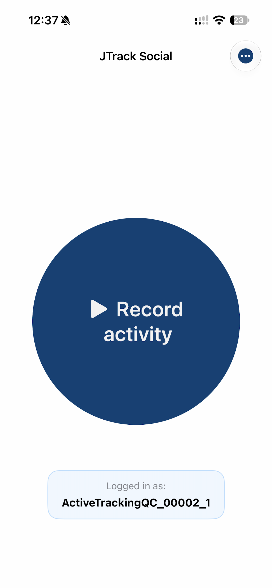

Open the app menu and choose **Shared Phone Dashboard** to manage the phone's
participants. **Active sensor data** opens the recorded-session view described
below. **Manual Synchronization** is also available from this menu.

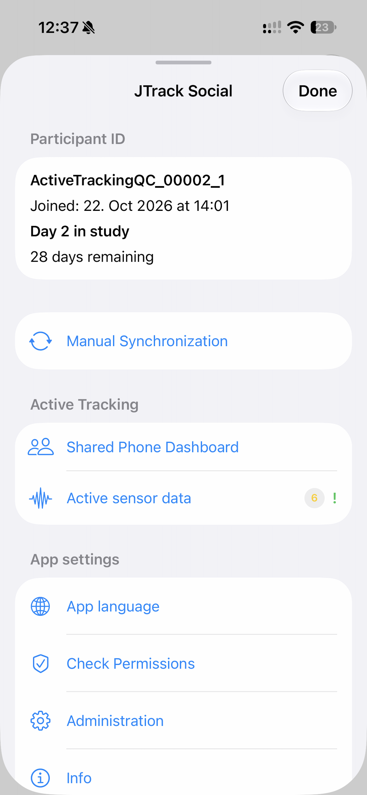

The dashboard identifies the **Administration profile** and the **Active
subject**, with session counts, pending synchronizations, unsent data points, and the
remaining study duration where shown. Use **Switch to** on the intended participant's
card, then recheck **Logged in as** before recording. **Create Label** provides
access to task creation for that participant.

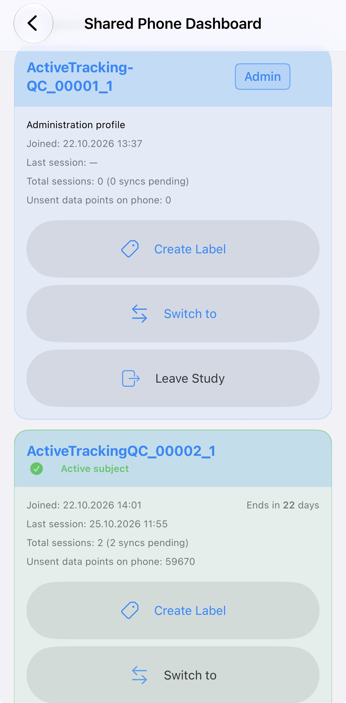

.. _social-active-session-data:

Active Sensor Data and Quality Control
~~~~~~~~~~~~~~~~~~~~~~~~~~~~~~~~~~~~~~

Use **Active sensor data** from the app menu to review sessions by participant,
task, and recording time. SensorKit supplements direct recordings and, as
shown in this view, can be fetched **48–167 hours after a task ends**. Check
the countdown or **Fetch before** deadline for the individual session.

- **Waiting:** the SensorKit fetch window has not opened yet. The disabled
  fetch control shows the remaining wait; direct recordings can still be
  inspected with **Quality Control**.
- **Ready to fetch:** use **Load SensorKit data** while the session is within
  its fetch window, then inspect the available data.

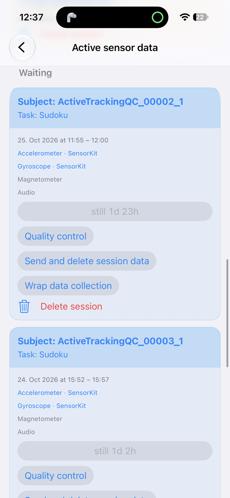

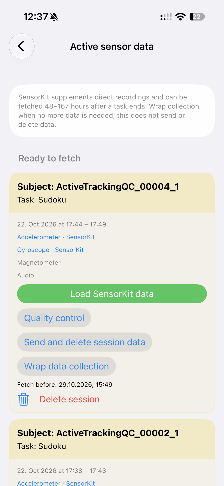

Choose **Quality Control** to inspect sample counts, the split between Core
Motion and SensorKit samples, the largest recording gaps, and sensor plots.
Use these details to investigate recording completeness before sending the
session. A SensorKit count of zero should be interpreted together with the
session's fetch status; it does not imply that direct Core Motion recording
failed.

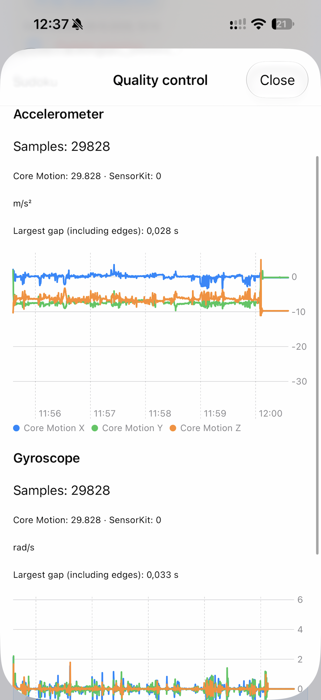

**Session actions**

- **Send and delete session data** combines sending the session data with
  deleting it locally. Use it when the session is ready for transfer.
- **Wrap data collection** ends collection for that session without sending
  or deleting its data.
- **Delete session** is a deletion action, not a synchronization step; use it
  only when the session should be discarded under the study protocol.

For server-side follow-up, check :ref:`JDash Compliance Monitoring
<jdash-compliance-monitoring>`. Local session plots and server receipt provide
complementary checks.

.. _social-troubleshooting-ios:

Troubleshooting
---------------

For incomplete enrollment, first check the QR code or manually entered
Subject ID, internet connection, and camera permission if scanning. For
missing sensor data or uncertain background collection, work through these
on-device checks in order. Protected administration tools should be used
by study staff.

1. Check Permissions
~~~~~~~~~~~~~~~~~~~~

Open **Check Permissions** in the main menu and resolve any missing study
permissions. Recheck after returning from iOS Settings. See
:ref:`Permission Check <social-permission-check-ios>` for the menu screenshot
and instructions.

2. Inspect Current and Historical Data
~~~~~~~~~~~~~~~~~~~~~~~~~~~~~~~~~~~~~~

Use **Administration → Debugging** to check whether each expected sensor is
collecting data now and whether it has recorded data during the previous
**72 hours**. Inspect both live readings and historical plots; a permission
being granted does not by itself confirm that recordings exist. See
:ref:`Debugging <social-debugging-ios>`.

3. Observe Save and Send Notifications
~~~~~~~~~~~~~~~~~~~~~~~~~~~~~~~~~~~~~~

Enable **Advanced Notifications** in
:ref:`General settings <social-general-settings-ios>` to get a feel for when
data is saved and sent during normal phone use. Note the times when expected
activity is missing, and compare them with the debugger and
:ref:`JDash received-data checks <jdash-compliance-monitoring>`.

Disable the extra notifications after the investigation. Notifications can
influence phone use and the experiment, so repeat checks with them disabled
when comparing behavior.

4. Record a Day of Forensic Logs and Export
~~~~~~~~~~~~~~~~~~~~~~~~~~~~~~~~~~~~~~~~~~~

If the preceding checks do not explain the problem:

1. Enable :ref:`Forensic logging <social-forensic-logging-ios>` under
   **Administration → General → Advanced**, then relaunch the app.
2. Leave logging enabled for about **one day** while using the phone normally.
   Note the times of any missing recordings or failed sends.
3. Return to **Administration → General → Advanced** and tap
   **Prepare complete log export**.
   Export the prepared log and send it to :ref:`our team <contact-us>` with
   the study ID, device/app versions, and the times and symptoms observed.
   The :doc:`support reporting guide <Troubleshooting>` lists the details
   to include.
4. Disable forensic logging when the investigation is complete.

The export is prepared locally; it is not sent to the team automatically.
The separate **Diagnostic notifications** toggle shown on this screen can
also affect the experiment. Repeat observations with notifications disabled
when assessing normal background behavior.

For background settings, see
:ref:`Compliance Optimization for JTrack Social <compliance-social>`.
If an Active Labeling task will not start, also ask the study team to check
that it is enabled in the :ref:`study configuration <active-tracking>` and
that the task list has downloaded.

Technical Notes
+++++++++++++++

Platform Implementation
-----------------------

The Android and iOS apps use the same study enrollment, sensor configuration, active-labeling, local-storage, and server-upload concepts. Platform APIs differ, but the participant workflow and resulting JTrack data model are kept as comparable as possible.

On iOS, JTrack Social currently:

* records only the phone sensors enabled by the downloaded :ref:`study configuration <jdash-studies>`;
* uses Core Motion for activity, pedometer, and active-labeling motion data;
* uses SensorKit for supported historical data such as app usage and lock/unlock information;
* supports location, Apple Health, audio during configured active-labeling tasks, and Garmin wearables when enabled;
* stores data locally until it can be uploaded securely; and
* stops new recording when the configured :ref:`study duration <jdash-studies>` ends, while allowing delayed SensorKit batches to be retrieved for up to 48 hours.

As on Android, not every module is available or enabled in every study. iOS permissions and background scheduling are controlled by the operating system and may therefore differ slightly from Android.

Active Labeling Records
-----------------------

Each Active Labeling session results in:

- A ``labeling event`` with ``taskname``, ``startTimestamp``, ``endTimestamp``, and ``duration``
- Sensor data, such as accelerometer and gyroscope samples, tagged with the task name
- An optional audio file that can be zipped and uploaded
- A corresponding database entry such as ``ActiveLabelingSensor``, ``ActiveLabelingSession``, or ``ActiveLabelingTasks``

.. important::
   The task name is included as a label in every recorded sensor sample. This supports supervised learning and later analysis.

Upload Conditions
-----------------

After the task finishes:

- Sensor data is saved locally.
- If the device is online and the server is reachable, the data is uploaded to the study backend.
- If audio recording is enabled, the audio file is zipped and transmitted as part of the upload.
- After successful upload, local files are deleted to save space.

.. note::
   Data is only uploaded if ``JTrack_serverOnline`` and ``JTrack_connected`` are both ``true``.

.. _sensor-comparison:

Sensor Data in Comparison between Android & iOS
+++++++++++++++++++++++++++++++++++++++++++++++

The overview above explains the sensor modules in plain language. The comparison below is intended for more technical readers who need platform-specific units, resolutions, and implementation details.

Example server records and export concepts are documented under :doc:`Data Storage <developers>`.

.. list-table:: Platform comparison
   :header-rows: 1
   :widths: 14 17 17 18 18 28

   * - Sensor
     - Unit (iOS)
     - Unit (Android)
     - Resolution (iOS)
     - Resolution (Android)
     - Notes
   * - Accelerometer
     - ``x, y, z`` in m/s²
     - ``x, y, z`` in m/s²
     - Up to 100 Hz
     - Up to 100 Hz
     - Active Labeling only; high sampling rates increase battery use and data volume.
   * - Gyroscope
     - ``x, y, z`` rotation rate
     - ``x, y, z`` rotation rate
     - Up to 100 Hz
     - Up to 100 Hz
     - Active Labeling only; records rotation and orientation changes.
   * - Activity recognition
     - Numeric activity code
     - Numeric activity code
     - On state changes, with iOS-side filtering
     - On state changes, as provided by Android
     - Platform support for individual activity states differs.
   * - Application usage
     - Foreground duration in seconds
     - Foreground duration in milliseconds
     - SensorKit intervals, typically 15 minutes
     - Dynamic intervals beginning at midnight
     - iOS may provide categories for third-party apps; Android provides app names and categories.
   * - Lock/unlock
     - Counts and time in each state
     - Individual lock or unlock events
     - SensorKit intervals, typically 15 minutes
     - Live events
     - The resulting records differ because the operating systems expose different APIs.
   * - Pedometer
     - Steps per interval
     - Steps per interval
     - Dynamic
     - Dynamic
     - Historical availability depends on the operating system and permission state.

Garmin Pairing & Sync
+++++++++++++++++++++

If your :ref:`study uses a Garmin wearable <jdash-studies>`, pairing and syncing are handled directly inside **JTrack Social**.
For participants, the main steps are:

1. Charge the Garmin device and turn it on.
2. Enable **Bluetooth** on your phone.
3. Open the Garmin pairing flow inside **JTrack Social** and follow the on-screen prompts.
4. Wait for the first sync to finish before starting normal study participation.
5. Keep the watch worn, charged, and within Bluetooth range of the phone.

.. tip::
   If syncing seems delayed, first check that Bluetooth is enabled, the watch battery is not low, and JTrack Social is allowed to run in the background on the phone.

Detailed Garmin Guide
---------------------

For full Garmin setup, pairing, dashboard configuration, syncing, and troubleshooting steps, see :doc:`Garmin Integration <Garmin_Integration>`.

